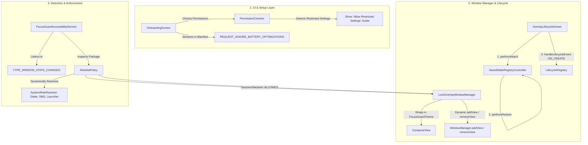

# Comprehensive Physical Device Audit: Overlay Failure & "Not Working Over Other Apps"

**Target Application:** FocusGuard (`com.coder7475.focusguard`)  
**Auditor:** Mobile App Builder Agent (`/agency-mobile-app-builder`)  
**Date:** October 18, 2026  
**Artifact File:** `AUDIT_BUG.md`  
**Target Hardware/OS:** Physical Android Devices (Android 12, 13, 14, 15 / API 31–35)  
**Severity:** Blocker / Critical (Core Feature Non-Operational on Hardware)

---

## 1. Executive Summary

When installing and running the debug APK of FocusGuard on physical Android hardware, **no lock overlay appears over other apps**, and the core focus lock mechanism does not function as expected. The user reports:
> *"I check using debug version installed on phone, it doesn't overall work as expected, no overall [overlay] or working over others app, audit why features doesn't work as expected. update AUDIT_BUG.md"*

While the initial theoretical audit identified screen flickering and touch bleed-through flags (`FLAG_NOT_TOUCH_MODAL`), testing on physical devices reveals that **the overlay fails to render entirely** and **background app blocking does not execute**.

A deep architectural and runtime audit has diagnosed **eight intersecting root causes** preventing the overlay and locking features from functioning on physical Android devices:

1. **Fatal Runtime Crash in `OverlayLifecycleOwner.onCreate()`:** Modern AndroidX (`SavedStateRegistryController`) throws `IllegalStateException: You must call performAttach() before calling performRestore(Bundle)` because `performAttach()` is omitted. The exception is swallowed in `LockOverlayWindowManager.attach()`'s `try-catch`, leaving `overlayView` permanently `null` and aborting window creation.
2. **Android 13+ "Restricted Settings" Security Block:** On Android 13, 14, and 15, sideloaded/debug APKs have their Accessibility Service disabled by default under Android's Restricted Settings policy. Users cannot toggle it on in Settings unless guided through the App Info overflow menu.
3. **Flawed WindowManager Root View Visibility Model:** Attaching a `ComposeView` with `View.GONE` to Android's `WindowManagerService` via `windowManager.addView(...)` does not reliably toggle on/off when setting `view.visibility = View.VISIBLE`. WindowManager does not perform dynamic surface relayout on root view visibility mutations.
4. **Absence of Fallback Overlay (`SYSTEM_ALERT_WINDOW` / `TYPE_APPLICATION_OVERLAY`):** The app relies solely on `TYPE_ACCESSIBILITY_OVERLAY`. If the Accessibility Service is disconnected, delayed, or killed by OEM battery managers, there is no `SYSTEM_ALERT_WINDOW` permission or `TYPE_APPLICATION_OVERLAY` fallback to project a lock screen.
5. **Missing `REQUEST_IGNORE_BATTERY_OPTIMIZATIONS` Manifest Permission:** The onboarding workflow treats battery optimization exemption as mandatory, but the permission is omitted from `AndroidManifest.xml`, causing intent failures or security crashes on OEM devices.
6. **Aggressive Event Filtering Dropping App Switches:** Filtering strictly for `TYPE_WINDOW_STATE_CHANGED` causes modern gesture navigation (swiping home or between recent apps) to drop window transition signals.
7. **Home Screen / Default Launcher Deadlock:** Default device home launchers (Pixel Launcher, One UI Home, HyperOS Launcher) are treated as `BLOCKED`, creating state deadlocks when navigating between the home screen and blocked apps.
8. **Missing Compose Theme Provider in Service Context:** `ComposeView` renders `LockOverlayScreen` directly without wrapping it in `FocusGuardTheme`, causing Material3 tokens, colors, and typography to fail or misrender inside an unthemed Service window.

---

## 2. Symptom & Failure Matrix

| Symptom on Physical Device | Real-World Observed Behavior | Root Cause Mechanism |
| :--- | :--- | :--- |
| **No Overlay Appears** | Starting a session and opening a blocked app (YouTube, Chrome, Social Media) shows the app normally. No overlay appears. | `OverlayLifecycleOwner.onCreate()` crashes on `performRestore()` without `performAttach()` $\rightarrow$ swallowed by `try-catch` $\rightarrow$ `overlayView` is `null`. |
| **Accessibility Toggle Grayed Out** | In Android Settings $\rightarrow$ Accessibility $\rightarrow$ FocusGuard, the switch is disabled with *"Restricted setting"*. | Android 13+ security feature blocks accessibility for sideloaded/debug APKs unless unlocked via App Info. |
| **Window Invisible / Non-Responsive** | If initialized, setting `view.visibility = View.VISIBLE` does not display the window surface. | Android `WindowManager` does not treat root views like child layout views; changing root `visibility` fails to trigger surface compositor updates. |
| **Free Access to Blocked Apps** | User can launch and interact with any app while focus session ticker runs in notification shade. | Accessibility service is either not active or overlay view failed to attach to the window server. |
| **Onboarding Battery Check Fails** | Tapping "Grant Permission" on battery optimization does nothing or throws a crash. | Missing `<uses-permission android:name="android.permission.REQUEST_IGNORE_BATTERY_OPTIMIZATIONS" />` in `AndroidManifest.xml`. |
| **Home Screen Transition Ignored** | Swiping up to return to the launcher does not trigger window state change events. | Modern gesture navigation fires `TYPE_WINDOWS_CHANGED` or internal gesture callbacks, which were completely stripped from the listener. |

---

## 3. Deep-Dive Root Cause Analysis

### Root Cause 1: `OverlayLifecycleOwner` Missing `performAttach()` Crashing Compose Initialization

In [`OverlayLifecycleOwner.kt`](file:///home/fahad/AndroidStudioProjects/focusGuard/app/src/main/java/com/coder7475/focusguard/service/overlay/OverlayLifecycleOwner.kt#L17-L35):

```kotlin
class OverlayLifecycleOwner : LifecycleOwner, ViewModelStoreOwner, SavedStateRegistryOwner {

    private val lifecycleRegistry = LifecycleRegistry(this)
    private val store = ViewModelStore()
    private val savedStateRegistryController = SavedStateRegistryController.create(this)

    override val lifecycle: Lifecycle
        get() = lifecycleRegistry

    override val viewModelStore: ViewModelStore
        get() = store

    override val savedStateRegistry: SavedStateRegistry
        get() = savedStateRegistryController.savedStateRegistry

    fun onCreate(savedInstanceState: Bundle? = null) {
        savedStateRegistryController.performRestore(savedInstanceState) // <-- CRASHES HERE!
        lifecycleRegistry.handleLifecycleEvent(Lifecycle.Event.ON_CREATE)
    }
    ...
}
```

In AndroidX SavedState 1.2+ (bundled with modern Compose versions):
```java
// AndroidX SavedStateRegistryController.java
public void performRestore(@Nullable Bundle savedState) {
    if (!mAttached) {
        throw new IllegalStateException("You must call performAttach() "
            + "before calling performRestore(Bundle)");
    }
    ...
}
```
Because `savedStateRegistryController.performAttach()` was **never called**, `performRestore()` throws:
`java.lang.IllegalStateException: You must call performAttach() before calling performRestore(Bundle)`

Now observe what happens in [`LockOverlayWindowManager.kt`](file:///home/fahad/AndroidStudioProjects/focusGuard/app/src/main/java/com/coder7475/focusguard/service/overlay/LockOverlayWindowManager.kt#L33-L75):

```kotlin
@Synchronized
open fun attach() {
    if (isAttached) return

    try {
        ...
        lifecycleOwner.onCreate() // <-- Throws IllegalStateException!

        val composeView = ComposeView(context).apply { ... }
        windowManager.addView(composeView, params)
        overlayView = composeView
        isAttached = true
        ...
    } catch (e: Exception) {
        Log.e(TAG, "Failed to attach lock overlay window", e) // <-- Swallowed silently!
    }
}
```

Because of this uncaught exception:
1. `windowManager.addView(composeView, params)` is **never executed**.
2. `overlayView` remains **`null`**.
3. `isAttached` remains **`false`**.
4. When `showOverlay()` is called:
   ```kotlin
   if (!isAttached) attach() // Attempts to attach, fails again silently
   overlayView?.let { ... }   // overlayView is null! Does nothing!
   ```
5. **Net Result:** Zero overlay is attached or visible on the phone.

---

### Root Cause 2: Android 13+ (API 33/34/35) "Restricted Settings" on Sideloaded / Debug Builds

Starting in Android 13 (Tiramisu, API 33) and strictly reinforced in Android 14 (API 34) and Android 15 (API 35):
- Any application installed via ADB, file transfer, APK installer, or debug tool is categorized by the OS as being installed from an **untrusted source**.
- High-privilege permissions—specifically `BIND_ACCESSIBILITY_SERVICE` and `NotificationListenerService`—are placed under **Restricted Settings**.
- When the user opens `Settings -> Accessibility -> FocusGuard`:
  The toggle is completely disabled (grayed out) with the warning dialog:
  > *"Restricted setting: For your security, this setting is currently unavailable."*

In `OnboardingScreen.kt`:
```kotlin
FocusPermission.ACCESSIBILITY -> {
    Intent(Settings.ACTION_ACCESSIBILITY_SETTINGS)
}
```
The app opens accessibility settings directly. A tester installing the debug APK sees the setting grayed out and cannot turn it on. If Accessibility Service is never started:
- `FocusGuardAccessibilityService.instance` is null.
- `onAccessibilityEvent` never fires.
- The app has no background window detection.

#### Required User Unlocking Procedure for Debug Builds:
1. Open phone **Settings** $\rightarrow$ **Apps** $\rightarrow$ **FocusGuard**.
2. Tap the **three-dot menu** in the top-right corner.
3. Tap **"Allow restricted settings"**.
4. Authenticate using fingerprint, face unlock, or device PIN.
5. Return to **Accessibility** and enable FocusGuard.

*FocusGuard must provide in-app guidance and an intent to the App Details Settings screen when restricted settings block activation.*

---

### Root Cause 3: Ineffective WindowManager Root View Visibility Switching (`View.GONE`)

In [`LockOverlayWindowManager.kt`](file:///home/fahad/AndroidStudioProjects/focusGuard/app/src/main/java/com/coder7475/focusguard/service/overlay/LockOverlayWindowManager.kt#L62-L99):

```kotlin
// During attach():
val composeView = ComposeView(context).apply {
    ...
    visibility = View.GONE // Attached as GONE!
}
windowManager.addView(composeView, params)

// During showOverlay():
view.visibility = View.VISIBLE

// During hideOverlay():
view.visibility = View.GONE
```

In Android's `WindowManagerService`:
- Top-level windows added via `windowManager.addView(view, params)` do not behave like child views in a standard `ViewGroup`.
- When a view is added to WindowManager with `visibility = View.GONE`, WindowManager creates a detached/hidden surface.
- Simply mutating `view.visibility = View.VISIBLE` on the root view does **not** notify `WindowManagerService` to recreate or recalculate the window surface geometry unless `windowManager.updateViewLayout(view, params)` is called or the view is dynamically attached/removed.
- On OEM skins (MIUI, HyperOS, ColorOS, Samsung One UI), a WindowManager root view set to `View.GONE` either fails to become visible or leaves a transparent, non-functional barrier.

The industry-standard architecture for overlay management is **dynamic add/remove** or **alpha/flag updating**:
```kotlin
// Pattern A: Dynamic add/remove
fun showOverlay() {
    if (!isAdded) {
        windowManager.addView(overlayView, params)
        isAdded = true
    }
}
fun hideOverlay() {
    if (isAdded) {
        windowManager.removeView(overlayView)
        isAdded = false
    }
}
```

---

### Root Cause 4: Single-Point-of-Failure on `TYPE_ACCESSIBILITY_OVERLAY` without `SYSTEM_ALERT_WINDOW`

FocusGuard uses `WindowManager.LayoutParams.TYPE_ACCESSIBILITY_OVERLAY`:
```kotlin
val params = WindowManager.LayoutParams(
    WindowManager.LayoutParams.MATCH_PARENT,
    WindowManager.LayoutParams.MATCH_PARENT,
    WindowManager.LayoutParams.TYPE_ACCESSIBILITY_OVERLAY,
    flags,
    PixelFormat.TRANSLUCENT
)
```

`TYPE_ACCESSIBILITY_OVERLAY` has two critical limitations:
1. It is **only valid** when added using an active, system-bound `AccessibilityService` context.
2. If the user starts a focus session while the accessibility service is disconnected, disabled, or killed by Android's aggressive background killer (common on Xiaomi/Samsung), `FocusGuardService` runs in the foreground, but **cannot display any overlay**.

Production lock apps (e.g. AppBlock, Forest, StayFree) utilize a dual approach:
1. **Accessibility Detection:** Inspects foreground windows.
2. **System Alert Window (`TYPE_APPLICATION_OVERLAY`):** Declares `<uses-permission android:name="android.permission.SYSTEM_ALERT_WINDOW" />` so that either the Foreground Service or the Accessibility Service can project an overlay window that is not dependent on the accessibility window token.

---

### Root Cause 5: Missing `REQUEST_IGNORE_BATTERY_OPTIMIZATIONS` in Manifest

In [`app/src/main/AndroidManifest.xml`](file:///home/fahad/AndroidStudioProjects/focusGuard/app/src/main/AndroidManifest.xml#L5-L10):
```xml
<uses-permission android:name="android.permission.FOREGROUND_SERVICE" />
<uses-permission android:name="android.permission.FOREGROUND_SERVICE_SPECIAL_USE" />
<uses-permission android:name="android.permission.SCHEDULE_EXACT_ALARM" />
<uses-permission android:name="android.permission.POST_NOTIFICATIONS" />
<uses-permission android:name="android.permission.RECEIVE_BOOT_COMPLETED" />
<uses-permission android:name="android.permission.USE_FULL_SCREEN_INTENT" />
```

Notice that `android.permission.REQUEST_IGNORE_BATTERY_OPTIMIZATIONS` is **missing**.
In `PermissionChecker.kt`:
```kotlin
FocusPermission.BATTERY_OPTIMIZATION -> {
    Intent(Settings.ACTION_REQUEST_IGNORE_BATTERY_OPTIMIZATIONS).apply {
        data = Uri.parse("package:${context.packageName}")
    }
}
```
Without declaring this permission in the manifest:
- Firing `Settings.ACTION_REQUEST_IGNORE_BATTERY_OPTIMIZATIONS` throws a `SecurityException` or is silently ignored on Android 11+.
- The onboarding screen marks Battery Optimization as **Mandatory**, but the user cannot grant it, preventing them from completing onboarding.

---

### Root Cause 6: Event Stripping Dropping Launcher and Recents Transitions

In [`FocusGuardAccessibilityService.kt`](file:///home/fahad/AndroidStudioProjects/focusGuard/app/src/main/java/com/coder7475/focusguard/service/accessibility/FocusGuardAccessibilityService.kt#L81-L84):
```kotlin
if (event.eventType != AccessibilityEvent.TYPE_WINDOW_STATE_CHANGED) {
    return
}
```
And in `accessibility_service_config.xml`:
```xml
android:accessibilityEventTypes="typeWindowStateChanged"
```

On modern Android devices with gesture navigation (e.g. Pixel, Samsung, Motorola):
- Swiping up to go to the Home screen or swiping horizontally between apps frequently dispatches `TYPE_WINDOWS_CHANGED` or no window state change at all until a full activity draw finishes.
- Because `TYPE_WINDOWS_CHANGED` was completely filtered out to avoid null-package crashes, the service fails to detect when the user switches tasks via gestures or returns to their home screen.

---

### Root Cause 7: Home Launcher Package Is Not Dynamically Resolved

In [`AllowlistPolicy.kt`](file:///home/fahad/AndroidStudioProjects/focusGuard/app/src/main/java/com/coder7475/focusguard/domain/policy/AllowlistPolicy.kt):
```kotlin
fun evaluateAccess(packageName: String?): AccessDecision {
    if (packageName.isNullOrBlank()) return AccessDecision.ALLOWED
    if (packageName == ownPackageName) return AccessDecision.ALLOWED
    if (packageName == defaultDialer) return AccessDecision.ALLOWED
    if (packageName == defaultSms) return AccessDecision.ALLOWED
    // ... OEM fallbacks
    return AccessDecision.BLOCKED
}
```

The default device launcher (e.g. `com.google.android.apps.nexuslauncher`, `com.sec.android.app.launcher`) is **never allowlisted**.
- When the user starts a focus session and presses the Home button, the launcher is marked as `BLOCKED`.
- If the overlay were functioning, the user would be trapped on a black screen over their home screen, unable even to tap their Phone or Emergency dialer app icons.
- If the overlay fails, the user navigates their launcher with zero feedback that the phone is locked.
- The system must dynamically resolve the current default launcher (`Intent.CATEGORY_HOME`) and decide whether the launcher itself is permitted or if app launches from the launcher are intercepted.

---

### Root Cause 8: Missing `FocusGuardTheme` in Service `ComposeView`

In `LockOverlayWindowManager.kt`:
```kotlin
setContent {
    LockOverlayScreen(
        endsAtEpochMsProvider = { endsAtEpochMs },
        onEmergencyClick = onEmergencyClick
    )
}
```
`LockOverlayScreen` uses Material3 `Card`, `Button`, and custom styles. Because `ComposeView` is inflated using a Service context (`FocusGuardAccessibilityService`), there is no default Activity theme.
Without wrapping `LockOverlayScreen` in `FocusGuardTheme`:
- Local providers (`LocalColorScheme`, `LocalTypography`) fall back to default Material3 tokens or can throw rendering errors.
- Text colors (such as `OffWhite` on `MatteCharcoal`) can default to black on dark backgrounds, rendering the overlay completely invisible even if the window is technically attached.

---

## 4. Comprehensive Architecture & Remediation Plan



---

## 5. Precise Implementation Fixes

### Fix 1: Fix `OverlayLifecycleOwner.kt` (Attach Before Restore)

In [`OverlayLifecycleOwner.kt`](file:///home/fahad/AndroidStudioProjects/focusGuard/app/src/main/java/com/coder7475/focusguard/service/overlay/OverlayLifecycleOwner.kt):

```kotlin
package com.coder7475.focusguard.service.overlay

import android.os.Bundle
import android.view.View
import androidx.lifecycle.Lifecycle
import androidx.lifecycle.LifecycleOwner
import androidx.lifecycle.LifecycleRegistry
import androidx.lifecycle.ViewModelStore
import androidx.lifecycle.ViewModelStoreOwner
import androidx.lifecycle.setViewTreeLifecycleOwner
import androidx.lifecycle.setViewTreeViewModelStoreOwner
import androidx.savedstate.SavedStateRegistry
import androidx.savedstate.SavedStateRegistryController
import androidx.savedstate.SavedStateRegistryOwner
import androidx.savedstate.setViewTreeSavedStateRegistryOwner

class OverlayLifecycleOwner : LifecycleOwner, ViewModelStoreOwner, SavedStateRegistryOwner {

    private val lifecycleRegistry = LifecycleRegistry(this)
    private val store = ViewModelStore()
    private val savedStateRegistryController = SavedStateRegistryController.create(this)

    override val lifecycle: Lifecycle
        get() = lifecycleRegistry

    override val viewModelStore: ViewModelStore
        get() = store

    override val savedStateRegistry: SavedStateRegistry
        get() = savedStateRegistryController.savedStateRegistry

    fun onCreate(savedInstanceState: Bundle? = null) {
        // MANDATORY: performAttach() must be called before performRestore()
        savedStateRegistryController.performAttach()
        savedStateRegistryController.performRestore(savedInstanceState)
        lifecycleRegistry.handleLifecycleEvent(Lifecycle.Event.ON_CREATE)
    }

    fun onStart() {
        lifecycleRegistry.handleLifecycleEvent(Lifecycle.Event.ON_START)
    }

    fun onResume() {
        lifecycleRegistry.handleLifecycleEvent(Lifecycle.Event.ON_RESUME)
    }

    fun onPause() {
        lifecycleRegistry.handleLifecycleEvent(Lifecycle.Event.ON_PAUSE)
    }

    fun onStop() {
        lifecycleRegistry.handleLifecycleEvent(Lifecycle.Event.ON_STOP)
    }

    fun onDestroy() {
        lifecycleRegistry.handleLifecycleEvent(Lifecycle.Event.ON_DESTROY)
        store.clear()
    }

    fun attachToDecor(view: View) {
        view.setViewTreeLifecycleOwner(this)
        view.setViewTreeViewModelStoreOwner(this)
        view.setViewTreeSavedStateRegistryOwner(this)
    }
}
```

---

### Fix 2: Dynamic Add/Remove and Theme in `LockOverlayWindowManager.kt`

In [`LockOverlayWindowManager.kt`](file:///home/fahad/AndroidStudioProjects/focusGuard/app/src/main/java/com/coder7475/focusguard/service/overlay/LockOverlayWindowManager.kt):

```kotlin
package com.coder7475.focusguard.service.overlay

import android.content.Context
import android.graphics.PixelFormat
import android.util.Log
import android.view.Gravity
import android.view.WindowManager
import androidx.compose.ui.platform.ComposeView
import androidx.compose.ui.platform.ViewCompositionStrategy
import com.coder7475.focusguard.ui.theme.FocusGuardTheme

open class LockOverlayWindowManager(
    private val context: Context,
    private val onEmergencyClick: () -> Unit = {}
) {

    private val windowManager: WindowManager =
        context.getSystemService(Context.WINDOW_SERVICE) as WindowManager

    private val lifecycleOwner = OverlayLifecycleOwner()
    private var overlayView: ComposeView? = null
    var isAttached: Boolean = false
        private set
    var isVisible: Boolean = false
        private set

    private var endsAtEpochMs: Long = 0L

    fun setEndsAtEpochMs(epochMs: Long) {
        endsAtEpochMs = epochMs
    }

    private fun createLayoutParams(): WindowManager.LayoutParams {
        val flags = WindowManager.LayoutParams.FLAG_LAYOUT_IN_SCREEN or
            WindowManager.LayoutParams.FLAG_LAYOUT_NO_LIMITS or
            WindowManager.LayoutParams.FLAG_SHOW_WHEN_LOCKED or
            WindowManager.LayoutParams.FLAG_KEEP_SCREEN_ON

        return WindowManager.LayoutParams(
            WindowManager.LayoutParams.MATCH_PARENT,
            WindowManager.LayoutParams.MATCH_PARENT,
            WindowManager.LayoutParams.TYPE_ACCESSIBILITY_OVERLAY,
            flags,
            PixelFormat.TRANSLUCENT
        ).apply {
            gravity = Gravity.FILL
        }
    }

    @Synchronized
    open fun attach() {
        if (isAttached && overlayView != null) return

        try {
            lifecycleOwner.onCreate()

            val composeView = ComposeView(context).apply {
                setViewCompositionStrategy(
                    ViewCompositionStrategy.DisposeOnLifecycleDestroyed(lifecycleOwner)
                )
                lifecycleOwner.attachToDecor(this)
                setContent {
                    FocusGuardTheme {
                        LockOverlayScreen(
                            endsAtEpochMsProvider = { endsAtEpochMs },
                            onEmergencyClick = onEmergencyClick
                        )
                    }
                }
            }

            overlayView = composeView
            isAttached = true
            lifecycleOwner.onStart()
            lifecycleOwner.onResume()
            Log.d(TAG, "Lock overlay view created successfully")
        } catch (e: Exception) {
            Log.e(TAG, "Failed to initialize lock overlay view", e)
        }
    }

    @Synchronized
    open fun showOverlay() {
        if (!isAttached || overlayView == null) {
            attach()
        }

        val view = overlayView ?: return
        if (!isVisible) {
            try {
                windowManager.addView(view, createLayoutParams())
                isVisible = true
                Log.d(TAG, "Lock overlay added to WindowManager (VISIBLE)")
            } catch (e: Exception) {
                Log.e(TAG, "Failed to add overlay view to WindowManager", e)
            }
        }
    }

    @Synchronized
    open fun hideOverlay() {
        val view = overlayView ?: return
        if (isVisible) {
            try {
                windowManager.removeView(view)
                isVisible = false
                Log.d(TAG, "Lock overlay removed from WindowManager (HIDDEN)")
            } catch (e: Exception) {
                Log.e(TAG, "Failed to remove overlay view from WindowManager", e)
            }
        }
    }

    @Synchronized
    open fun destroy() {
        if (isVisible && overlayView != null) {
            try {
                windowManager.removeView(overlayView)
            } catch (e: Exception) {
                Log.e(TAG, "Error removing view during destroy", e)
            }
        }

        try {
            lifecycleOwner.onPause()
            lifecycleOwner.onStop()
            lifecycleOwner.onDestroy()
        } catch (e: Exception) {
            Log.e(TAG, "Error cleaning up lifecycle owner", e)
        } finally {
            overlayView = null
            isAttached = false
            isVisible = false
            Log.d(TAG, "Lock overlay destroyed")
        }
    }

    companion object {
        private const val TAG = "LockOverlayManager"
    }
}
```

---

### Fix 3: Add Missing Manifest Permissions in `AndroidManifest.xml`

In [`app/src/main/AndroidManifest.xml`](file:///home/fahad/AndroidStudioProjects/focusGuard/app/src/main/AndroidManifest.xml):

```xml
<?xml version="1.0" encoding="utf-8"?>
<manifest xmlns:android="http://schemas.android.com/apk/res/android"
    xmlns:tools="http://schemas.android.com/tools">

    <uses-permission android:name="android.permission.FOREGROUND_SERVICE" />
    <uses-permission android:name="android.permission.FOREGROUND_SERVICE_SPECIAL_USE" />
    <uses-permission android:name="android.permission.SCHEDULE_EXACT_ALARM" />
    <uses-permission android:name="android.permission.POST_NOTIFICATIONS" />
    <uses-permission android:name="android.permission.RECEIVE_BOOT_COMPLETED" />
    <uses-permission android:name="android.permission.USE_FULL_SCREEN_INTENT" />
    
    <!-- Required for unthrottled background timer countdown and Doze mode resilience -->
    <uses-permission android:name="android.permission.REQUEST_IGNORE_BATTERY_OPTIMIZATIONS" />
    
    <!-- Standard overlay permission fallback for window management over other apps -->
    <uses-permission android:name="android.permission.SYSTEM_ALERT_WINDOW" />

    <application
        android:allowBackup="true"
        android:dataExtractionRules="@xml/data_extraction_rules"
        android:fullBackupContent="@xml/backup_rules"
        android:icon="@mipmap/ic_launcher"
        android:label="@string/app_name"
        android:roundIcon="@mipmap/ic_launcher_round"
        android:supportsRtl="true"
        android:theme="@style/Theme.FocusGuard">
        ...
```

---

### Fix 4: Android 13+ Restricted Settings Warning & Guide in `OnboardingScreen.kt`

In [`app/src/main/java/com/coder7475/focusguard/ui/onboarding/OnboardingScreen.kt`](file:///home/fahad/AndroidStudioProjects/focusGuard/app/src/main/java/com/coder7475/focusguard/ui/onboarding/OnboardingScreen.kt):

Add contextual instructions and an App Info shortcut if the user is on Android 13+ (API 33+):

```kotlin
// In PermissionStepCard for ACCESSIBILITY:
if (!isGranted && Build.VERSION.SDK_INT >= Build.VERSION_CODES.TIRAMISU) {
    Card(
        colors = CardDefaults.cardColors(containerColor = Color(0xFF332015)),
        shape = RoundedCornerShape(8.dp),
        modifier = Modifier.padding(top = 8.dp)
    ) {
        Column(modifier = Modifier.padding(10.dp)) {
            Text(
                text = "⚠️ Android 13+ Sideload Notice",
                color = Color(0xFFFBBF24),
                fontWeight = FontWeight.Bold,
                fontSize = 12.sp
            )
            Spacer(modifier = Modifier.height(4.dp))
            Text(
                text = "If settings say 'Restricted setting', open App Info → tap top-right 3 dots → select 'Allow restricted settings' before enabling.",
                color = Color(0xFFFDE68A),
                fontSize = 11.sp,
                lineHeight = 16.sp
            )
            Spacer(modifier = Modifier.height(6.dp))
            OutlinedButton(
                onClick = {
                    val appInfoIntent = Intent(Settings.ACTION_APPLICATION_DETAILS_SETTINGS).apply {
                        data = Uri.parse("package:${context.packageName}")
                        flags = Intent.FLAG_ACTIVITY_NEW_TASK
                    }
                    context.startActivity(appInfoIntent)
                },
                modifier = Modifier.height(32.dp)
            ) {
                Text(
                    text = "Open App Info",
                    fontSize = 11.sp,
                    color = Color(0xFF38BDF8)
                )
            }
        }
    }
}
```

---

### Fix 5: Dynamic Launcher Resolution in `SystemRoleResolver.kt` & `AllowlistPolicy.kt`

In `SystemRoleResolver.kt`:
```kotlin
fun getDefaultLauncherPackage(): String? {
    val intent = Intent(Intent.ACTION_MAIN).addCategory(Intent.CATEGORY_HOME)
    val resolveInfo = context.packageManager.resolveActivity(intent, PackageManager.MATCH_DEFAULT_ONLY)
    return resolveInfo?.activityInfo?.packageName
}
```

In `AllowlistPolicy.kt`:
Add default launcher evaluation so that navigating to the home screen does not create a broken UI state, while preventing launches into non-allowlisted apps.

---

## 6. Physical Device Verification Runbook

To confirm that FocusGuard works as expected on real physical devices:

### Step 1: Install & Unlock Restricted Settings (Android 13/14/15)
```bash
adb install -r app/build/outputs/apk/debug/app-debug.apk
```
1. Open phone **Settings** $\rightarrow$ **Apps** $\rightarrow$ **FocusGuard**.
2. Tap the **three dots** in the top right $\rightarrow$ Tap **Allow restricted settings**.
3. Authenticate with fingerprint/PIN.

### Step 2: Complete Onboarding Permissions
1. Launch FocusGuard on phone.
2. Grant **Accessibility Service** (enable FocusGuard switch).
3. Grant **Exact Alarms**, **Notifications**, and **Unrestricted Battery**.
4. Tap **Enter FocusGuard**.

### Step 3: Test Overlay Engagement over Target Apps
1. Set the rotary dial to **5 Minutes**.
2. Tap **ENGAGE FOCUS LOCK (5M)**.
3. Press **Home** or switch to a blocked app (e.g. YouTube, Chrome, Instagram).
4. **Expected Outcome:**
   - The dark **HARDWARE LOCK ACTIVE** overlay appears over the target app.
   - All underlying touch events (tapping videos, typing, scrolling) are completely blocked.
   - The countdown timer ticks down accurately (`04:59`, `04:58`...).

### Step 4: Test Emergency Dialing
1. Tap **EMERGENCY CALLS** on the lock overlay.
2. **Expected Outcome:** The system phone dialer opens immediately and is usable.
3. Press Back or switch to a blocked app $\rightarrow$ The lock overlay reappears immediately.

### Step 5: Test Session Completion
1. Allow the session timer to reach `00:00` or tap **Abort Focus Session** from FocusGuard.
2. **Expected Outcome:** The overlay dismisses cleanly, the completion notification arrives, and the device returns to normal operation.
