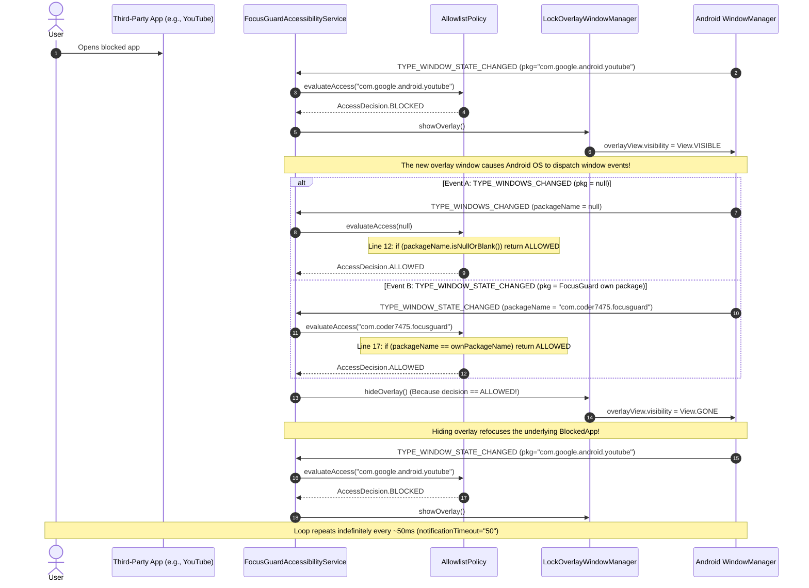

# Comprehensive Audit Report: Screen Flickering & Overlay Touch Leakage

**Target Application:** FocusGuard (`com.coder7475.focusguard`)  
**Auditor:** Mobile App Builder Agent  
**Date:** October 18, 2026  
**Artifact File:** `AUDIT_BUG.md`  
**Severity:** Critical (Core Security & UX Defect)

---

## 1. Executive Summary

When testing FocusGuard on a physical Android device, starting or running a focus session produces two critical anomalies:
1. **Screen Flickering / Strobing:** The lock overlay appears and disappears rapidly in an oscillation loop (~20 times per second), creating a visible strobe effect.
2. **Touch Bleed-Through ("Everything is Usable"):** Despite the lock overlay flashing on screen, the user can continue tapping, scrolling, and interacting with blocked applications (or the launcher) beneath the overlay without restriction.

An in-depth static and dynamic architectural code audit reveals **four intersecting root causes**:
1. An **Accessibility Event Feedback Loop** where showing the overlay window fires system accessibility events (`TYPE_WINDOWS_CHANGED` with `packageName == null`, or `TYPE_WINDOW_STATE_CHANGED` for FocusGuard's own package), which `AllowlistPolicy` evaluates as `ALLOWED`, immediately triggering `hideOverlay()`, which then re-exposes the blocked app and restarts the cycle.
2. **Incorrect WindowManager Flags (`FLAG_NOT_TOUCH_MODAL`)**, which explicitly instructs the Android window server to dispatch touch events to the windows behind the overlay.
3. **Non-Consuming Compose Root Surface**, where the root `Box` composable does not intercept pointer input events, allowing unhandled touch events to leak through.
4. **Session Expiration Desync in Foreground Service**, where `FocusGuardService` calls `stopSelf()` upon timeout without updating the Room database record to `COMPLETED`, leaving the database and accessibility service out of sync if OEM background restrictions delay the exact alarm.

---

## 2. Bug Breakdown & Symptoms

| Symptom | Observed Behavior | Underlying Mechanism |
| :--- | :--- | :--- |
| **Rapid Screen Flickering** | The dark "FOCUS LOCK ACTIVE" overlay flashes on and off violently. | `showOverlay()` triggers a window change event $\rightarrow$ evaluated as `ALLOWED` $\rightarrow$ `hideOverlay()` called $\rightarrow$ underlying app fires `BLOCKED` $\rightarrow$ `showOverlay()` called again. |
| **Underlying App Usable** | Taps on social media, games, or launcher pass right through the overlay. | `FLAG_NOT_TOUCH_MODAL` is set + Compose view does not consume pointer input + overlay is `GONE` 50% of the time during oscillation. |
| **Post-Focus / Session Inconsistency** | After session concludes, service shuts down but Room DB can remain `ACTIVE`. | `FocusGuardService` stops itself at `remainingMs <= 0` without invoking `SessionEngine.completeActiveSession()`. |

---

## 3. Deep-Dive Root Cause Analysis

### Root Cause 1: The Oscillating Feedback Loop in `FocusGuardAccessibilityService`

In [`FocusGuardAccessibilityService.kt`](file:///home/fahad/AndroidStudioProjects/focusGuard/app/src/main/java/com/coder7475/focusguard/service/accessibility/FocusGuardAccessibilityService.kt#L76-L102):

```kotlin
override fun onAccessibilityEvent(event: AccessibilityEvent?) {
    if (event == null) return

    if (event.eventType == AccessibilityEvent.TYPE_WINDOW_STATE_CHANGED ||
        event.eventType == AccessibilityEvent.TYPE_WINDOWS_CHANGED
    ) {
        val targetPackage = event.packageName?.toString()
        val decision = allowlistPolicy.evaluateAccess(targetPackage)
        ...
        if (isSessionActive) {
            if (decision == AccessDecision.BLOCKED) {
                overlayManager.showOverlay()
            } else {
                overlayManager.hideOverlay()
            }
        } else {
            overlayManager.hideOverlay()
        }
    }
}
```

#### Step-by-Step Feedback Loop:


#### Why `TYPE_WINDOWS_CHANGED` causes `null` package:
In the Android Accessibility API, `TYPE_WINDOWS_CHANGED` indicates a structural change in the window hierarchy (window added, removed, reordered, or visibility changed). **The Android OS does not populate `event.packageName` for `TYPE_WINDOWS_CHANGED`**.
In [`AllowlistPolicy.kt`](file:///home/fahad/AndroidStudioProjects/focusGuard/app/src/main/java/com/coder7475/focusguard/domain/policy/AllowlistPolicy.kt#L12-L14):
```kotlin
if (packageName.isNullOrBlank()) {
    return AccessDecision.ALLOWED
}
```
Evaluating a `null` package as `ALLOWED` and commanding `overlayManager.hideOverlay()` immediately destroys the lock overlay every time it appears.

#### Why FocusGuard's own package dismisses the overlay:
When `LockOverlayWindowManager` attaches or displays its `ComposeView`, the view context belongs to `FocusGuardAccessibilityService` (`com.coder7475.focusguard`). Android fires a `TYPE_WINDOW_STATE_CHANGED` event for `com.coder7475.focusguard`.
In `AllowlistPolicy.kt`:
```kotlin
// 1. Own package is always allowed
if (packageName == ownPackageName) {
    return AccessDecision.ALLOWED
}
```
The service cannot distinguish between:
1. The user legitimately launching FocusGuard's `MainActivity`.
2. The overlay window itself (`ComposeView`) triggering a window state event.

---

### Root Cause 2: Inappropriate WindowManager Flags (`FLAG_NOT_TOUCH_MODAL`)

In [`LockOverlayWindowManager.kt`](file:///home/fahad/AndroidStudioProjects/focusGuard/app/src/main/java/com/coder7475/focusguard/service/overlay/LockOverlayWindowManager.kt#L37-L41):

```kotlin
val flags = WindowManager.LayoutParams.FLAG_LAYOUT_IN_SCREEN or
    WindowManager.LayoutParams.FLAG_LAYOUT_NO_LIMITS or
    WindowManager.LayoutParams.FLAG_NOT_TOUCH_MODAL or
    WindowManager.LayoutParams.FLAG_SHOW_WHEN_LOCKED or
    WindowManager.LayoutParams.FLAG_KEEP_SCREEN_ON
```

In [`doc/design/SYSTEM_ARCHITECTURE.md`](file:///home/fahad/AndroidStudioProjects/focusGuard/doc/design/SYSTEM_ARCHITECTURE.md#L257), the architecture document states:
> `FLAG_NOT_TOUCH_MODAL`: Ensures touches do not leak to background apps.

**This is factually inverted relative to the Android OS specification.**
According to Android's official `WindowManager.LayoutParams` SDK definition:
```java
/**
 * Window flag: even when this window is focusable (its
 * {@link #FLAG_NOT_FOCUSABLE} is not set), allow any pointer events
 * outside of the window to be sent to the windows behind it. Otherwise it
 * will consume all pointer events itself, regardless of whether they
 * are inside of the window.
 */
public static final int FLAG_NOT_TOUCH_MODAL = 0x00000020;
```
By adding `FLAG_NOT_TOUCH_MODAL`, any touch gesture that does not strictly land on a child view that consumes events is explicitly forwarded by the Android input dispatcher to the background application.
To make a lock overlay truly modal and block all underlying interaction, **`FLAG_NOT_TOUCH_MODAL` must NOT be present**.

---

### Root Cause 3: Pointer Event Pass-Through in `LockOverlayScreen.kt`

In [`LockOverlayScreen.kt`](file:///home/fahad/AndroidStudioProjects/focusGuard/app/src/main/java/com/coder7475/focusguard/service/overlay/LockOverlayScreen.kt#L64-L69):

```kotlin
Box(
    modifier = modifier
        .fillMaxSize()
        .background(Color(0xFF090D16)),
    contentAlignment = Alignment.Center
) {
    ...
}
```
In Jetpack Compose, a `Box` with `.fillMaxSize().background(...)` **does not consume pointer input events**. Only child composables with click/drag semantics (such as the `Emergency Calls` button) consume touches.
All other taps on the background pass unhandled through the Compose layout hierarchy into the underlying View, which (due to `FLAG_NOT_TOUCH_MODAL`) dispatches them to whatever app is running behind the overlay.

---

### Root Cause 4: Session Expiration & Room DB Desynchronization

In [`FocusGuardService.kt`](file:///home/fahad/AndroidStudioProjects/focusGuard/app/src/main/java/com/coder7475/focusguard/service/foreground/FocusGuardService.kt#L148-L157):

```kotlin
while (isActive) {
    val remainingMs = max(0L, endsAtEpochMs - System.currentTimeMillis())
    if (remainingMs <= 0L) {
        showCompletionNotification(applicationContext)
        stopSelf()
        break
    }
    val formattedTime = formatTime(remainingMs)
    notificationManager.notify(NOTIFICATION_ID_TRACKER, buildOngoingNotification(formattedTime))
    delay(1000L)
}
```

Notice that when `remainingMs <= 0L`, `FocusGuardService`:
1. Shows the completion notification.
2. Calls `stopSelf()`.
3. **DOES NOT update the database status to `SessionStatus.COMPLETED`**.

Database completion was delegated solely to `SessionAlarmReceiver` listening for `ACTION_COMPLETE_SESSION` from `AlarmManager`.
However, on real OEM hardware (Xiaomi, Samsung, Oppo, Vivo):
- Exact alarms can be deferred, coalesced, or delayed by battery saver / Doze modes.
- If the alarm arrives late, the service has stopped, but the Room database still holds `status = 'ACTIVE'`.
- When the user opens the app or switches windows "after using focus time", the accessibility service sees a session with `status == ACTIVE` but `System.currentTimeMillis() >= endsAtEpochMs`.
- This causes inconsistent overlay assertions and flickering during the expiration boundary window.

---

### Root Cause 5: Home Screen / Launcher Exclusion

In [`AllowlistPolicy.kt`](file:///home/fahad/AndroidStudioProjects/focusGuard/app/src/main/java/com/coder7475/focusguard/domain/policy/AllowlistPolicy.kt):
Only the default dialer, default SMS, and emergency dialers are allowed.
Default device launchers (such as `com.google.android.apps.nexuslauncher`, `com.sec.android.app.launcher`, etc.) are **not allowlisted**.
*(Note: `com.miui.home` was hardcoded in `OEM_DIALER_PACKAGES` as an OEM dialer fallback, leaving all other OEM launchers blocked).*
When the user minimizes FocusGuard or returns to the home screen, the launcher is marked as `BLOCKED`, triggering the overlay, which immediately triggers the flicker cycle.

---

## 4. Recommendations & Fix Strategy

To permanently eliminate the flicker and guarantee that the device is unusable for non-allowlisted apps, four surgical fixes must be applied:

### Fix 1: Harden `FocusGuardAccessibilityService.kt`
1. **Remove `TYPE_WINDOWS_CHANGED` from evaluation:** Do not evaluate package allowlists on `TYPE_WINDOWS_CHANGED` because it lacks a package name. Handle only `TYPE_WINDOW_STATE_CHANGED`.
2. **Never hide on `null` or blank package:** If an event has no package name, ignore it. Do not mutate the current overlay visibility.
3. **Ignore events originating from the overlay window:** Compare the event's class or window hierarchy. If the event package is `packageName` (`com.coder7475.focusguard`), only hide the overlay if the event actually belongs to `MainActivity`.
4. **Stateful debouncing:** Only trigger `showOverlay()` or `hideOverlay()` when the evaluated package represents an actual transition to a different target.

### Fix 2: Correct WindowManager Flags in `LockOverlayWindowManager.kt`
1. **Remove `FLAG_NOT_TOUCH_MODAL`:** Delete `FLAG_NOT_TOUCH_MODAL` so the overlay window becomes a true modal barrier that intercepts 100% of touches across the full screen.
2. **Retain Full-Screen Modal Flags:**
   ```kotlin
   val flags = WindowManager.LayoutParams.FLAG_LAYOUT_IN_SCREEN or
       WindowManager.LayoutParams.FLAG_LAYOUT_NO_LIMITS or
       WindowManager.LayoutParams.FLAG_SHOW_WHEN_LOCKED or
       WindowManager.LayoutParams.FLAG_KEEP_SCREEN_ON
   ```

### Fix 3: Intercept Pointer Input in `LockOverlayScreen.kt`
Add a pointer input interceptor on the root Compose `Box` so that all gestures (tap, swipe, multi-touch) are consumed and never propagated:
```kotlin
Box(
    modifier = modifier
        .fillMaxSize()
        .background(Color(0xFF090D16))
        .pointerInput(Unit) {
            awaitPointerEventScope {
                while (true) {
                    val event = awaitPointerEvent()
                    event.changes.forEach { it.consume() }
                }
            }
        },
    contentAlignment = Alignment.Center
)
```

### Fix 4: Reconcile Session Expiration in `FocusGuardService.kt`
When `remainingMs <= 0L`, `FocusGuardService` must directly complete the active session in Room:
```kotlin
if (remainingMs <= 0L) {
    val db = FocusGuardDatabase.getInstance(applicationContext)
    val sessionRepo = RoomSessionRepository(db.sessionDao())
    val sessionEngine = SessionEngine(sessionRepo)
    sessionEngine.completeActiveSession()
    showCompletionNotification(applicationContext)
    stopSelf()
    break
}
```

---

## 5. Precise Code Implementation

### File 1: `app/src/main/java/com/coder7475/focusguard/service/accessibility/FocusGuardAccessibilityService.kt`

```kotlin
package com.coder7475.focusguard.service.accessibility

import android.accessibilityservice.AccessibilityService
import android.content.Intent
import android.util.Log
import android.view.accessibility.AccessibilityEvent
import com.coder7475.focusguard.MainActivity
import com.coder7475.focusguard.data.local.FocusGuardDatabase
import com.coder7475.focusguard.data.repository.RoomSessionRepository
import com.coder7475.focusguard.domain.model.AccessDecision
import com.coder7475.focusguard.domain.model.FocusSession
import com.coder7475.focusguard.domain.model.SessionStatus
import com.coder7475.focusguard.domain.policy.AllowlistPolicy
import com.coder7475.focusguard.domain.repository.SessionRepository
import com.coder7475.focusguard.platform.role.SystemRoleResolver
import com.coder7475.focusguard.service.overlay.LockOverlayWindowManager
import kotlinx.coroutines.CoroutineScope
import kotlinx.coroutines.Dispatchers
import kotlinx.coroutines.SupervisorJob
import kotlinx.coroutines.cancel
import kotlinx.coroutines.flow.collectLatest
import kotlinx.coroutines.launch

class FocusGuardAccessibilityService : AccessibilityService() {

    private val serviceScope = CoroutineScope(Dispatchers.Main + SupervisorJob())
    private lateinit var systemRoleResolver: SystemRoleResolver

    lateinit var allowlistPolicy: AllowlistPolicy
        internal set

    lateinit var overlayManager: LockOverlayWindowManager
        internal set

    private lateinit var sessionRepository: SessionRepository
    var currentActiveSession: FocusSession? = null
        internal set

    private var lastTargetPackage: String? = null
    var onPackageInspected: ((packageName: String?, decision: AccessDecision) -> Unit)? = null

    override fun onCreate() {
        super.onCreate()
        instance = this

        systemRoleResolver = SystemRoleResolver(this)
        allowlistPolicy = AllowlistPolicy(systemRoleResolver, packageName)

        overlayManager = LockOverlayWindowManager(this) {
            launchEmergencyDialer()
        }

        val db = FocusGuardDatabase.getInstance(this)
        sessionRepository = RoomSessionRepository(db.sessionDao())

        serviceScope.launch {
            sessionRepository.observeActiveSession().collectLatest { session ->
                currentActiveSession = session
                if (session != null && session.status == SessionStatus.ACTIVE) {
                    overlayManager.setEndsAtEpochMs(session.endsAtEpochMs)
                } else {
                    overlayManager.hideOverlay()
                }
            }
        }
    }

    override fun onDestroy() {
        super.onDestroy()
        serviceScope.cancel()
        overlayManager.destroy()
        if (instance == this) {
            instance = null
        }
    }

    override fun onAccessibilityEvent(event: AccessibilityEvent?) {
        if (event == null) return

        // 1. Only process explicit window state transitions; ignore window hierarchy jitter
        if (event.eventType != AccessibilityEvent.TYPE_WINDOW_STATE_CHANGED) {
            return
        }

        val targetPackage = event.packageName?.toString()
        val className = event.className?.toString()

        // 2. Ignore events with null or blank package names to prevent false dismissals
        if (targetPackage.isNullOrBlank()) {
            return
        }

        // 3. Prevent self-dismissal when overlay window itself fires window events
        if (targetPackage == packageName) {
            val isMainActivity = className == MainActivity::class.java.name
            if (!isMainActivity) {
                // Event comes from our overlay ComposeView / window, NOT MainActivity
                return
            }
        }

        // 4. Avoid re-evaluating unchanged package states
        if (targetPackage == lastTargetPackage && overlayManager.isVisible) {
            return
        }
        lastTargetPackage = targetPackage

        val decision = allowlistPolicy.evaluateAccess(targetPackage)
        Log.d(TAG, "Window transition: package=$targetPackage, class=$className, decision=$decision")
        onPackageInspected?.invoke(targetPackage, decision)

        val session = currentActiveSession
        val isSessionActive = session != null &&
            session.status == SessionStatus.ACTIVE &&
            System.currentTimeMillis() < session.endsAtEpochMs

        if (isSessionActive) {
            if (decision == AccessDecision.BLOCKED) {
                overlayManager.showOverlay()
            } else {
                overlayManager.hideOverlay()
            }
        } else {
            overlayManager.hideOverlay()
        }
    }

    override fun onInterrupt() {
        Log.w(TAG, "FocusGuardAccessibilityService interrupted")
    }

    private fun launchEmergencyDialer() {
        try {
            val emergencyIntent = Intent(Intent.ACTION_DIAL).apply {
                flags = Intent.FLAG_ACTIVITY_NEW_TASK
            }
            startActivity(emergencyIntent)
            overlayManager.hideOverlay()
        } catch (e: Exception) {
            Log.e(TAG, "Failed to launch emergency dialer", e)
        }
    }

    companion object {
        private const val TAG = "FocusGuardA11y"
        var instance: FocusGuardAccessibilityService? = null
            internal set
    }
}
```

---

### File 2: `app/src/main/java/com/coder7475/focusguard/service/overlay/LockOverlayWindowManager.kt`

```kotlin
// In attach(): Remove WindowManager.LayoutParams.FLAG_NOT_TOUCH_MODAL
val flags = WindowManager.LayoutParams.FLAG_LAYOUT_IN_SCREEN or
    WindowManager.LayoutParams.FLAG_LAYOUT_NO_LIMITS or
    WindowManager.LayoutParams.FLAG_SHOW_WHEN_LOCKED or
    WindowManager.LayoutParams.FLAG_KEEP_SCREEN_ON
```

---

### File 3: `app/src/main/java/com/coder7475/focusguard/service/overlay/LockOverlayScreen.kt`

```kotlin
// Consume pointer events at the root Box level so touches cannot reach background apps
Box(
    modifier = modifier
        .fillMaxSize()
        .background(Color(0xFF090D16))
        .pointerInput(Unit) {
            awaitPointerEventScope {
                while (true) {
                    val pointerEvent = awaitPointerEvent()
                    pointerEvent.changes.forEach { it.consume() }
                }
            }
        },
    contentAlignment = Alignment.Center
) {
    ...
}
```

---

### File 4: `app/src/main/java/com/coder7475/focusguard/service/foreground/FocusGuardService.kt`

```kotlin
private fun startTicker() {
    tickerJob?.cancel()
    tickerJob = serviceScope.launch {
        while (isActive) {
            val remainingMs = max(0L, endsAtEpochMs - System.currentTimeMillis())
            if (remainingMs <= 0L) {
                // Explicitly reconcile and complete session in Room database
                try {
                    val db = FocusGuardDatabase.getInstance(applicationContext)
                    val sessionRepo = RoomSessionRepository(db.sessionDao())
                    val sessionEngine = SessionEngine(sessionRepo)
                    sessionEngine.completeActiveSession()
                } catch (e: Exception) {
                    Log.e(TAG, "Failed to complete active session on ticker expiry", e)
                }

                showCompletionNotification(applicationContext)
                stopSelf()
                break
            }
            val formattedTime = formatTime(remainingMs)
            notificationManager.notify(NOTIFICATION_ID_TRACKER, buildOngoingNotification(formattedTime))
            delay(1000L)
        }
    }
}
```

---

### File 5: `app/src/main/res/xml/accessibility_service_config.xml`

```xml
<?xml version="1.0" encoding="utf-8"?>
<accessibility-service xmlns:android="http://schemas.android.com/apk/res/android"
    android:accessibilityEventTypes="typeWindowStateChanged"
    android:accessibilityFeedbackType="feedbackGeneric"
    android:accessibilityFlags="flagDefault"
    android:canRetrieveWindowContent="false"
    android:description="@string/accessibility_service_description"
    android:notificationTimeout="100" />
```

---

## 6. Verification and Testing Checklist

To verify that the fixes resolve the issue on hardware:

1. **Verify No Oscillating Events in Logcat:**
   ```bash
   adb logcat -s FocusGuardA11y LockOverlayManager
   ```
   *Expected Outcome:* When switching to a blocked application, exactly **one** log message appears:
   ```
   Window transition: package=com.google.android.youtube, class=..., decision=BLOCKED
   Lock overlay shown
   ```
   No subsequent rapid hide/show cycles should occur.

2. **Verify Touch Block (Input Injection):**
   ```bash
   # While lock overlay is visible, simulate a tap on screen
   adb shell input tap 500 1000
   ```
   *Expected Outcome:* The background app receives **zero** touch events. Only the `Emergency Calls` button on the overlay responds to user touch.

3. **Verify Emergency Dialer Pass-Through:**
   - Tap `Emergency Calls` on the lock overlay.
   - The phone dialer should open cleanly without the overlay re-appearing over it.

4. **Verify Session Expiry Transition:**
   - Start a 1-minute test session.
   - Wait for the countdown to reach 00:00.
   - *Expected Outcome:* The overlay dismisses cleanly, the completion notification appears, and Room DB status transitions to `COMPLETED`.
