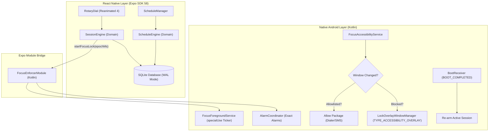

# FocusGuard

> A privacy-first, uncompromising focus and sleep discipline lock that eliminates digital distractions, defeats background process killers, and restores your productivity.

[-3DDC84.svg?style=flat&logo=android)](https://www.android.com)
[](https://expo.dev)
[](https://reactnative.dev)
[](https://www.typescriptlang.org)
[](https://kotlinlang.org)
[](LICENSE)

---

## Why FocusGuard Exists

Most screen-time limiters and app blockers fail when willpower breaks. Standard timers can be swiped away with a simple back gesture, bypassed through the recent apps switcher, or silently aborted by OEM background killers (Samsung One UI, Xiaomi HyperOS/MIUI, OnePlus OxygenOS).

**FocusGuard is engineered for uncompromised discipline:**

- **Un-Dismissible Full-Screen Overlay**: Uses Android's `TYPE_ACCESSIBILITY_OVERLAY` to cover blocked apps and consume all hardware back, home, and touch gestures.
- **Deep Doze & Reboot Resilience**: Tracks focus sessions via absolute wall-clock epoch time with exact alarms (`AlarmManager.setExactAndAllowWhileIdle`) and native boot receivers (`BOOT_COMPLETED`), surviving device restarts and deep power-saving sleep.
- **Safety by Design**: Emergency calls, incoming phone rings, and default system dialers are dynamically whitelisted without invasive permissions.
- **100% Offline & Private**: Zero network permissions in the manifest, zero telemetry, zero analytics, and zero on-screen content inspection (`canRetrieveWindowContent = false`).

---

## 📂 Repository Structure

This monorepo houses the cross-platform React Native / Expo application, its custom Kotlin native enforcement module, and the original native Android reference implementation:

```
focusGuard/
├── focusGuard/                       # 📱 Primary Application (Expo SDK 58, React Native 0.88, TypeScript 6)
│   ├── modules/focus-enforcer/       # ⚡ Native Android Expo Module (Kotlin accessibility & overlay engine)
│   ├── plugins/withFocusEnforcer.js  # 🔌 Continuous Native Generation (CNG) config plugin
│   └── src/                          # 🎨 Expo Router screens, Clean Architecture domain engines, SQLite WAL
├── archive/
│   └── kotlin-jav/                   # 🏛️ Archived Native Reference (Kotlin 2.2, Jetpack Compose, Room 2.8)
├── docs/                             # 📚 Migration documentation, onboarding, and team plans
└── openspec/                         # 📐 OpenSpec formal specifications, architectural designs, and changes
```

| Project | Tech Stack | Role & Description | Status |
| :--- | :--- | :--- | :--- |
| [**focusGuard**](./focusGuard) | React Native 0.88, Expo SDK 58, Expo Router v5, Reanimated 4, TypeScript 6 | Universal mobile app featuring tactile rotary dial controls, SQLite WAL storage, recurring midnight-crossing schedules, and native Continuous Native Generation (CNG). | 🚀 **Active Primary App** |
| [**focus-enforcer**](./focusGuard/modules/focus-enforcer) | Kotlin 2.2, Expo Modules API, Android WindowManager | High-speed native Android subsystem providing sub-100ms window interception, full-screen lock overlay, exact alarm recovery, and foreground ticker service. | ⚡ **Core Native Engine** |
| [**archive/kotlin-jav**](./archive/kotlin-jav) | Pure Kotlin 2.2, Jetpack Compose, Room 2.8, Android 15/16 | The original native Android focus lock reference architecture. Preserved for architectural reference and algorithmic verification. | 🏛️ **Archived Reference** |

---

## ⚡ Quick Start

### 1. Primary App: `focusGuard` (React Native & Expo)

**Prerequisites**: Node.js 20+, pnpm 9+, and Android Studio / Android SDK (for native Android builds).

```bash
# Navigate to the app directory
cd focusGuard

# Install dependencies
pnpm install

# Run automated sanity suite (TypeScript + ESLint + Jest)
pnpm test:sanity

# Start web preview server (fastest UI development loop)
pnpm web

# Build and run native Android client on connected device/emulator
pnpm android
```

For full setup instructions, build variants, EAS profiles, and testing runbooks, see **[focusGuard/README.md](./focusGuard/README.md)** and **[focusGuard/TESTING.md](./focusGuard/TESTING.md)**.

### 2. Archived Native Reference: `archive/kotlin-jav`

**Prerequisites**: Android Studio Ladybug (2024.2.1+) or JDK 17.

```bash
# Navigate to the archived native directory
cd archive/kotlin-jav

# Run unit tests across all domain and platform layers
./gradlew testDebugUnitTest

# Build debug APK for sideloading
./gradlew assembleDebug
```

For the original Jetpack Compose UI previews, Room schemas, and Architecture Decision Records (ADRs), see **[archive/kotlin-jav/README.md](./archive/kotlin-jav/README.md)**.

---

## 🏗️ High-Level Architecture

FocusGuard pairs a responsive React Native declarative UI with an autonomous, crash-resilient native Android enforcement engine:



---

## 🛡️ Security & Privacy Guarantees

- **Zero Network Calls**: FocusGuard omits `android.permission.INTERNET`. No analytics, telemetry, or remote crash reports are ever sent.
- **Zero Content Inspection**: Accessibility service runs with `canRetrieveWindowContent = false`. The app cannot read text, keystrokes, passwords, or screen contents.
- **No Broad Package Queries**: Dynamic system role resolution (`TelecomManager` and `Telephony.Sms`) replaces invasive `QUERY_ALL_PACKAGES` permissions.
- **Emergency Exemption**: System emergency dialers and incoming phone rings are prioritized above all lock overlays.

---

## 📖 Key Documentation

- **[React Native App Guide](./focusGuard/README.md)**: UI components, scripts, and Expo Router navigation.
- **[Focus Enforcer Native Module](./focusGuard/modules/focus-enforcer/README.md)**: Kotlin module APIs, window overlays, and exact alarms.
- **[Testing & Build Guide](./focusGuard/TESTING.md)**: Manual test scenarios, OEM battery killers, and Doze testing.
- **[Migration Plan](./docs/MIGRATION_PLAN.md)**: Architecture migration strategy from native Kotlin to React Native/Expo.
- **[Beginner Step-by-Step Guide](./docs/BEGINNER_STEP_BY_STEP_GUIDE.md)**: Detailed onboarding for new contributors.
- **[Archived Reference Implementation](./archive/kotlin-jav/README.md)**: Original native Kotlin implementation and ADR index.

---

## 📄 License

FocusGuard is open-source software licensed under the [Apache License, Version 2.0](LICENSE).
