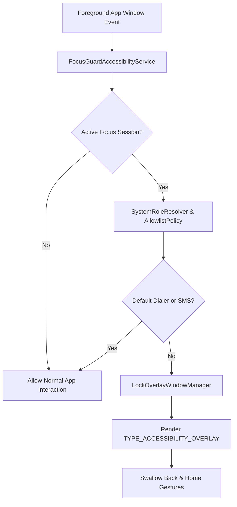

# FocusGuard

> A privacy-first, uncompromising Android focus lock that eliminates digital distractions and restores your productivity.

[](https://www.android.com)
[](https://kotlinlang.org)
[](https://developer.android.com/jetpack/compose)
[-blue.svg)](https://developer.android.com)
[-blue.svg)](https://developer.android.com)
[](LICENSE)
[](CONTRIBUTING.md)

---

## Why FocusGuard Exists

Standard app blockers fail when willpower breaks. Most timers and blockers can be dismissed with a simple back-gesture, bypassed via the recent apps switcher, or killed silently in the background by OEM battery optimizers.

**FocusGuard is engineered for uncompromised discipline.** It treats active focus periods as binding commitments:

- **Un-Dismissible Overlay**: Intercepts touches and swallows back and home gestures across non-whitelisted apps.
- **Deep Doze & Reboot Resilience**: Reconciles active session state against absolute wall-clock epoch time, ensuring session persistence through device restarts and deep power-saving sleep.
- **OEM Killer Mitigation**: Guides you through OEM-specific battery management settings (Samsung One UI, Xiaomi HyperOS/MIUI, OnePlus OxygenOS) so focus sessions are never aborted prematurely.
- **Safety by Design**: Emergency calls, incoming phone rings, and essential SMS messages always pass through unhindered.
- **100% Offline & Private**: Zero network permissions, zero telemetry, and zero screen inspection.

---

## Key Features

- **Tactile Rotary Dial & Quick Presets**: Spin an interactive, haptic-enabled dial or select instant duration presets (15 min, 45 min, 60 min) to trigger on-demand focus locks.
- **Recurring Schedules with Midnight-Crossing**: Configure daily focus intervals (such as 10:00 PM to 7:00 AM) that seamlessly handle overnight date boundaries.
- **System Role-Based Communication Pass-Through**: Dynamically detects your system's default dialer (`TelecomManager`) and SMS handler (`Telephony.Sms`) so emergency contacts remain reachable without needing invasive package scanning permissions.
- **Persistent Accessibility Overlay (`TYPE_ACCESSIBILITY_OVERLAY`)**: Enforces the lock screen on top of blocked apps without allowing touch pass-through.
- **Continuous Countdown Ticker Notification**: Uses a dedicated foreground service (`specialUse`) with continuous notification countdown updates.
- **7-Step Onboarding & Diagnostics Wizard**: Direct settings intent dispatchers walk you through required system permissions in under two minutes.

---

## Tech Stack

| Layer | Technology | Details |
| :--- | :--- | :--- |
| **Language** | Kotlin 2.2 | Idiomatic coroutines, StateFlow, and modern language features |
| **UI Framework** | Jetpack Compose + Material 3 | 100% declarative UI with dynamic colors and interactive previews |
| **Architecture** | Clean Architecture | Strict separation: Domain, Data, Platform, Service, and UI |
| **Local Storage** | Room Database 2.8.4 | SQLite persistence with automated schema version exports |
| **Preferences** | Jetpack Preferences DataStore 1.1.1 | Reactive, transactional key-value state management |
| **Timekeeping** | AlarmManager + Desugaring | Exact wall-clock epoch alarms surviving deep Doze |
| **Build System** | Gradle Kotlin DSL + AGP 9.4.1 | Java 17 toolchain with Core Library Desugaring (`minSdk 24`, `targetSdk 37`) |

---

## Architecture & How It Works

FocusGuard is built following Clean Architecture principles:

```
app/src/main/java/com/coder7475/focusguard/
├── domain/                      # Pure Kotlin business logic (no Android dependencies)
│   ├── engine/                  # SessionEngine, ScheduleEngine (epoch math & state transitions)
│   ├── model/                   # FocusSession, FocusSchedule, AccessDecision, SessionStatus
│   ├── policy/                  # AllowlistPolicy (rules for phone dialer & SMS pass-through)
│   └── repository/              # Repository interfaces
├── data/                        # Persistence & storage implementations
│   ├── local/                   # Room Database, DAOs, and Session/Schedule entities
│   ├── preferences/             # FocusPreferences (DataStore persistence)
│   └── repository/              # Repository implementations (RoomSessionRepository, etc.)
├── platform/                    # Android system integrations & hardware APIs
│   ├── alarm/                   # AlarmCoordinator (exact epoch scheduling & recovery)
│   ├── permission/              # PermissionChecker (7-step validation & intent dispatchers)
│   ├── receiver/                # BootCompletedReceiver (post-reboot lock reconciliation)
│   └── role/                    # SystemRoleResolver (dynamic dialer & SMS package detection)
├── service/                     # Android background & accessibility services
│   ├── accessibility/           # FocusGuardAccessibilityService (window state detection)
│   ├── foreground/              # FocusGuardService (specialUse foreground ticker)
│   └── overlay/                 # LockOverlayWindowManager, LockOverlayScreen, LifecycleOwner
└── ui/                          # Presentation layer (Jetpack Compose)
    ├── battery/                 # OemBatteryGuideDialog (Samsung, Xiaomi, OnePlus guides)
    ├── home/                    # HomeScreen, RotaryDialTimer, active session cards
    ├── onboarding/              # OnboardingScreen (permission checklist wizard)
    ├── schedule/                # SchedulesScreen, schedule editor, time pickers
    └── theme/                   # Material 3 typography, color schemes, and shapes
```

### Locking Enforcement Flow



---

## Getting Started

### Prerequisites

- **Android Studio**: [Ladybug (2024.2.1+)](https://developer.android.com/studio) or newer
- **JDK 17**: Eclipse Adoptium Temurin 17 (automatically provisioned via Gradle JVM Toolchain)
- **Android SDK**: `compileSdk 37`, `minSdk 24`, `targetSdk 37`
- **Device or Emulator**: Android 7.0 (API 24) to Android 15 (API 35)

### Running via Android Studio

1. Open Android Studio and select **File > Open**, then choose the `focusGuard` root directory.
2. Click **Sync Project with Gradle Files** (elephant icon) on the top toolbar.
3. **Live UI Previews**: Open [`HomeScreen.kt`](file:///home/fahad/AndroidStudioProjects/focusGuard/app/src/main/java/com/coder7475/focusguard/ui/home/HomeScreen.kt) and click **Split** to interact with Compose previews directly.
4. **Deploy to Device**: Connect an Android device with USB debugging enabled (or boot an Android Virtual Device), select it in the target device dropdown, and click **Run 'app'** (`Shift+F10`).
5. **Inspect Local Database**: Navigate to **App Inspection > Database Inspector** to view active Room database tables in real time.

For full step-by-step instructions, see the **[Developer, Testing & Deployment Guide](doc/developer/DEVELOPMENT_TESTING_DEPLOYMENT_GUIDE.md)**.

### Running via Command Line (CLI)

You can build, test, and package FocusGuard without opening Android Studio:

```bash
# Clone the repository
git clone https://github.com/coder7475/focusGuard.git
cd focusGuard

# Run unit tests across all layers
./gradlew testDebugUnitTest

# Perform static code analysis and Android Lint audit
./gradlew lintDebug

# Assemble debug APK for sideloading
./gradlew assembleDebug

# Install onto connected ADB device
adb install -r app/build/outputs/apk/debug/app-debug.apk

# Build release Android App Bundle (AAB) for Google Play
./gradlew bundleRelease
```

---

## Testing & Quality Assurance

FocusGuard maintains automated unit test coverage across all critical business logic and system platform coordinators:

| Test Suite | Coverage Area |
| :--- | :--- |
| [`SessionEngineTest`](file:///home/fahad/AndroidStudioProjects/focusGuard/app/src/test/java/com/coder7475/focusguard/domain/engine/SessionEngineTest.kt) | Epoch duration calculations, state transitions, remaining time |
| [`ScheduleEngineTest`](file:///home/fahad/AndroidStudioProjects/focusGuard/app/src/test/java/com/coder7475/focusguard/domain/engine/ScheduleEngineTest.kt) | Midnight-crossing schedule intervals, day-of-week recurrence |
| [`AllowlistPolicyTest`](file:///home/fahad/AndroidStudioProjects/focusGuard/app/src/test/java/com/coder7475/focusguard/domain/policy/AllowlistPolicyTest.kt) | Emergency dialer, SMS role matching, system package validation |
| [`AlarmCoordinatorTest`](file:///home/fahad/AndroidStudioProjects/focusGuard/app/src/test/java/com/coder7475/focusguard/platform/alarm/AlarmCoordinatorTest.kt) | Exact alarm triggering, cancellation, and deep Doze wakeups |
| [`RoomDaoTest`](file:///home/fahad/AndroidStudioProjects/focusGuard/app/src/test/java/com/coder7475/focusguard/data/local/RoomDaoTest.kt) | Room database transactions, session CRUD, and schedule queries |
| [`FocusPreferencesTest`](file:///home/fahad/AndroidStudioProjects/focusGuard/app/src/test/java/com/coder7475/focusguard/data/preferences/FocusPreferencesTest.kt) | DataStore preference serialization and reactive flow state |
| [`BootCompletedReceiverTest`](file:///home/fahad/AndroidStudioProjects/focusGuard/app/src/test/java/com/coder7475/focusguard/platform/receiver/BootCompletedReceiverTest.kt) | Post-reboot alarm and lock reconciliation |
| [`OverlayLifecycleOwnerTest`](file:///home/fahad/AndroidStudioProjects/focusGuard/app/src/test/java/com/coder7475/focusguard/service/overlay/OverlayLifecycleOwnerTest.kt) | ViewTree lifecycle owner attachment in standalone WindowManager |

Run all tests locally with:
```bash
./gradlew testDebugUnitTest
```

Before pushing release candidates, verify against the **[Smoke Test Checklist](doc/qa/SMOKE_TEST_CHECKLIST.md)**.

---

## Security & Privacy Model

FocusGuard is built around user trust and strict data privacy:

- **100% On-Device & Offline**: FocusGuard contains **zero internet permissions**, telemetry trackers, or external network requests. Your focus habits and schedules never leave your phone.
- **Zero Screen Reading (`canRetrieveWindowContent = false`)**: FocusGuard configures its Accessibility Service exclusively to monitor foreground application switches (`TYPE_WINDOW_STATE_CHANGED`). It cannot inspect your keystrokes, messages, passwords, or on-screen content.
- **No `QUERY_ALL_PACKAGES` Exemption**: FocusGuard does not request broad package scanning permissions. It queries the operating system dynamically using `TelecomManager` and `Telephony.Sms` to resolve default phone and SMS apps.
- **Uncompromised Emergency Access**: Emergency calls and dialer functions are prioritized above all lock overlays.

For our complete security policy and responsible disclosure procedure, please review [SECURITY.md](SECURITY.md).

---

## Contributing

We welcome contributions from developers, designers, and testers! Whether you are fixing an edge case on a specific OEM device or improving Compose UI animations, here is how you can help:

1. **Read the Guidelines**: Review [CONTRIBUTING.md](CONTRIBUTING.md) for code style, architectural boundaries, and branch conventions.
2. **Fork & Branch**: Create a feature branch (`git checkout -b feat/my-new-feature`) from `main`.
3. **Write Tests**: Ensure any business logic changes include accompanying unit tests.
4. **Run Quality Checks**:
   ```bash
   ./gradlew testDebugUnitTest
   ./gradlew lintDebug
   ```
5. **Submit a Pull Request**: Provide a descriptive summary of your changes and reference any related issues.

---

## Documentation

Comprehensive architecture, testing, and deployment documentation is available in the [`doc/`](doc/) directory:

| Document | Purpose |
| :--- | :--- |
| **[Developer, Testing & Deployment Guide](doc/developer/DEVELOPMENT_TESTING_DEPLOYMENT_GUIDE.md)** | Complete Android Studio manual for Compose previews, emulator/hardware debugging, ADB commands, and Play Store releases. |
| **[APK & AAB Build & Release Guide](doc/developer/BUILD_AND_RELEASE_GUIDE.md)** | Keystore generation, secret configuration, version management, and Play Console deployment. |
| **[Smoke Test Checklist](doc/qa/SMOKE_TEST_CHECKLIST.md)** | Manual verification scenarios (dialer pass-through, deep Doze alarms, reboot survival, tamper detection). |
| **[Google Play Store Disclosures](doc/play/PLAY_STORE_DISCLOSURES.md)** | Prominent disclosure copy and video submission guidelines for Accessibility and Foreground services. |
| **[Architecture Decision Records (ADRs)](doc/design/adrs/)** | Documented technical decisions for overlays, Compose in window managers, and exact alarms. |
| **[MVP Implementation Plan](doc/mvp/MVP_PLAN.md)** | System specifications, milestone tracking, and risk analysis. |

---

## License

FocusGuard is open-source software licensed under the **[Apache License 2.0](LICENSE)**.

```
Copyright 2026 FocusGuard Contributors

Licensed under the Apache License, Version 2.0 (the "License");
you may not use this file except in compliance with the License.
You may obtain a copy of the License at

    http://www.apache.org/licenses/LICENSE-2.0
```
