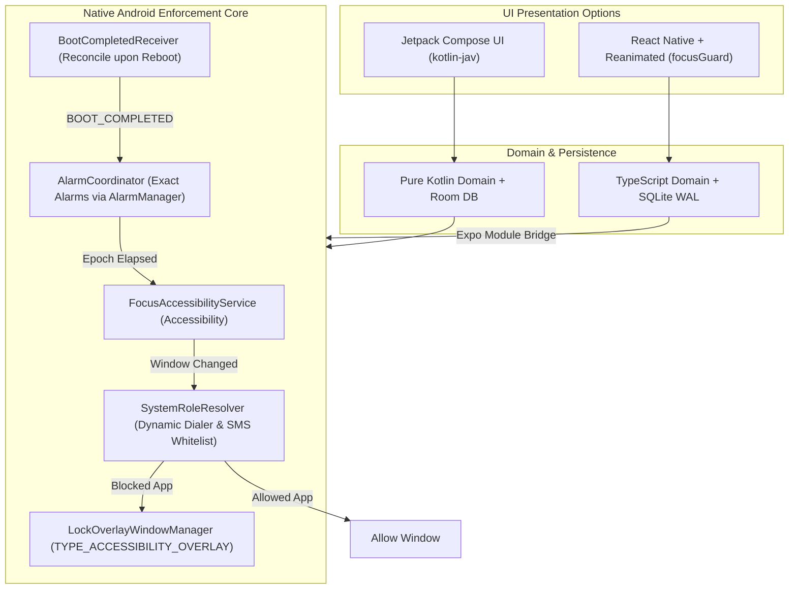

# FocusGuard

> A privacy-first, uncompromising focus and sleep discipline lock that eliminates digital distractions, defeats background process killers, and restores your productivity.

[-3DDC84.svg?style=flat&logo=android)](https://www.android.com)
[](https://kotlinlang.org)
[](https://developer.android.com/jetpack/compose)
[](https://reactnative.dev)
[](https://expo.dev)
[](https://www.typescriptlang.org)
[](LICENSE)

---

## Why FocusGuard Exists

Most screen-time limiters and app blockers fail when willpower breaks. Standard timers can be swiped away with a simple back gesture, bypassed through the recent apps switcher, or silently aborted by OEM background killers (Samsung One UI, Xiaomi HyperOS/MIUI, OnePlus OxygenOS).

**FocusGuard is engineered for uncompromised discipline:**

- **Un-Dismissible Full-Screen Overlay**: Injects Android's `TYPE_ACCESSIBILITY_OVERLAY` directly into the system `WindowManager` to cover blocked apps and swallow all hardware back, home, and touch gestures.
- **Deep Doze & Reboot Resilience**: Tracks focus sessions via absolute wall-clock epoch time with exact alarms (`AlarmManager.setExactAndAllowWhileIdle`) and native boot receivers (`BOOT_COMPLETED`), surviving device restarts and deep power-saving sleep.
- **Safety by Design**: Emergency calls, incoming phone rings, and default system dialers are dynamically whitelisted without invasive permissions.
- **100% Offline & Private**: Zero network permissions in the manifest, zero telemetry, zero analytics, and zero on-screen content inspection (`canRetrieveWindowContent = false`).

---

## 🏛️ Two Production-Ready Implementations

FocusGuard is delivered in **two first-class implementations**, sharing the same architectural principles and native enforcement guarantees:

1. [**Pure Native Android (`kotlin-jav/`)**](./kotlin-jav): Built in pure Kotlin 2.2 with Jetpack Compose (Material 3), Room Database 2.8, DataStore, and Clean Architecture. Direct-to-metal, minimal footprint, and zero JavaScript runtime dependencies.
2. [**Cross-Platform Universal App (`focusGuard/`)**](./focusGuard): Built in React Native 0.88 and Expo SDK 58 (TypeScript 6, Reanimated 4, Expo Router v5, SQLite WAL) backed by a custom Continuous Native Generation (CNG) Kotlin enforcer module (`modules/focus-enforcer`).

### Implementation Comparison

| Capability / Dimension | [Native Android (`kotlin-jav`)](./kotlin-jav) | [Universal React Native (`focusGuard`)](./focusGuard) |
| :--- | :--- | :--- |
| **Primary Language** | Pure Kotlin 2.2 | TypeScript 6.0 + Kotlin 2.2 (Native Module) |
| **UI Framework** | Jetpack Compose + Material 3 | React Native 0.88 + Expo Router v5 + Reanimated 4 |
| **Enforcement Primitive** | `FocusGuardAccessibilityService` + `TYPE_ACCESSIBILITY_OVERLAY` | `FocusAccessibilityService` + `TYPE_ACCESSIBILITY_OVERLAY` (`focus-enforcer`) |
| **Persistence Engine** | Room Database 2.8 (SQLite) + Preferences DataStore | `expo-sqlite` (WAL Mode) + JSON serialization |
| **Background Service** | Android Foreground Service (`specialUse` ticker) | Android Foreground Service (`specialUse` ticker) |
| **Timekeeping & Alarms** | `AlarmManager.setExactAndAllowWhileIdle` | `AlarmManager.setExactAndAllowWhileIdle` (`ScheduleCoordinator`) |
| **Emergency Allowlist** | Dynamic `TelecomManager` & `Telephony.Sms` package resolution | Dynamic `TelecomManager` & `Telephony.Sms` package resolution |
| **Boot Reconciliation** | `BootCompletedReceiver` (`BOOT_COMPLETED`) | `BootReceiver` (`BOOT_COMPLETED`) |
| **Supported Platforms** | Android 7.0+ (API 24 to 35+) | Android 7.0+ (API 24+) & Web (UI Preview) |
| **Build Tooling** | Gradle Kotlin DSL (`build.gradle.kts`) | Expo Continuous Native Generation (CNG) + pnpm |
| **Status** | ⚡ **Active & Production-Ready** | 🚀 **Active & Production-Ready** |

---

## 📂 Repository Structure

```
focusGuard/
├── kotlin-jav/                       # 🤖 Pure Native Android Implementation
│   ├── app/                          # Clean Architecture (Domain, Data, Platform, Service, UI)
│   │   ├── src/main/java/com/coder7475/focusguard/
│   │   │   ├── domain/               # SessionEngine, ScheduleEngine, AllowlistPolicy
│   │   │   ├── data/                 # Room Database, DAOs, DataStore Preferences
│   │   │   ├── platform/             # AlarmCoordinator, BootReceiver, RoleResolver
│   │   │   ├── service/              # AccessibilityService, OverlayWindowManager
│   │   │   └── ui/                   # Jetpack Compose Screens (RotaryDial, Schedules)
│   ├── doc/                          # ADRs, System Architecture, and Developer Guides
│   └── build.gradle.kts              # Root Gradle build configuration
│
├── focusGuard/                       # 📱 Universal React Native & Expo Implementation
│   ├── modules/focus-enforcer/       # ⚡ Native Android Expo Module (Kotlin accessibility engine)
│   ├── plugins/withFocusEnforcer.js  # 🔌 Continuous Native Generation (CNG) plugin
│   ├── src/                          # 🎨 Expo Router screens, Reanimated 4 Dial, SQLite WAL
│   ├── package.json                  # Dependencies (Expo SDK 58, React Native 0.88)
│   └── app.json                      # Expo application manifest & plugin configuration
│
├── docs/                             # 📚 Shared architectural analysis, audits, and migration guides
└── openspec/                         # 📐 OpenSpec formal specifications, architectural designs, and changes
```

---

## ⚡ Quick Start

### Option A: Native Android (`kotlin-jav`)

**Prerequisites**: Android Studio Ladybug (2024.2.1+) or JDK 17, Android SDK (`compileSdk 37`, `minSdk 24`).

```bash
# Navigate to the native Kotlin directory
cd kotlin-jav

# Run unit tests across all domain, data, and platform layers
./gradlew testDebugUnitTest

# Assemble debug APK for installation
./gradlew assembleDebug

# Sideload onto connected Android device or emulator
adb install -r app/build/outputs/apk/debug/app-debug.apk
```

> For full developer setup, Compose Split-view live previews, and Architecture Decision Records (ADRs), see **[kotlin-jav/README.md](./kotlin-jav/README.md)**.

---

### Option B: Universal React Native & Expo (`focusGuard`)

**Prerequisites**: Node.js 20+, pnpm 9+, Android Studio / SDK (for Android builds).

```bash
# Navigate to the React Native directory
cd focusGuard

# Install dependencies
pnpm install

# Run automated sanity suite (TypeScript + ESLint + Jest)
pnpm test:sanity

# Start web preview server (fast UI hot-reloading loop)
pnpm web

# Compile native Android client and launch on connected device/emulator
pnpm android
```

> For EAS cloud builds, build profiles, and device testing runbooks, see **[focusGuard/README.md](./focusGuard/README.md)** and **[focusGuard/TESTING.md](./focusGuard/TESTING.md)**.

---

## 🏗️ High-Level Enforcement Architecture

Both implementations converge on the same crash-resilient native Android enforcement architecture:



---

## 🛡️ Security & Privacy Guarantees

- **Zero Network Calls**: FocusGuard intentionally omits `android.permission.INTERNET`. Zero data is transmitted, and no analytics, ads, or telemetry libraries exist in either codebase.
- **Zero Content Inspection**: The accessibility service runs with `canRetrieveWindowContent = false`. FocusGuard cannot inspect on-screen text, passwords, or user inputs.
- **No Invasive Package Scanning**: Rather than requesting wide `QUERY_ALL_PACKAGES` permissions, FocusGuard dynamically resolves only the default dialer and SMS handlers via `TelecomManager` and `Telephony.Sms`.
- **Emergency Exemption**: System emergency calls and incoming phone rings take priority over lock overlays under all circumstances.

---

## 📖 Key Documentation

| Area | Documentation Link | Description |
| :--- | :--- | :--- |
| **Native Kotlin App** | [**kotlin-jav/README.md**](./kotlin-jav/README.md) | Native Android guide, Jetpack Compose UI, Room DB setup |
| **Native ADRs** | [**kotlin-jav/doc/design/README.md**](./kotlin-jav/doc/design/README.md) | Architecture Decision Records (ADR-001 through ADR-005) |
| **React Native App** | [**focusGuard/README.md**](./focusGuard/README.md) | Expo SDK 58 guide, Metro bundler, EAS build pipelines |
| **Focus Enforcer Module** | [**focusGuard/modules/focus-enforcer/README.md**](./focusGuard/modules/focus-enforcer/README.md) | Kotlin Expo Module bridging JS domain to native WindowManager |
| **Testing & Runbooks** | [**focusGuard/TESTING.md**](./focusGuard/TESTING.md) | Doze mode testing, OEM battery optimizer setup, manual scenarios |
| **Root Cause & Fixes** | [**docs/BLOCKING_BUG_ROOT_CAUSE_AND_FIX.md**](./docs/BLOCKING_BUG_ROOT_CAUSE_AND_FIX.md) | Architectural comparison and native enforcement fixes |
| **Overlay Flicker Audit** | [**focusGuard/docs/OVERLAY_FLICKER_AUDIT.md**](./focusGuard/docs/OVERLAY_FLICKER_AUDIT.md) | Analysis of WindowManager overlay stability |

---

## 📄 License

FocusGuard is open-source software licensed under the [Apache License, Version 2.0](LICENSE).
