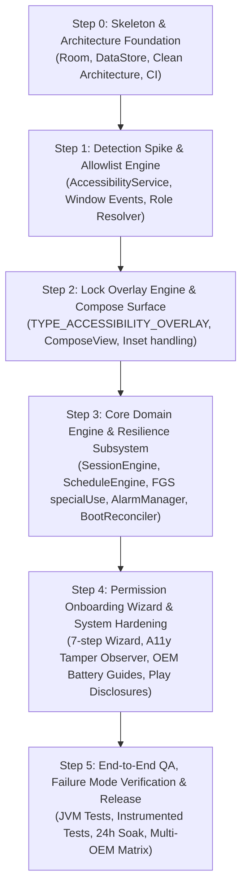

# FocusGuard — Step-by-Step Implementation Roadmap (STEPS.md)

**Role:** Mobile App Builder (`agency-mobile-app-builder`)  
**Target Platform:** Native Android (minSdk 24, targetSdk 37) · Kotlin 2.2 · Jetpack Compose · Material 3  
**Source Plan:** [`doc/mvp/MVP_PLAN.md`](file:///home/fahad/AndroidStudioProjects/focusGuard/doc/mvp/MVP_PLAN.md)  
**System Architecture:** [`doc/design/SYSTEM_ARCHITECTURE.md`](file:///home/fahad/AndroidStudioProjects/focusGuard/doc/design/SYSTEM_ARCHITECTURE.md)  
**Sprint Runbook:** [`doc/sprint/NEXUS_SPRINT_RUNBOOK.md`](file:///home/fahad/AndroidStudioProjects/focusGuard/doc/sprint/NEXUS_SPRINT_RUNBOOK.md)  

---

## Executive Overview & Platform Strategy

FocusGuard enforces phone-lock discipline during active focus sessions. Unlike weak digital wellbeing apps that can be casually dismissed, FocusGuard provides an un-bypassable lock over non-allowlisted apps while strictly safeguarding essential communications (calls, emergency dialer, and SMS).

### Android Platform Guarantees & Constraints
1. **Accessibility Enforcement without Root or MDM:** Consumer Play Store distribution cannot mandate Device-Owner / MDM status ([Android Enterprise Lock Task Mode][r-lock-task], [DevicePolicyManager][r-dpm]). Enforcement is anchored on `AccessibilityService` window-change events and `TYPE_ACCESSIBILITY_OVERLAY` windows ([ADR-001](file:///home/fahad/AndroidStudioProjects/focusGuard/doc/design/adrs/ADR-001-accessibility-overlay-enforcement.md), [A11y Service Guide][r-a11y-guide]).
2. **Reboot & Process-Death Resilience:** In-memory timers desync or vanish when OEM battery managers kill processes. Single source of truth is absolute wall-clock epoch timestamps stored in Room SQLite (`endsAtEpochMs = System.currentTimeMillis() + durationMs`) with exact alarm scheduling ([ADR-002](file:///home/fahad/AndroidStudioProjects/focusGuard/doc/design/adrs/ADR-002-persistent-epoch-state-reconciliation.md), [ADR-003](file:///home/fahad/AndroidStudioProjects/focusGuard/doc/design/adrs/ADR-003-alarmmanager-over-workmanager-for-session-timing.md)).
3. **Android 14 & 15 Compliance:** FGS requires declared types (`specialUse` with `PROPERTY_SPECIAL_USE_FGS_SUBTYPE`), handling Android 15 background launch restrictions ([FGS Types][r-fgs-types], [Android 15 FGS Changes][r-fgs-changes], [Schedule Exact Alarms][r-exact-alarms]).
4. **Play Policy Safety:** Zero broad package scanning. Allowlist resolution dynamically resolves system dialer and messaging roles via `TelecomManager` and `Telephony.Sms` with static OEM fallbacks, avoiding `QUERY_ALL_PACKAGES` rejection ([ADR-005](file:///home/fahad/AndroidStudioProjects/focusGuard/doc/design/adrs/ADR-005-system-role-based-allowlist-resolution.md), [Play Policy][r-play-policy]).

---

## Roadmap Summary & Dependency Graph



---

## Step 0: Skeleton & Architecture Foundation (Milestone M0)

### 0.1 Objective
Establish the Clean Architecture foundation, configure Gradle version catalogs with Room SQLite, KSP, and DataStore, establish deterministic data entities, and verify that clean build and test pipelines pass.

### 0.2 Technical Explanation & Rationale
To guarantee that active focus sessions survive process death and reboots ([ADR-002](file:///home/fahad/AndroidStudioProjects/focusGuard/doc/design/adrs/ADR-002-persistent-epoch-state-reconciliation.md)), state cannot live solely in memory. We establish Room entities (`FocusSessionRecord`, `FocusScheduleRecord`) holding absolute epoch timestamps. We configure KSP for Room annotation processing and set up pure Kotlin domain models decoupled from Android framework imports ([SYSTEM_ARCHITECTURE.md §7](file:///home/fahad/AndroidStudioProjects/focusGuard/doc/design/SYSTEM_ARCHITECTURE.md#7-package-structure--dependency-direction)).

### 0.3 Citations & Verification References
- **Android Documentation:** [Room Persistence Library][r-room], [DataStore Overview][r-datastore], [Guide to App Architecture][r-arch-guide].
- **Internal Specs:** [`doc/mvp/MVP_PLAN.md` §7 & §9 (M0)](file:///home/fahad/AndroidStudioProjects/focusGuard/doc/mvp/MVP_PLAN.md), [`doc/design/SYSTEM_ARCHITECTURE.md` §6 & §7](file:///home/fahad/AndroidStudioProjects/focusGuard/doc/design/SYSTEM_ARCHITECTURE.md), [`ADR-002`](file:///home/fahad/AndroidStudioProjects/focusGuard/doc/design/adrs/ADR-002-persistent-epoch-state-reconciliation.md).

### 0.4 Detailed Tasks
1. **Update Gradle Dependencies (`gradle/libs.versions.toml` & `app/build.gradle.kts`):**
   - Add Room runtime, Room KTX, Room compiler via KSP (`2.6.1`).
   - Add Preferences DataStore (`1.1.1`).
   - Add Kotlinx Coroutines Android & Test (`1.8.1`).
   - Add AndroidX Lifecycle Service & ViewModel Compose (`2.8.4`).
   - Add MockK / Robolectric for unit testing.
2. **Setup Clean Architecture Package Structure:**
   - `core/` (dispatchers, time utils, design system).
   - `domain/` (pure models: `FocusSession`, `FocusSchedule`, `SessionStatus`, repositories).
   - `data/` (Room DB, DAOs: `SessionDao`, `ScheduleDao`, DataStore preferences).
   - `platform/` (system alarms, boot receivers, role resolvers).
   - `service/` (accessibility, foreground service, overlay manager).
   - `ui/` (home, schedule, onboarding, overlay).
3. **Implement Room Database & DAOs:**
   - `FocusSessionEntity` with fields: `id`, `sessionType`, `status`, `startTimeEpochMs`, `endsAtEpochMs`, `durationMs`, `interruptionCount`.
   - `SessionDao` queries: reactive `getActiveSession(): Flow<FocusSessionEntity?>`, `insertSession()`, `updateStatus()`, `getCompletedCount(): Flow<Int>`.
   - `FocusScheduleEntity` with fields: `id`, `name`, `startMinuteOfDay`, `endMinuteOfDay`, `daysOfWeekBitmask`, `isEnabled`.
   - `ScheduleDao` queries: `getAllSchedules(): Flow<List<FocusScheduleEntity>>`, `getEnabledSchedules(): List<FocusScheduleEntity>`.
4. **Implement Preferences DataStore:**
   - Keys: `KEY_ONBOARDING_COMPLETED`, `KEY_BATTERY_GUIDE_DISMISSED`.
5. **Verify Baseline Build:**
   - Execute `./gradlew compileDebugSources test` to ensure clean compilation and dependency resolution.

### 0.5 Deliverables & Verification Criteria
- [ ] Room schema generated with indices on `status` and `endsAtEpochMs`.
- [ ] Unit tests for `SessionDao` and `ScheduleDao` using in-memory Room database pass.
- [ ] Clean `./gradlew test` exit code 0.

---

## Step 1: Detection Spike & Allowlist Engine (Milestone M1)

### 1.1 Objective
Implement `FocusGuardAccessibilityService` to listen for foreground window transitions (`TYPE_WINDOW_STATE_CHANGED`) with sub-100ms latency, and create `AllowlistPolicy` to evaluate packages against system dialer, SMS, and emergency roles without `QUERY_ALL_PACKAGES`.

### 1.2 Technical Explanation & Rationale
An accessibility service receives event callbacks directly from Android's window server (`WindowManagerService`) whenever an activity takes focus ([A11y Service Guide][r-a11y-guide], [ADR-001](file:///home/fahad/AndroidStudioProjects/focusGuard/doc/design/adrs/ADR-001-accessibility-overlay-enforcement.md)). Unlike polling `UsageStatsManager` (which incurs battery penalties, delayed sync on Android 14+, and a 500ms–2s window where blocked apps are visible), accessibility events are instantaneous and event-driven.
Per [ADR-005](file:///home/fahad/AndroidStudioProjects/focusGuard/doc/design/adrs/ADR-005-system-role-based-allowlist-resolution.md), to prevent Google Play policy rejection, we avoid `QUERY_ALL_PACKAGES` by dynamically resolving `TelecomManager.getDefaultDialerPackage()` and `Telephony.Sms.getDefaultSmsPackage()`, paired with static fallback definitions for common OEM phone and emergency apps.

### 1.3 Citations & Verification References
- **Android Documentation:** [Create an accessibility service][r-a11y-guide], [AccessibilityService API Reference][r-a11y-ref], [TelecomManager API][r-telecom], [Telephony.Sms API][r-telephony].
- **Play Store Policy:** [Accessibility API Policy in Google Play][r-play-a11y], [Package Visibility Policy][r-play-package-visibility].
- **Open-Source References:** [AppBlock Accessibility Implementation][r-appblock], [UltraFocus Permission Architecture][r-ultrafocus].
- **Internal Specs:** [`doc/mvp/MVP_PLAN.md` §4, §6 (M1), §7](file:///home/fahad/AndroidStudioProjects/focusGuard/doc/mvp/MVP_PLAN.md), [`doc/design/SYSTEM_ARCHITECTURE.md` §4.2, §4.3](file:///home/fahad/AndroidStudioProjects/focusGuard/doc/design/SYSTEM_ARCHITECTURE.md), [`ADR-001`](file:///home/fahad/AndroidStudioProjects/focusGuard/doc/design/adrs/ADR-001-accessibility-overlay-enforcement.md), [`ADR-005`](file:///home/fahad/AndroidStudioProjects/focusGuard/doc/design/adrs/ADR-005-system-role-based-allowlist-resolution.md).

### 1.4 Detailed Tasks
1. **Accessibility Service Manifest & XML Configuration:**
   - Declare `FocusGuardAccessibilityService` with `android.permission.BIND_ACCESSIBILITY_SERVICE`.
   - Provide `@xml/accessibility_service_config`:
     ```xml
     <accessibility-service xmlns:android="http://schemas.android.com/apk/res/android"
         android:accessibilityEventTypes="typeWindowStateChanged|typeWindowsChanged"
         android:accessibilityFeedbackType="feedbackGeneric"
         android:accessibilityFlags="flagDefault|flagIncludeNotImportantViews"
         android:canRetrieveWindowContent="false"
         android:description="@string/accessibility_service_description"
         android:notificationTimeout="50" />
     ```
2. **Implement `AllowlistPolicy` & `SystemRoleResolver`:**
   - Dynamic lookups:
     - `telecomManager.defaultDialerPackage`
     - `Telephony.Sms.getDefaultSmsPackage(context)`
   - Immutable system and emergency fallbacks:
     - Phone: `com.google.android.dialer`, `com.android.dialer`, `com.samsung.android.dialer`, `com.android.server.telecom`, `com.android.incallui`, `com.google.android.incallui`.
     - Emergency: `com.android.phone.EmergencyDialer`, `com.android.phone`, actions `ACTION_EMERGENCY_ASSIST`, `ACTION_DIAL`.
     - SMS: `com.google.android.apps.messaging`, `com.android.mms`, `com.samsung.android.messaging`.
     - FocusGuard itself: `com.coder7475.focusguard`.
   - Method: `fun evaluateAccess(packageName: String?): AccessDecision (ALLOWED | BLOCKED)`.
3. **Implement Window Event Inspector in Service:**
   - Filter events in `onAccessibilityEvent(event: AccessibilityEvent)`:
     - Check `event.eventType == AccessibilityEvent.TYPE_WINDOW_STATE_CHANGED`.
     - Extract `packageName = event.packageName?.toString()`.
     - Log detection latency and verify package identity.
4. **Unit Tests for `AllowlistPolicy`:**
   - Test that default dialer and SMS return `AccessDecision.ALLOWED`.
   - Test that emergency packages return `AccessDecision.ALLOWED`.
   - Test that FocusGuard own package returns `AccessDecision.ALLOWED`.
   - Test that third-party packages (e.g. `com.instagram.android`, `com.zhiliaoapp.musically`) return `AccessDecision.BLOCKED`.

### 1.5 Deliverables & Verification Criteria
- [ ] Service correctly logs foreground package switches on device/emulator within 100ms.
- [ ] `AllowlistPolicyTest` achieves 100% code coverage.
- [ ] No `QUERY_ALL_PACKAGES` permission in `AndroidManifest.xml`.

---

## Step 2: Lock Overlay Engine & Compose Surface (Milestone M2)

### 2.1 Objective
Construct `LockOverlayWindowManager` to attach a non-dismissible full-screen `TYPE_ACCESSIBILITY_OVERLAY` window over blocked apps, hosting a Jetpack Compose `ComposeView` with immersive edge-to-edge layout, responsive live countdown, and emergency call triggers.

### 2.2 Technical Explanation & Rationale
An accessibility service has the unique privilege of creating windows with `WindowManager.LayoutParams.TYPE_ACCESSIBILITY_OVERLAY` without needing the runtime `SYSTEM_ALERT_WINDOW` permission ([ADR-001](file:///home/fahad/AndroidStudioProjects/focusGuard/doc/design/adrs/ADR-001-accessibility-overlay-enforcement.md), [Overlay Codelab][r-a11y-codelab]).
To swallow hardware Back and Home gestures, window flags must be configured with `FLAG_LAYOUT_IN_SCREEN`, `FLAG_NOT_TOUCH_MODAL`, and `FLAG_SHOW_WHEN_LOCKED`.
Because `AccessibilityService` is a `Service` rather than an `Activity`, attaching Jetpack Compose requires a synthetic `OverlayLifecycleOwner` providing `LifecycleOwner`, `ViewModelStoreOwner`, and `SavedStateRegistryOwner` attached to the view tree ([ADR-004](file:///home/fahad/AndroidStudioProjects/focusGuard/doc/design/adrs/ADR-004-composeview-in-accessibility-overlay.md), [compose-overlay-window][r-compose-overlay]).

### 2.3 Citations & Verification References
- **Android Documentation:** [Developing an Accessibility Service (Google Codelab)][r-a11y-codelab], [WindowManager.LayoutParams][r-wm-params], [Edge-to-Edge in Compose][r-compose-e2e], [Window Insets][r-compose-insets].
- **Open-Source References:** [compose-overlay-window sample][r-compose-overlay], [android-accessibility-overlay][r-a11y-overlay-sample].
- **Internal Specs:** [`doc/mvp/MVP_PLAN.md` §4, §6 (M2), §7](file:///home/fahad/AndroidStudioProjects/focusGuard/doc/mvp/MVP_PLAN.md), [`doc/design/SYSTEM_ARCHITECTURE.md` §4.2](file:///home/fahad/AndroidStudioProjects/focusGuard/doc/design/SYSTEM_ARCHITECTURE.md), [`ADR-001`](file:///home/fahad/AndroidStudioProjects/focusGuard/doc/design/adrs/ADR-001-accessibility-overlay-enforcement.md), [`ADR-004`](file:///home/fahad/AndroidStudioProjects/focusGuard/doc/design/adrs/ADR-004-composeview-in-accessibility-overlay.md).

### 2.4 Detailed Tasks
1. **Build `OverlayLifecycleOwner`:**
   - Implement `LifecycleOwner`, `ViewModelStoreOwner`, and `SavedStateRegistryOwner`.
   - Manage state transitions (`CREATED` -> `STARTED` -> `RESUMED` on attach, `DESTROYED` on service shutdown).
2. **Implement `LockOverlayWindowManager`:**
   - Configure window layout parameters:
     ```kotlin
     val params = WindowManager.LayoutParams(
         WindowManager.LayoutParams.MATCH_PARENT,
         WindowManager.LayoutParams.MATCH_PARENT,
         WindowManager.LayoutParams.TYPE_ACCESSIBILITY_OVERLAY,
         WindowManager.LayoutParams.FLAG_LAYOUT_IN_SCREEN or
             WindowManager.LayoutParams.FLAG_LAYOUT_NO_LIMITS or
             WindowManager.LayoutParams.FLAG_NOT_TOUCH_MODAL or
             WindowManager.LayoutParams.FLAG_SHOW_WHEN_LOCKED or
             WindowManager.LayoutParams.FLAG_KEEP_SCREEN_ON,
         PixelFormat.TRANSLUCENT
     ).apply {
         gravity = Gravity.FILL
     }
     ```
   - Prevent window churn: maintain synchronized `isAttached` state. Toggle visibility via `view.visibility = View.VISIBLE` / `View.GONE` rather than invoking rapid `addView`/`removeView` cycles during rapid app switching ([SYSTEM_ARCHITECTURE.md §5](file:///home/fahad/AndroidStudioProjects/focusGuard/doc/design/SYSTEM_ARCHITECTURE.md#5-resilience--failure-mode-analysis-what-happens-when-x-fails)).
3. **Create `LockOverlayScreen` Composable:**
   - Render minimalist, distraction-free high-contrast UI (black background, crisp typography).
   - Display remaining time derived dynamically: `remainingMs = max(0L, endsAtEpochMs - System.currentTimeMillis())`.
   - Provide "Emergency Calls" button initiating `Intent(Intent.ACTION_DIAL)`.
   - Display motivational quote / focus badge.
4. **Integrate with `FocusGuardAccessibilityService`:**
   - When an event arrives:
     - If active session exists AND package is `BLOCKED`: invoke `overlayManager.showOverlay()`.
     - If package is `ALLOWED` (e.g. dialer, SMS, emergency): invoke `overlayManager.hideOverlay()`.

### 2.5 Deliverables & Verification Criteria
- [ ] Overlay displays over blocked apps and swallows Back/Home interactions.
- [ ] When dialer or SMS is launched, overlay immediately retreats and allows interaction.
- [ ] Compose lifecycle is stable: zero crashes or memory leaks during 50 repeated show/hide cycles.

---

## Step 3: Core Domain Engine & Resilience Subsystem (Milestone M3)

### 3.1 Objective
Implement `SessionEngine` and `ScheduleEngine` with deterministic wall-clock math, `FocusGuardService` (FGS `specialUse`) with continuous notification ticker, `AlarmCoordinator` utilizing `setExactAndAllowWhileIdle()`, and `BootCompletedReceiver` for crash and reboot recovery.

### 3.2 Technical Explanation & Rationale
To guarantee the app survives reboots, process termination, and Doze mode ([ADR-002](file:///home/fahad/AndroidStudioProjects/focusGuard/doc/design/adrs/ADR-002-persistent-epoch-state-reconciliation.md)), countdown time must never be computed via relative thread sleep. `AlarmManager.setExactAndAllowWhileIdle()` wakes the device from deep Doze precisely when `endsAtEpochMs` is reached ([ADR-003](file:///home/fahad/AndroidStudioProjects/focusGuard/doc/design/adrs/ADR-003-alarmmanager-over-workmanager-for-session-timing.md)).
For Android 14/15 compliance, `FocusGuardService` is declared with `android:foregroundServiceType="specialUse"` and documented via `PROPERTY_SPECIAL_USE_FGS_SUBTYPE` ([FGS Types][r-fgs-types], [Android 15 FGS Restrictions][r-fgs-changes]).
Upon boot (`ACTION_BOOT_COMPLETED`), `BootCompletedReceiver` queries Room: if current time is before `endsAtEpochMs`, the session is immediately re-armed; if expired, it is cleanly marked completed ([SYSTEM_ARCHITECTURE.md §5](file:///home/fahad/AndroidStudioProjects/focusGuard/doc/design/SYSTEM_ARCHITECTURE.md#5-resilience--failure-mode-analysis-what-happens-when-x-fails)).

### 3.3 Citations & Verification References
- **Android Documentation:** [Schedule exact alarms][r-exact-alarms], [AlarmManager Guide][r-alarms-guide], [FGS Types required (Android 14)][r-fgs-types], [Changes to FGS (Android 15)][r-fgs-changes], [BroadcastReceiver Boot Completed][r-boot-completed], [Notifications Overview][r-notifications].
- **Internal Specs:** [`doc/mvp/MVP_PLAN.md` §4, §6 (M3), §7](file:///home/fahad/AndroidStudioProjects/focusGuard/doc/mvp/MVP_PLAN.md), [`doc/design/SYSTEM_ARCHITECTURE.md` §4.1, §4.4, §5](file:///home/fahad/AndroidStudioProjects/focusGuard/doc/design/SYSTEM_ARCHITECTURE.md), [`ADR-002`](file:///home/fahad/AndroidStudioProjects/focusGuard/doc/design/adrs/ADR-002-persistent-epoch-state-reconciliation.md), [`ADR-003`](file:///home/fahad/AndroidStudioProjects/focusGuard/doc/design/adrs/ADR-003-alarmmanager-over-workmanager-for-session-timing.md).

### 3.4 Detailed Tasks
1. **Implement `SessionEngine`:**
   - Methods:
     - `startQuickSession(durationMinutes: Int)`: calculates `endsAt = now + duration`, inserts `FocusSessionEntity(status = ACTIVE)`, triggers `AlarmCoordinator`, starts `FocusGuardService`.
     - `cancelBeforeStart()`: allowed only before activation.
     - `completeActiveSession()`: marks `COMPLETED`, clears alarms, posts completion notification, increments completed counter.
     - `reconcileState()`: invoked on app launch and boot.
2. **Implement `ScheduleEngine`:**
   - Support overnight windows: if `endLocalTime <= startLocalTime`, interval crosses midnight (e.g. 20:00 to 08:00).
   - Compute next occurrence timestamp using `java.time.ZonedDateTime`.
   - Schedule exact alarm to trigger session start.
3. **Implement `AlarmCoordinator` & `SessionAlarmReceiver`:**
   - Register pending intents with `FLAG_IMMUTABLE` and `FLAG_UPDATE_CURRENT`.
   - Check `alarmManager.canScheduleExactAlarms()` on Android 12+; fallback to `setAndAllowWhileIdle()` if ungranted.
   - On alarm received: wake `SessionEngine` to start scheduled session or complete active session.
4. **Implement `FocusGuardService` (FGS):**
   - Manifest:
     ```xml
     <service
         android:name=".service.foreground.FocusGuardService"
         android:foregroundServiceType="specialUse"
         android:exported="false">
         <property
             android:name="android.app.PROPERTY_SPECIAL_USE_FGS_SUBTYPE"
             android:value="Focus lock countdown ticker and state preservation" />
     </service>
     ```
   - Provide ongoing notification with channel `ID_SESSION_TRACKER`, priority `LOW` (no sound), updated every second with formatted `mm:ss`.
   - Completion notification with channel `ID_SESSION_COMPLETION`, priority `HIGH`, sound, and full-screen intent trigger.
5. **Implement `BootCompletedReceiver`:**
   - Listen for `ACTION_BOOT_COMPLETED` and `ACTION_LOCKED_BOOT_COMPLETED`.
   - Call `sessionEngine.reconcileState()`. If session is still within duration, immediately restart FGS and re-arm exact alarm.

### 3.5 Deliverables & Verification Criteria
- [ ] Unit tests for `SessionEngine`: start, invariant single-active, wall-clock completion.
- [ ] Unit tests for `ScheduleEngine`: overnight midnight crossing calculations pass.
- [ ] On-device test: device rebooted mid-session wakes with session still active and correct remaining time.
- [ ] Exact alarm terminates session within ±1 second of scheduled epoch.

---

## Step 4: Permission Onboarding Wizard & System Hardening (Milestone M4)

### 4.1 Objective
Construct the user-friendly 7-step Permission Onboarding Wizard in Jetpack Compose, build an accessibility service tamper detector (`ContentObserver`), create OEM-specific battery optimization guides, and draft Play Store compliance disclosures.

### 4.2 Technical Explanation & Rationale
FocusGuard requires sensitive special permissions ([`MVP_PLAN.md` §7](file:///home/fahad/AndroidStudioProjects/focusGuard/doc/mvp/MVP_PLAN.md#manifest-permissions-mvp)). Requesting permissions all at once without explanation leads to immediate user drop-off. We structure an ordered 7-step onboarding wizard where each step verifies live grant state and explains *why* the permission is needed.
To prevent users from breaking their own commitment by turning off Accessibility in Settings ([`SYSTEM_ARCHITECTURE.md` §5](file:///home/fahad/AndroidStudioProjects/focusGuard/doc/design/SYSTEM_ARCHITECTURE.md#5-resilience--failure-mode-analysis-what-happens-when-x-fails)), we register a `ContentObserver` on `Settings.Secure.ENABLED_ACCESSIBILITY_SERVICES`. If disabled during an active session, a high-priority warning notification fires.
Additionally, OEM-specific background guidance (Samsung, Xiaomi, OnePlus) is provided to prevent OEM battery savers from killing the countdown ([dontkillmyapp.com][r-dontkillmyapp]).

### 4.3 Citations & Verification References
- **Android Documentation:** [App Permissions Overview][r-permissions], [Schedule Exact Alarm Permission][r-exact-alarms], [Notification Runtime Permission][r-notification-permission], [Battery Optimization Request][r-battery-opt].
- **Play Store Policies:** [Accessibility API Policy in Google Play][r-play-a11y], [Play Policy Center][r-play-policy].
- **OEM Battery Killers Reference:** [DontKillMyApp Benchmark][r-dontkillmyapp].
- **Internal Specs:** [`doc/mvp/MVP_PLAN.md` §6 (M4), §7, §11](file:///home/fahad/AndroidStudioProjects/focusGuard/doc/mvp/MVP_PLAN.md), [`doc/design/SYSTEM_ARCHITECTURE.md` §4.4, §5](file:///home/fahad/AndroidStudioProjects/focusGuard/doc/design/SYSTEM_ARCHITECTURE.md).

### 4.4 Detailed Tasks
1. **Implement `PermissionChecker` & Registry:**
   - Detect status for:
     1. Accessibility Service (`AccessibilityManager` enabled check).
     2. Exact Alarm (`AlarmManager.canScheduleExactAlarms()`).
     3. Post Notifications (`POST_NOTIFICATIONS` runtime grant).
     4. Ignore Battery Optimizations (`PowerManager.isIgnoringBatteryOptimizations()`).
     5. Usage Stats Access (`AppOpsManager.checkOpNoThrow(OPSTR_GET_USAGE_STATS)`).
     6. Boot Completed (`RECEIVE_BOOT_COMPLETED` install-time check).
     7. Full-Screen Intent (`USE_FULL_SCREEN_INTENT`).
2. **Build 7-Step Onboarding Wizard UI (Compose):**
   - Step card layout with status indicator (Pending / Granted).
   - "Grant Permission" button launching the specific system intent:
     - Accessibility: `Intent(Settings.ACTION_ACCESSIBILITY_SETTINGS)`.
     - Exact Alarm: `Intent(Settings.ACTION_REQUEST_SCHEDULE_EXACT_ALARM)`.
     - Battery: `Intent(Settings.ACTION_REQUEST_IGNORE_BATTERY_OPTIMIZATIONS, Uri.parse("package:$packageName"))`.
     - Usage Stats: `Intent(Settings.ACTION_USAGE_ACCESS_SETTINGS)`.
   - Gate entry to Home screen until all mandatory permissions are granted. Persist `KEY_ONBOARDING_COMPLETED` in DataStore.
3. **Build Accessibility Tamper Detection:**
   - Register `ContentObserver` in `FocusGuardService` listening to `Settings.Secure.getUriFor(Settings.Secure.ENABLED_ACCESSIBILITY_SERVICES)`.
   - If service is toggled off while `sessionEngine.hasActiveSession()` is true: trigger high-priority alert notification with direct intent to re-enable.
4. **OEM Battery Optimization Guides:**
   - Detect manufacturer (`Build.MANUFACTURER`).
   - Show specific card for Xiaomi (MIUI AutoStart & Battery Saver No Restrictions), Samsung (Never Sleeping Apps), OnePlus (Battery Optimization Off).
5. **Draft Google Play Store Disclosures:**
   - Accessibility API Prominent Disclosure text.
   - Foreground Service `specialUse` justification statement.
   - Exact Alarm core feature disclosure.

### 4.5 Deliverables & Verification Criteria
- [ ] Onboarding wizard correctly advances step-by-step as permissions are granted in Settings.
- [ ] New user completes onboarding in ≤ 90 seconds.
- [ ] Disabling accessibility mid-session immediately triggers alert notification.
- [ ] Store disclosure copy documented and ready for Play Console review.

---

## Step 5: End-to-End QA, Failure Mode Verification & Release (Milestone M5)

### 5.1 Objective
Execute automated unit and instrumented test suites, run a 24-hour soak test, perform manual verification across the device test matrix (API 24 to 37, across Pixel, Samsung, Xiaomi), and generate the production release APK/AAB.

### 5.2 Technical Explanation & Rationale
FocusGuard is a mission-critical utility where false locks or silent failures directly undermine user trust. We enforce Definition of Done criteria ([`MVP_PLAN.md` §12](file:///home/fahad/AndroidStudioProjects/focusGuard/doc/mvp/MVP_PLAN.md#12-definition-of-done-mvp)):
1. Calls and SMS must never be blocked under any circumstance ([ADR-005](file:///home/fahad/AndroidStudioProjects/focusGuard/doc/design/adrs/ADR-005-system-role-based-allowlist-resolution.md)).
2. An active lock must survive Doze, task clearing, and device reboots ([ADR-002](file:///home/fahad/AndroidStudioProjects/focusGuard/doc/design/adrs/ADR-002-persistent-epoch-state-reconciliation.md)).
3. The app must pass all lint checks with zero errors and clean release compilation.

### 5.3 Citations & Verification References
- **Android Documentation:** [Test your app on Android][r-testing], [Testing Compose UI][r-compose-testing], [Core App Quality Guidelines][r-play-quality].
- **Internal Specs:** [`doc/mvp/MVP_PLAN.md` §9 (M5), §10, §12](file:///home/fahad/AndroidStudioProjects/focusGuard/doc/mvp/MVP_PLAN.md), [`doc/design/SYSTEM_ARCHITECTURE.md` §9](file:///home/fahad/AndroidStudioProjects/focusGuard/doc/design/SYSTEM_ARCHITECTURE.md), [`doc/sprint/NEXUS_SPRINT_RUNBOOK.md` §4 (Phase 6 & 7)](file:///home/fahad/AndroidStudioProjects/focusGuard/doc/sprint/NEXUS_SPRINT_RUNBOOK.md).

### 5.4 Detailed Tasks
1. **Automated Unit Testing Suite (JVM):**
   - `SessionEngineTest`: start, tick calculation, single active invariant, completion trigger.
   - `ScheduleEngineTest`: weekday bitmask recurrence, overnight interval (20:00 to 08:00) next-trigger calculation.
   - `AllowlistPolicyTest`: verified pass-through for dialer, emergency dialer, and SMS.
   - `BootReconcilerTest`: verified re-arming logic upon reboot simulation.
2. **Instrumented Testing (`androidTest`):**
   - `FocusGuardDatabaseTest`: Room CRUD and migration testing.
   - `LockOverlayScreenTest`: Compose UI test verifying countdown text format and Emergency button click.
3. **Manual Smoke Test Matrix Execution:**
   - Test 1 (Quick Session): Start 15-min session -> open Chrome/Instagram -> overlay blocks within 100ms.
   - Test 2 (Call Safety): Incoming phone call -> overlay instantly yields -> answer and end call -> overlay returns.
   - Test 3 (Outgoing Emergency): Tap "Emergency Calls" on overlay -> dialer opens without block.
   - Test 4 (Reboot Survival): Start 45-min session -> reboot device -> phone powers up with lock active and accurate remaining time.
   - Test 5 (Overnight Soak): Start schedule crossing midnight -> verify alarm fires on time after deep Doze.
4. **Lint and Release Packaging:**
   - Execute `./gradlew lint test assembleRelease`.
   - Verify ProGuard/R8 keep rules for Room and Compose.
   - Check APK size (< 15 MB) and zero unnecessary permissions.

### 5.5 Deliverables & Verification Criteria
- [ ] All 10 User Stories (US1–US10) signed off.
- [ ] 100% test pass rate with `./gradlew test`.
- [ ] 24-hour soak test completed with 0 missed alarms.
- [ ] Crash-free session rate ≥ 99.5%.

---

## Step-by-Step Task Tracking Checklist

| Step | Milestone | Key Task | Verification Evidence | Status |
| :--- | :--- | :--- | :--- | :--- |
| **0.1** | M0 | Update Gradle version catalog & build scripts (Room, DataStore, KSP) | `./gradlew dependencies` | [ ] |
| **0.2** | M0 | Setup clean architecture package directories | Directory tree | [ ] |
| **0.3** | M0 | Implement Room database, entities, and DAOs | In-memory Room tests | [ ] |
| **0.4** | M0 | Implement Preferences DataStore | DataStore unit test | [ ] |
| **1.1** | M1 | Configure `FocusGuardAccessibilityService` & manifest declaration | A11y service binds | [ ] |
| **1.2** | M1 | Implement `SystemRoleResolver` & `AllowlistPolicy` | `AllowlistPolicyTest` | [ ] |
| **1.3** | M1 | Implement foreground package change event listener | On-device latency log (<100ms) | [ ] |
| **2.1** | M2 | Build `OverlayLifecycleOwner` for Compose in service | Synthetic lifecycle tests | [ ] |
| **2.2** | M2 | Implement `LockOverlayWindowManager` (`TYPE_ACCESSIBILITY_OVERLAY`) | Overlay window attached | [ ] |
| **2.3** | M2 | Build `LockOverlayScreen` Composable with countdown & emergency dialer | Compose UI preview & test | [ ] |
| **2.4** | M2 | Connect accessibility event interceptor to overlay show/hide | On-device blocked app test | [ ] |
| **3.1** | M3 | Implement `SessionEngine` (wall-clock monotonic epoch math) | `SessionEngineTest` | [ ] |
| **3.2** | M3 | Implement `ScheduleEngine` with overnight midnight-crossing support | `ScheduleEngineTest` | [ ] |
| **3.3** | M3 | Implement `AlarmCoordinator` & `SessionAlarmReceiver` | Alarm wake test | [ ] |
| **3.4** | M3 | Implement `FocusGuardService` (FGS `specialUse`) & notifications | FGS notification ticker | [ ] |
| **3.5** | M3 | Implement `BootCompletedReceiver` for reboot state reconciliation | Boot intent simulation test | [ ] |
| **4.1** | M4 | Implement `PermissionChecker` & registry for 7 permissions | Permission status checks | [ ] |
| **4.2** | M4 | Build 7-Step Permission Onboarding Wizard UI in Compose | Onboarding UI flow test | [ ] |
| **4.3** | M4 | Implement `ContentObserver` for accessibility tamper detection | Tamper notification alert | [ ] |
| **4.4** | M4 | Build OEM battery optimization guidance dialogs | Manufacturer detection test | [ ] |
| **4.5** | M4 | Finalize Google Play store policy disclosures | Documented text | [ ] |
| **5.1** | M5 | Execute JVM unit test suite | `./gradlew test` pass | [ ] |
| **5.2** | M5 | Execute Android instrumented test suite | Connected tests pass | [ ] |
| **5.3** | M5 | Execute manual smoke test matrix (calls, SMS, reboot, Doze) | Manual QA sign-off sheet | [ ] |
| **5.4** | M5 | 24-hour overnight soak test | 0 missed alarms | [ ] |
| **5.5** | M5 | Production APK / AAB packaging and lint audit | `./gradlew assembleRelease` | [ ] |

---

## Reference Links & Verified Sources

### Official Android Documentation
- [r-a11y-guide]: [Create an accessibility service](https://developer.android.com/guide/topics/ui/accessibility/service)
- [r-a11y-ref]: [AccessibilityService API Reference](https://developer.android.com/reference/android/accessibilityservice/AccessibilityService)
- [r-a11y-codelab]: [Developing an Accessibility Service for Android (Google Codelab)](https://codelabs.developers.google.com/codelabs/developing-android-a11y-service)
- [r-wm-params]: [WindowManager.LayoutParams](https://developer.android.com/reference/android/view/WindowManager.LayoutParams)
- [r-fgs-types]: [Foreground service types are required (Android 14)](https://developer.android.com/about/versions/14/changes/fgs-types-required)
- [r-fgs-changes]: [Changes to foreground services (Android 15)](https://developer.android.com/develop/background-work/services/fgs/changes)
- [r-exact-alarms]: [Schedule exact alarms are denied by default (Android 14)](https://developer.android.com/about/versions/14/changes/schedule-exact-alarms)
- [r-alarms-guide]: [Schedule alarms guide](https://developer.android.com/develop/background-work/services/alarms)
- [r-room]: [Room persistence library](https://developer.android.com/training/data-storage/room)
- [r-datastore]: [DataStore Overview](https://developer.android.com/topic/libraries/architecture/datastore)
- [r-arch-guide]: [Guide to app architecture](https://developer.android.com/topic/architecture)
- [r-telecom]: [TelecomManager API Reference](https://developer.android.com/reference/android/telecom/TelecomManager)
- [r-telephony]: [Telephony.Sms API Reference](https://developer.android.com/reference/android/provider/Telephony.Sms)
- [r-compose-e2e]: [Set up edge-to-edge in Compose](https://developer.android.com/develop/ui/compose/system/setup-e2e)
- [r-compose-insets]: [Window insets in Compose](https://developer.android.com/develop/ui/compose/system/insets)
- [r-boot-completed]: [BroadcastReceiver BOOT_COMPLETED](https://developer.android.com/reference/android/content/Intent#ACTION_BOOT_COMPLETED)
- [r-permissions]: [App permissions overview](https://developer.android.com/guide/topics/permissions/overview)
- [r-notification-permission]: [Notification runtime permission](https://developer.android.com/develop/ui/views/notifications/notification-permission)
- [r-battery-opt]: [Optimize for Doze and App Standby](https://developer.android.com/training/monitoring-device-state/doze-standby)
- [r-testing]: [Test your app on Android](https://developer.android.com/training/testing)
- [r-compose-testing]: [Testing Compose UI](https://developer.android.com/develop/ui/compose/testing)
- [r-dpm]: [DevicePolicyManager](https://developer.android.com/reference/kotlin/android/app/admin/DevicePolicyManager.html)
- [r-lock-task]: [Lock task mode (Android Enterprise)](https://developer.android.com/work/dpc/dedicated-devices/lock-task-mode)
- [r-notifications]: [Notifications overview](https://developer.android.com/develop/ui/views/notifications)

### Google Play Policies
- [r-play-a11y]: [Accessibility features in Google Play](https://support.google.com/googleplay/answer/16318151)
- [r-play-policy]: [Google Play Policies](https://developer.android.com/distribute/play-policies)
- [r-play-package-visibility]: [Package visibility policy (QUERY_ALL_PACKAGES)](https://support.google.com/googleplay/android-developer/answer/10158779)
- [r-play-quality]: [Core app quality](https://developer.android.com/docs/quality-guidelines/core-app-quality)

### Open-Source References & Benchmarks
- [r-appblock]: [AppBlock (SadeekFarhan21)](https://github.com/SadeekFarhan21/AppBlock) — A11y blocking & strict presets
- [r-ultrafocus]: [UltraFocus (Binondi)](https://github.com/Binondi/UltraFocus) — Focus mode permission flows
- [r-compose-overlay]: [compose-overlay-window (ArthurKun21)](https://github.com/ArthurKun21/compose-overlay-window) — Compose UI in global window
- [r-a11y-overlay-sample]: [android-accessibility-overlay (thbecker)](https://github.com/thbecker/android-accessibility-overlay) — Overlay above system windows
- [r-dontkillmyapp]: [DontKillMyApp OEM Battery Killer Database](https://dontkillmyapp.com) — Per-manufacturer background handling
