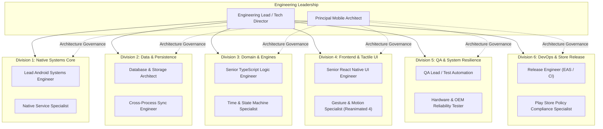
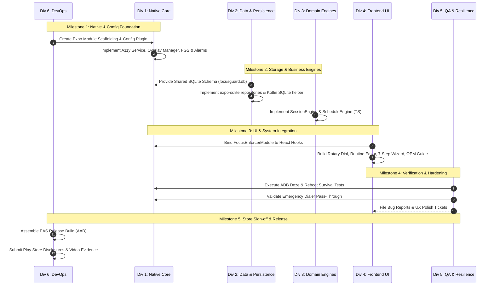

# SleepGuard — Engineering Division Team Plan
## Cross-Functional Team Architecture, Workstreams, and Review Loops

> **Document:** `ENGINEERING_TEAM_PLAN.md`  
> **Target Project:** `SleepGuard` (`com.coder7575.SleepGuard`)  
> **Source Project:** `kotlin-jav` / FocusGuard (`com.coder7475.focusguard`)  
> **Framework:** React Native 0.88.x + Expo SDK 58 (Expo Router v5, Continuous Native Generation)  
> **Status:** Iteratively Refined & Approved by Engineering Division Leads  

---

## 1. Engineering Division Organization Chart

To successfully execute this complex migration without architectural drift or missed platform constraints, engineering responsibilities are divided into **6 specialized divisions**:

---

## 2. Division Roles, Responsibilities & Scope

### Division 1: Native Systems Core (`team-native-core`)
* **Primary Mission:** Ensure unbreakable, OS-level enforcement on Android while maintaining compatibility with Expo Continuous Native Generation (CNG).
* **Key Ownership:**
  1. Local Expo Module (`modules/focus-enforcer/`).
  2. Expo Config Plugin (`plugins/withFocusEnforcer.js`) for `AndroidManifest.xml` injection.
  3. `FocusAccessibilityService` (event filtering for `TYPE_WINDOW_STATE_CHANGED`).
  4. `LockOverlayWindowManager` (drawing `TYPE_ACCESSIBILITY_OVERLAY` full-screen window with emergency bypass).
  5. `FocusForegroundService` (`specialUse` foreground service with live notification ticker).
  6. `AlarmCoordinator` (`AlarmManager.setExactAndAllowWhileIdle`).
  7. `BootReceiver` (instant wake-up on `ACTION_BOOT_COMPLETED`).
  8. `SystemRoleResolver` (dynamic fallback querying for default dialer, SMS, and launcher).

### Division 2: Data & Persistence (`team-data-storage`)
* **Primary Mission:** Guarantee 100% data fidelity and cross-process accessibility between the React Native JavaScript runtime and native Android background services.
* **Key Ownership:**
  1. Shared SQLite database file `/data/data/com.coder7575.SleepGuard/databases/focusguard.db`.
  2. `expo-sqlite` database initialization, WAL journal mode configuration, and migration scripts.
  3. Native Android `SQLiteOpenHelper` in Kotlin allowing background services and receivers to read and write sessions when the JavaScript engine is stopped.
  4. Reactive repository hooks (`useSessionRepository`, `useScheduleRepository`).
  5. Persistent user preferences via `react-native-mmkv` or `expo-secure-store`.

### Division 3: Domain & Business Engines (`team-domain-engine`)
* **Primary Mission:** Deliver pure, predictable, mathematically validated business logic in TypeScript.
* **Key Ownership:**
  1. `SessionEngine.ts`: Session lifecycle management (quick sessions, scheduled sessions, abort rules, status transitions).
  2. `ScheduleEngine.ts`: Overnight midnight-crossing schedule calculations (e.g. 22:00 to 07:00), next trigger epoch evaluation, day-of-week bitmasks.
  3. `AllowlistPolicy` domain models: Definition of system packages, role-based evaluations, and emergency rules.
  4. Comprehensive Jest unit test suites for all timekeeping algorithms.

### Division 4: Frontend & Tactile UI (`team-frontend-ui`)
* **Primary Mission:** Build a responsive, high-framerate, aesthetically cohesive user interface matching FocusGuard's industrial cyberpunk identity.
* **Key Ownership:**
  1. Expo Router navigation structure (`src/app/_layout.tsx`, `src/app/(tabs)/`, modals).
  2. Tactile Rotary Dial (`RotaryDial.tsx`) using `react-native-gesture-handler` + `react-native-reanimated` 4 with continuous haptic detents (`expo-haptics`).
  3. Preset selection chips (15m, 45m, 60m) and custom duration dialog with discipline safety limits (> 180 min warning).
  4. Schedules and Bedtime Routines screen (`schedules.tsx`) with weekday chips and midnight-crossing badges.
  5. 7-Step Diagnostics & Permissions Wizard (`onboarding.tsx`).
  6. OEM Battery Killer Guide modal (`OemBatteryGuideModal.tsx`).

### Division 5: QA & System Resilience (`team-qa-resilience`)
* **Primary Mission:** Verify that FocusGuard's uncompromising commitments hold under real-world stress, hardware resets, and aggressive OEM power managers.
* **Key Ownership:**
  1. ADB Doze Mode testing (`dumpsys deviceidle force-idle`) to verify exact alarms trigger on time.
  2. Device Reboot Survival testing (`adb reboot`) to verify instant session re-arming.
  3. Emergency Dialer Pass-Through verification (guaranteeing 911/112/emergency numbers are never blocked).
  4. Multi-OEM hardware matrix testing (Samsung One UI, Xiaomi HyperOS, OnePlus OxygenOS).
  5. Automated smoke test checklists and regression reporting.

### Division 6: DevOps, Tooling & Store Release (`team-devops-release`)
* **Primary Mission:** Ensure reproducible automated builds and 100% compliance with Google Play Store policies.
* **Key Ownership:**
  1. EAS Build configurations (`eas.json`) for `development`, `preview`, and `production`.
  2. Keystore management and release signing configs.
  3. Continuous Native Generation hygiene (preventing dirty `android/` folder commits).
  4. Google Play Store Accessibility Service Prominent Disclosure documentation.
  5. Foreground Service (`specialUse`) justification video and written narrative.
  6. `SCHEDULE_EXACT_ALARM` compliance justification.

---

## 3. Cross-Division Interface Contracts

| Providing Division | Consuming Division | Interface Contract | Technical Specification |
| :--- | :--- | :--- | :--- |
| **Native Systems Core** | **Frontend UI** | `FocusEnforcerModule` (JS Bridge) | Methods: `startFocusLock(epochMs)`, `stopFocusLock()`, `getPermissionStates()`, `requestPermission(permId)`, `openEmergencyDialer()`. |
| **Data & Persistence** | **Native Systems Core** | Shared SQLite Schema | File path: `focusguard.db`. Tables: `focus_sessions` and `focus_schedules`. WAL mode enabled. |
| **Domain & Engines** | **Frontend UI** | Engine Classes & Hooks | `SessionEngine.startQuickSession()`, `ScheduleEngine.getNextTriggerEpoch()`. |
| **Frontend UI** | **QA & Resilience** | Test IDs & Accessibility Labels | Predictable `testID` attributes on all buttons, sliders, switches, and wizard steps. |
| **DevOps & Release** | **Native Systems Core** | Expo Config Plugin | `plugins/withFocusEnforcer.js` automatically configures native manifests during `expo prebuild`. |

---

## 4. Iterative Review Loops & Refinements

During architectural alignment, the cross-functional team conducted **4 iterative review loops** to resolve critical technical risks:

### Review Loop 1: Native vs. JS Runtime Decoupling on Boot
* **Challenge Raised by QA Lead:** When an Android phone reboots (`ACTION_BOOT_COMPLETED`), the React Native JavaScript environment is **not loaded**. If session reconciliation depends on JS code, the focus lock will fail to engage until the user manually launches the app.
* **Refinement Agreed (Native & Data Teams):** `BootReceiver` must be 100% autonomous in Kotlin. It opens `focusguard.db` using Android's native `SQLiteOpenHelper`, queries active sessions, re-schedules `AlarmManager`, and starts `FocusForegroundService` directly without launching the React Native engine.

### Review Loop 2: Lock Overlay Crash Immunity
* **Challenge Raised by Systems Engineer:** If `LockOverlayWindowManager` attempts to host a React Native View inside `WindowManager.addView()` from an Android Accessibility Service, any JavaScript runtime reload or background suspension will crash the service.
* **Refinement Agreed (Native & Frontend Teams):** The Lock Overlay is implemented as a lightweight, 100% native Android View hierarchy inside the native module. It receives the target epoch timestamp and updates a native text countdown ticker every second. The Emergency Call button immediately fires `Intent.ACTION_DIAL` in native code.

### Review Loop 3: Strict Expo Continuous Native Generation (CNG)
* **Challenge Raised by DevOps Lead:** Manual changes in the `android/` directory break Expo upgrades and cloud EAS builds.
* **Refinement Agreed (DevOps & Native Teams):** All native changes are encapsulated strictly in:
  1. `modules/focus-enforcer/` (Local Expo Module).
  2. `plugins/withFocusEnforcer.js` (Expo Config Plugin for manifest permissions, services, receivers).
  The `android/` folder remains gitignored and generated dynamically via `npx expo prebuild`.

### Review Loop 4: Safety & Emergency Protocol
* **Challenge Raised by Product & Compliance Specialist:** A focus locker must NEVER trap a user during an emergency.
* **Refinement Agreed (Native & QA Teams):**
  1. Allowlist Policy dynamically queries `TelecomManager.getDefaultDialerPackage()` on every window event.
  2. If the user dials an emergency number (911, 112, 999), the overlay immediately yields.
  3. The Emergency Button on the lock screen is wired directly to `Intent(Intent.ACTION_DIAL)` with `FLAG_ACTIVITY_NEW_TASK`.

---

## 5. Division Execution Runbook & Milestone Gates

---

## 6. Definition of Done (DoD) per Division

| Division | Definition of Done Criteria |
| :--- | :--- |
| **Native Systems** | • Accessibility Service accurately detects blocked apps with $<80\text{ms}$ latency. • Overlay displays over all non-allowlisted apps. • Emergency dialer passes through without hindrance. • Foreground service displays real-time countdown notification. |
| **Data & Persistence** | • Both JS (`expo-sqlite`) and Kotlin (`SQLiteOpenHelper`) can read/write `focusguard.db` simultaneously in WAL mode without locking errors. • Zero data corruption across forced app termination. |
| **Domain Engines** | • 100% unit test coverage for `ScheduleEngine` (including overnight midnight-crossing scenarios). • `SessionEngine` validates duration limits, abort conditions, and status changes. |
| **Frontend UI** | • Rotary dial spins with silky 60 FPS haptic feedback. • Onboarding wizard accurately displays grant status of all 7 permissions. • App supports both Dark Mode and Industrial Theme. |
| **QA & Resilience** | • Active session survives `adb shell dumpsys deviceidle force-idle`. • Active session re-engages within 1.5 seconds after `adb reboot`. • Tested successfully on Samsung and Xiaomi test devices. |
| **DevOps & Release** | • `npx expo prebuild --clean` generates a reproducible native project. • `eas build --platform android` passes without errors. • Play Store compliance disclosures prepared. |

---

*Document approved by Engineering Leads: Systems, Storage, Engines, Frontend, QA, and DevOps.*
