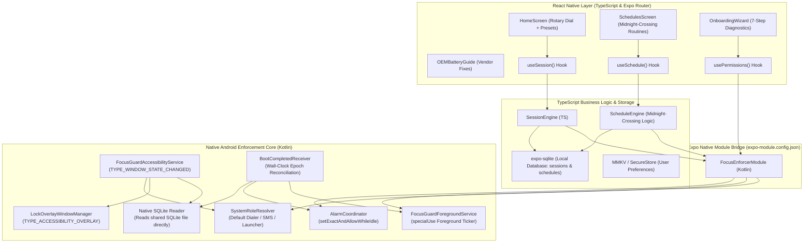
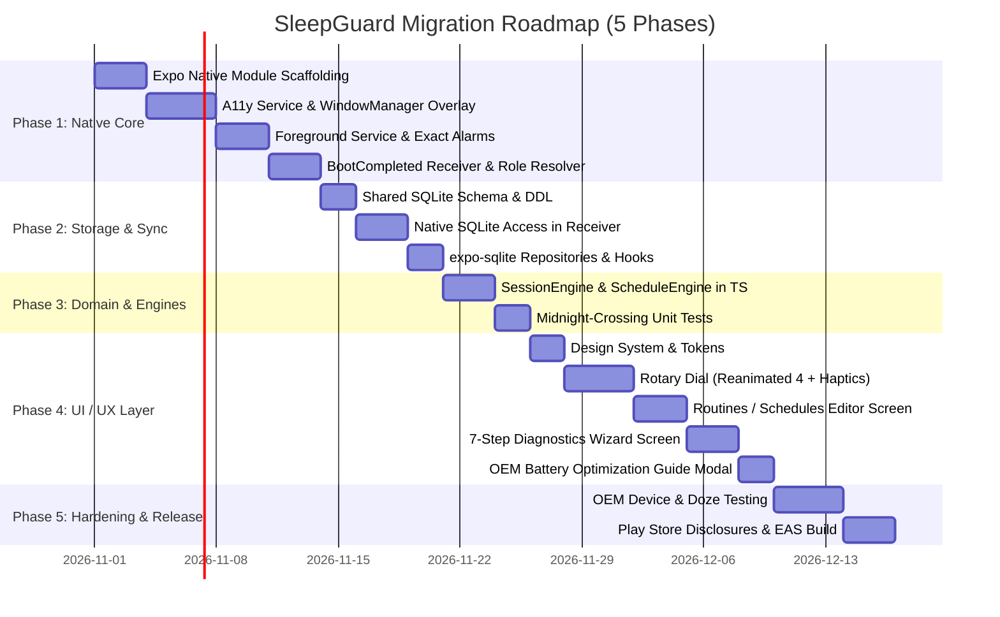

# SleepGuard — Comprehensive Architecture & Migration Plan
## Converting FocusGuard (Native Kotlin/Compose) to SleepGuard (React Native / Expo)

> **Document Version:** 1.0.0  
> **Author:** Mobile App Builder Agent  
> **Target Application:** `SleepGuard` (`com.coder7575.SleepGuard`)  
> **Source Application:** `kotlin-jav` / FocusGuard (`com.coder7475.focusguard`)  
> **Target Framework:** React Native 0.88.x + Expo SDK 58 (Expo Router v5, Continuous Native Generation)  

---

## Executive Summary

FocusGuard is a strict, privacy-first Android focus lock designed to eliminate digital distraction through uncompromising system-level enforcement:
- **Un-dismissible Accessibility Overlay (`TYPE_ACCESSIBILITY_OVERLAY`)**: Traps touch events and blocks non-whitelisted apps during an active focus lock.
- **Deep Doze & Reboot Resilience**: Persists session and schedule state across power-saving Doze modes and device reboots using absolute wall-clock epoch timestamps and `AlarmManager.setExactAndAllowWhileIdle()`.
- **Foreground Service Countdown**: Continuous notification ticker updating every second.
- **Role-Based Emergency Pass-Through**: Dynamically detects the system's default dialer (`TelecomManager`) and default SMS handler (`Telephony.Sms`) so emergency communications are never blocked.
- **Zero-Network, 100% Offline**: Zero telemetry, zero external network permissions, zero screen content inspection (`canRetrieveWindowContent = false`).

Migrating this application to **React Native (Expo SDK 58)** in `SleepGuard` requires a **Hybrid Core Architecture**. A standard cross-platform JavaScript app cannot run an `AccessibilityService`, mount a `WindowManager` overlay over third-party apps, or survive deep process death without native code. 

Using **Expo Continuous Native Generation (CNG)** and the **Expo Modules API (Kotlin)**, we partition the application cleanly:
1. **Native Focus Enforcement Subsystem (Custom Expo Module)**: Manages low-level Android services (`AccessibilityService`, `LockOverlayWindowManager`, `FocusGuardForegroundService`, `AlarmCoordinator`, `BootCompletedReceiver`, and `SystemRoleResolver`).
2. **React Native / Expo Application Layer**: Provides the high-polish, tactile UI (Rotary Dial timer with `react-native-reanimated` 4 and `react-native-gesture-handler`, Schedules with midnight-crossing calculation, 7-step Diagnostics & Permissions Wizard, and OEM Battery Guides).

---

## 1. Platform Strategy & Architecture

### 1.1 Target Platforms & Device Support
- **Android**: Primary platform. Min SDK 24 (Android 7.0 Nougat), Target SDK 35/36 (Android 15/16). Full enforcement capabilities via native module.
- **iOS (Future / Dual-Track Architecture)**: Apple iOS does not permit accessibility overlays or third-party window interception. On iOS, the application architecture will interface with Apple's **Screen Time API (`FamilyControls`, `DeviceActivity`, `ManagedSettings`)**. The business engine and state layers in TypeScript are designed to support an iOS Screen Time native bridge seamlessly.

### 1.2 Technology Stack Comparison

| Capability | FocusGuard (`kotlin-jav`) | SleepGuard (`React Native / Expo`) | Migration Strategy |
| :--- | :--- | :--- | :--- |
| **Language** | Kotlin 2.2 | TypeScript 6.x + Kotlin (Expo Module) | Clean separation of UI/Engine (TS) and OS Enforcers (Kotlin) |
| **UI Framework** | Jetpack Compose + Material 3 | React Native + Expo UI / StyleSheet + Reanimated 4 | Component-for-component recreation with shared design tokens |
| **Navigation** | State-driven Compose screens | Expo Router (file-based routing in `src/app/`) | Modular routes: `(tabs)`, `onboarding`, modals |
| **Local Database** | Room SQLite 2.8.4 | `expo-sqlite` (shared SQLite database) | Unified SQLite database file accessed by both JS and Native Service |
| **Key-Value Store** | Jetpack Preferences DataStore | `react-native-mmkv` / `expo-secure-store` | Synchronous, ultra-fast preference access |
| **Gestures & Dial** | Compose Canvas + PointerInput | `react-native-gesture-handler` + `react-native-reanimated` | Haptic-driven rotary dial with 60 FPS physics |
| **Overlay Window** | ComposeView in `WindowManager` | Native Android View / Compose via Expo Module | Native module directly attaches overlay view |
| **Background Ticker** | Foreground Service (`specialUse`) | Native Android Foreground Service via Expo Module | Native service with `specialUse` type and notification channel |
| **Exact Alarms** | `AlarmManager.setExactAndAllowWhileIdle` | Android `AlarmManager` exposed via Expo Module | Native exact alarm coordinator triggered from TS or native engine |
| **Reboot Survival** | `BootCompletedReceiver` | Native `BroadcastReceiver` in Expo Module | Reconciles SQLite database immediately on boot |
| **Permissions Check** | Native `PermissionChecker` | Native Module Bridge $\to$ React Hook (`usePermissions`) | 7-step diagnostics wizard with native intent launchers |

---

## 2. High-Level System Architecture



---

## 3. Detailed Component & File Mapping

### 3.1 Domain & Data Models

| Kotlin File (`kotlin-jav`) | React Native / Expo File (`SleepGuard`) | Responsibilities / Migration Details |
| :--- | :--- | :--- |
| `domain/model/FocusSession.kt` | `src/types/session.ts` | `id`, `startedAtEpochMs`, `endsAtEpochMs`, `durationMs`, `type` (`QUICK`, `SCHEDULED`), `status` (`ACTIVE`, `COMPLETED`, `ABORTED`). |
| `domain/model/FocusSchedule.kt` | `src/types/schedule.ts` | `id`, `name`, `startHour`, `startMinute`, `endHour`, `endMinute`, `daysOfWeek` (Set of 1..7), `isEnabled`, `createdAtEpochMs`. |
| `domain/model/AccessDecision.kt` | `src/types/permission.ts` | `ALLOWED`, `BLOCKED`, `IGNORED`. |
| `data/local/entity/*` | `src/data/db/schema.ts` | DDL queries for SQLite: tables `focus_sessions` and `focus_schedules` matching Room schema exactly. |
| `data/local/dao/*` | `src/data/db/session-repository.ts`<br>`src/data/db/schedule-repository.ts` | CRUD and reactive queries using `expo-sqlite` (`useSQLiteContext`). |
| `data/preferences/FocusPreferences.kt` | `src/data/preferences/use-app-preferences.ts` | Storage keys for `isOnboardingCompleted`, `selectedDurationMinutes`, `strictModeEnabled`. |

### 3.2 Domain Engines

| Kotlin File | TypeScript File | Logic to Port |
| :--- | :--- | :--- |
| `domain/engine/SessionEngine.kt` | `src/services/session-engine.ts` | Validation rules: start session, abort session, calculate elapsed/remaining percentage, check whether session is active at epoch timestamp. |
| `domain/engine/ScheduleEngine.kt` | `src/services/schedule-engine.ts` | Midnight-crossing algorithm: evaluates if `currentEpoch` falls within intervals that cross midnight (e.g., 22:00 to 07:00), calculates next trigger epoch. |
| `domain/policy/AllowlistPolicy.kt` | Native Module: `AllowlistPolicy.kt` | Kept in native Kotlin module because accessibility window transition checking must happen in sub-millisecond execution without bridge latency. |

### 3.3 Platform & Native Enforcement Subsystem

| Native Component | Location in SleepGuard | Implementation Details |
| :--- | :--- | :--- |
| **Expo Config Plugin** | `plugins/withFocusEnforcer.js` | Modifies `AndroidManifest.xml` during `npx expo prebuild`: registers permissions (`FOREGROUND_SERVICE_SPECIAL_USE`, `SCHEDULE_EXACT_ALARM`, `RECEIVE_BOOT_COMPLETED`), adds `<service>` tags and `<receiver>` tags. |
| **Expo Local Module** | `modules/focus-enforcer/` | Native bridge defining methods: `startFocusLock(epochMs)`, `stopFocusLock()`, `checkPermissionStatus()`, `requestPermission(type)`, `getSystemRoles()`. |
| `FocusGuardAccessibilityService.kt` | `modules/focus-enforcer/android/.../FocusGuardAccessibilityService.kt` | Inspects `TYPE_WINDOW_STATE_CHANGED`, queries `AllowlistPolicy`, triggers `LockOverlayWindowManager`. |
| `LockOverlayWindowManager.kt` | `modules/focus-enforcer/android/.../LockOverlayWindowManager.kt` | Attaches `TYPE_ACCESSIBILITY_OVERLAY` full-screen layout. Implements emergency bypass button that fires `Intent(Intent.ACTION_DIAL)`. |
| `FocusGuardService.kt` | `modules/focus-enforcer/android/.../FocusGuardForegroundService.kt` | Android Foreground Service with continuous notification countdown ticker (`NotificationCompat.Builder`), tamper observer on `Settings.Secure.ENABLED_ACCESSIBILITY_SERVICES`. |
| `AlarmCoordinator.kt` | `modules/focus-enforcer/android/.../AlarmCoordinator.kt` | Schedules exact wakeups with `AlarmManager.setExactAndAllowWhileIdle()` to terminate/start sessions even in Android Doze mode. |
| `BootCompletedReceiver.kt` | `modules/focus-enforcer/android/.../BootReceiver.kt` | Runs on `ACTION_BOOT_COMPLETED` and `ACTION_LOCKED_BOOT_COMPLETED`. Reads the shared SQLite database directly and re-arms active locks without launching React Native. |
| `SystemRoleResolver.kt` | `modules/focus-enforcer/android/.../SystemRoleResolver.kt` | Queries `TelecomManager` for default dialer, `Telephony.Sms` for default SMS, and package manager for home launcher. |

### 3.4 User Interface & Components

| Jetpack Compose Screen | React Native / Expo Route | Component Architecture |
| :--- | :--- | :--- |
| `MainActivity.kt` | `src/app/_layout.tsx` | Root layout with font loading, theme provider, and reactive check for `isOnboardingCompleted`. |
| `OnboardingScreen.kt` | `src/app/onboarding.tsx` | 7-step diagnostics wizard with live permission grant indicators, explanatory cards, and direct intent triggers. |
| `HomeScreen.kt` | `src/app/(tabs)/index.tsx` | Main dashboard displaying rotary dial timer or active lock banner, stats chips, and preset buttons. |
| `RotaryDialTimer.kt` | `src/components/timer/RotaryDial.tsx` | Custom circular slider using `react-native-gesture-handler` + Reanimated 4, supporting continuous spin, tick marks, and haptic feedback. |
| `CustomDurationDialog.kt` | `src/components/timer/CustomDurationModal.tsx` | Number input modal with duration validation and discipline warning modal for sessions > 180 minutes. |
| `SchedulesScreen.kt` | `src/app/(tabs)/schedules.tsx` | Routine management screen with weekday chips, midnight-crossing badges, and enable/disable toggles. |
| `OemBatteryGuideDialog.kt` | `src/components/settings/OemBatteryGuideModal.tsx` | Tabbed dialog with OEM-specific instructions (Samsung, Xiaomi/MIUI, OnePlus, Huawei, Vivo, Stock Android). |
| `Theme.kt`, `Color.kt` | `src/constants/theme.ts`, `src/constants/colors.ts` | Industrial dark cyberpunk palette: Matte Charcoal (`#121316`), Electric Cyan (`#00E5FF`), Safety Orange (`#FF5722`), Danger Red (`#FF3366`), Dark Gunmetal (`#1A1C23`), Off-White (`#F0F2F5`). |

---

## 4. Key Technical Solutions & Code Designs

### 4.1 Native Expo Config Plugin (`plugins/withFocusEnforcer.js`)

To keep SleepGuard compliant with Expo's Continuous Native Generation (CNG), all AndroidManifest entries must be injected programmatically via a config plugin:

```javascript
// plugins/withFocusEnforcer.js
const { withAndroidManifest } = require('@expo/config-plugins');

module.exports = function withFocusEnforcer(config) {
  return withAndroidManifest(config, async (config) => {
    const androidManifest = config.modResults.manifest;
    
    // 1. Add Required Permissions
    const permissions = [
      'android.permission.FOREGROUND_SERVICE',
      'android.permission.FOREGROUND_SERVICE_SPECIAL_USE',
      'android.permission.SCHEDULE_EXACT_ALARM',
      'android.permission.POST_NOTIFICATIONS',
      'android.permission.RECEIVE_BOOT_COMPLETED',
      'android.permission.USE_FULL_SCREEN_INTENT',
      'android.permission.REQUEST_IGNORE_BATTERY_OPTIMIZATIONS',
      'android.permission.SYSTEM_ALERT_WINDOW'
    ];

    permissions.forEach((perm) => {
      if (!androidManifest['uses-permission']) {
        androidManifest['uses-permission'] = [];
      }
      if (!androidManifest['uses-permission'].some((p) => p.$['android:name'] === perm)) {
        androidManifest['uses-permission'].push({
          $: { 'android:name': perm }
        });
      }
    });

    // 2. Add Accessibility Service, Foreground Service, and Receivers
    const app = androidManifest.application[0];
    
    if (!app.service) app.service = [];
    if (!app.receiver) app.receiver = [];

    // Accessibility Service
    app.service.push({
      $: {
        'android:name': 'com.coder7575.sleepguard.enforcer.FocusAccessibilityService',
        'android:permission': 'android.permission.BIND_ACCESSIBILITY_SERVICE',
        'android:exported': 'true'
      },
      'intent-filter': [{
        action: [{ $: { 'android:name': 'android.accessibilityservice.AccessibilityService' } }]
      }],
      'meta-data': [{
        $: {
          'android:name': 'android.accessibilityservice',
          'android:resource': '@xml/accessibility_service_config'
        }
      }]
    });

    // Foreground Ticker Service
    app.service.push({
      $: {
        'android:name': 'com.coder7575.sleepguard.enforcer.FocusForegroundService',
        'android:foregroundServiceType': 'specialUse',
        'android:exported': 'false'
      },
      property: [{
        $: {
          'android:name': 'android.app.PROPERTY_SPECIAL_USE_FGS_SUBTYPE',
          'android:value': 'Focus lock countdown ticker and state preservation'
        }
      }]
    });

    // Boot Receiver
    app.receiver.push({
      $: {
        'android:name': 'com.coder7575.sleepguard.enforcer.BootReceiver',
        'android:exported': 'true'
      },
      'intent-filter': [{
        action: [
          { $: { 'android:name': 'android.intent.action.BOOT_COMPLETED' } },
          { $: { 'android:name': 'android.intent.action.LOCKED_BOOT_COMPLETED' } }
        ]
      }]
    });

    return config;
  });
};
```

### 4.2 Shared SQLite Database Architecture

A critical architectural pitfall in converting an app like FocusGuard to React Native is **data isolation**:
- If `BootCompletedReceiver` wakes up after a device reboot, the React Native JavaScript engine is **NOT** running.
- If data is stored only in JavaScript memory or AsyncStorage, the native Android service cannot know if a focus lock was active!
- **Solution**: Use standard Android SQLite file naming. Configure `expo-sqlite` in JavaScript to read/write `focusguard.db`. The native Kotlin module uses standard Android SQLite API (`SQLiteOpenHelper`) pointing directly to `/data/data/com.coder7575.SleepGuard/databases/focusguard.db`.

```typescript
// src/data/db/database.ts
import * as SQLite from 'expo-sqlite';

export const DB_NAME = 'focusguard.db';

export async function initDatabase(db: SQLite.SQLiteDatabase) {
  await db.execAsync(`
    PRAGMA journal_mode = WAL;
    
    CREATE TABLE IF NOT EXISTS focus_sessions (
      id TEXT PRIMARY KEY NOT NULL,
      startedAtEpochMs INTEGER NOT NULL,
      endsAtEpochMs INTEGER NOT NULL,
      durationMs INTEGER NOT NULL,
      type TEXT NOT NULL,
      status TEXT NOT NULL
    );

    CREATE TABLE IF NOT EXISTS focus_schedules (
      id TEXT PRIMARY KEY NOT NULL,
      name TEXT NOT NULL,
      startHour INTEGER NOT NULL,
      startMinute INTEGER NOT NULL,
      endHour INTEGER NOT NULL,
      endMinute INTEGER NOT NULL,
      daysOfWeek TEXT NOT NULL,
      isEnabled INTEGER NOT NULL,
      createdAtEpochMs INTEGER NOT NULL
    );
  `);
}
```

### 4.3 Tactile Rotary Dial in React Native Reanimated 4

The signature visual element of FocusGuard is its tactile rotary dial. In React Native, this is implemented using `react-native-gesture-handler` and `react-native-reanimated` with `expo-haptics`:

```typescript
// src/components/timer/RotaryDial.tsx
import React from 'react';
import { View, StyleSheet, Dimensions } from 'react-native';
import { Gesture, GestureDetector } from 'react-native-gesture-handler';
import Animated, {
  useSharedValue,
  useAnimatedStyle,
  runOnJS,
  withSpring
} from 'react-native-reanimated';
import * as Haptics from 'expo-haptics';
import Svg, { Circle, G, Line, Text as SvgText } from 'react-native-svg';
import { Colors } from '@/constants/colors';

interface RotaryDialProps {
  value: number; // minutes: 5..180
  onChange: (minutes: number) => void;
  size?: number;
}

export const RotaryDial: React.FC<RotaryDialProps> = ({
  value,
  onChange,
  size = 280
}) => {
  const angle = useSharedValue(((value - 5) / (180 - 5)) * 300);
  const lastHapticStep = useSharedValue(value);

  const triggerHaptic = () => {
    Haptics.impactAsync(Haptics.ImpactFeedbackStyle.Light);
  };

  const panGesture = Gesture.Pan().onUpdate((event) => {
    const center = size / 2;
    const x = event.x - center;
    const y = event.y - center;
    let rad = Math.atan2(y, x) + Math.PI / 2;
    if (rad < 0) rad += 2 * Math.PI;

    const deg = (rad * 180) / Math.PI;
    if (deg <= 300) {
      angle.value = deg;
      const calculatedMinutes = Math.round(5 + (deg / 300) * (180 - 5));
      
      if (Math.abs(calculatedMinutes - lastHapticStep.value) >= 5) {
        lastHapticStep.value = calculatedMinutes;
        runOnJS(triggerHaptic)();
      }
      runOnJS(onChange)(calculatedMinutes);
    }
  });

  const pointerStyle = useAnimatedStyle(() => {
    return {
      transform: [
        { rotate: `${angle.value}deg` }
      ]
    };
  });

  return (
    <GestureDetector gesture={panGesture}>
      <View style={[styles.container, { width: size, height: size }]}>
        <Svg width={size} height={size}>
          <Circle
            cx={size / 2}
            cy={size / 2}
            r={size / 2 - 20}
            stroke={Colors.darkGunmetal}
            strokeWidth={12}
            fill={Colors.matteCharcoal}
          />
          {/* Dial graduation lines & numbers */}
        </Svg>
        <Animated.View style={[styles.needleContainer, pointerStyle]}>
          <View style={styles.indicatorKnob} />
        </Animated.View>
      </View>
    </GestureDetector>
  );
};

const styles = StyleSheet.create({
  container: {
    alignItems: 'center',
    justifyContent: 'center',
  },
  needleContainer: {
    ...StyleSheet.absoluteFillObject,
    alignItems: 'center',
  },
  indicatorKnob: {
    width: 14,
    height: 14,
    borderRadius: 7,
    backgroundColor: Colors.safetyOrange,
    marginTop: 14,
  }
});
```

### 4.4 Midnight-Crossing Schedule Engine (TypeScript)

Porting `ScheduleEngine.kt` to TypeScript with 100% mathematical fidelity:

```typescript
// src/services/schedule-engine.ts
import { FocusSchedule } from '@/types/schedule';

export class ScheduleEngine {
  /**
   * Evaluates if a given epoch timestamp falls within the schedule's active window.
   */
  static isScheduleActiveAt(schedule: FocusSchedule, epochMs: number): boolean {
    if (!schedule.isEnabled) return false;

    const date = new Date(epochMs);
    const dayOfWeek = date.getDay() === 0 ? 7 : date.getDay(); // 1 = Monday, 7 = Sunday
    const currentMinutes = date.getHours() * 60 + date.getMinutes();

    const startMinutes = schedule.startHour * 60 + schedule.startMinute;
    const endMinutes = schedule.endHour * 60 + schedule.endMinute;

    // Normal intraday schedule (e.g. 09:00 -> 17:00)
    if (startMinutes < endMinutes) {
      return (
        schedule.daysOfWeek.includes(dayOfWeek) &&
        currentMinutes >= startMinutes &&
        currentMinutes < endMinutes
      );
    }

    // Overnight midnight-crossing schedule (e.g. 22:00 -> 07:00)
    if (startMinutes > endMinutes) {
      // Evening portion (day of schedule start)
      if (currentMinutes >= startMinutes && schedule.daysOfWeek.includes(dayOfWeek)) {
        return true;
      }
      // Morning portion (next calendar day)
      const prevDay = dayOfWeek === 1 ? 7 : dayOfWeek - 1;
      if (currentMinutes < endMinutes && schedule.daysOfWeek.includes(prevDay)) {
        return true;
      }
    }

    return false;
  }
}
```

---

## 5. Phase-by-Phase Implementation Roadmap



### Phase 1: Native Focus Enforcement Core (Kotlin Expo Module)
1. **Module Scaffolding**: Create `modules/focus-enforcer` with `expo-module.config.json`.
2. **Accessibility Service**: Implement `FocusAccessibilityService` watching `TYPE_WINDOW_STATE_CHANGED` with `canRetrieveWindowContent = false`.
3. **Window Overlay**: Implement `LockOverlayWindowManager` mounting `TYPE_ACCESSIBILITY_OVERLAY` with Emergency Call bypass.
4. **Foreground Ticker**: Implement `FocusForegroundService` with `specialUse` foreground type and 1-second countdown notification updates.
5. **Exact Alarms & Reboot**: Integrate `AlarmCoordinator` (`setExactAndAllowWhileIdle`) and `BootReceiver`.
6. **Config Plugin**: Build `plugins/withFocusEnforcer.js` to automate manifest permissions and declarations.

### Phase 2: Persistent Storage & Cross-Process State
1. **Database Setup**: Configure `expo-sqlite` to initialize tables `focus_sessions` and `focus_schedules`.
2. **Native SQLite Reader**: In `BootReceiver` and `FocusAccessibilityService`, instantiate native SQLite reader to inspect active session epoch without invoking JavaScript.
3. **Reactive Hooks**: Implement `useActiveSession()` and `useSchedules()` with live updates.

### Phase 3: TypeScript Domain Engines & Business Logic
1. **Engine Porting**: Port `SessionEngine` and `ScheduleEngine` to TypeScript.
2. **Test Suite**: Add Jest tests for session state transitions, midnight-crossing routines, and allowlist rules.
3. **Role Synchronization**: Expose `SystemRoleResolver` via Expo Module to allow the UI to show default dialer and SMS status.

### Phase 4: Modern React Native UI & Tactile Experience
1. **Design Tokens**: Standardize colors (`Matte Charcoal`, `Electric Cyan`, `Safety Orange`, `Danger Red`).
2. **Tactile Rotary Dial**: Build the 300-degree rotary timer with continuous haptics and instant duration presets (15, 45, 60 min).
3. **Schedules & Routines Screen**: Build routine list, time pickers, and weekday selection chips.
4. **7-Step Onboarding Wizard**: Build permission status indicators (`usePermissions`) with direct deep-links to Android system settings.
5. **OEM Battery Guide Modal**: Provide detailed vendor walkthroughs for Samsung, Xiaomi, OnePlus, Huawei, and Vivo.

### Phase 5: Verification, Play Store Compliance & Production Readiness
1. **Deep Doze Verification**: Test ADB idle commands:
   ```bash
   adb shell dumpsys deviceidle force-idle
   adb shell dumpsys battery unplug
   ```
2. **Reboot Verification**: Ensure active lock persists after `adb reboot`.
3. **Dialer Pass-Through Verification**: Ensure emergency calls can be made while overlay is active.
4. **EAS Build Configuration**: Set up production Android release signing and APK/AAB builds in `eas.json`.
5. **Play Store Disclosures**: Draft Accessibility Service and Foreground Service video scripts and privacy disclosures.

---

## 6. Performance & Quality Targets

| Metric | Target | Verification Method |
| :--- | :--- | :--- |
| **Cold Startup Time** | $< 1.8\text{ s}$ | Measured with Android Simpleperf / Systrace |
| **Active Memory Footprint** | $< 65\text{ MB}$ (JS) / $< 20\text{ MB}$ (Service) | Android Profiler during active lock |
| **Battery Consumption** | $< 1.5\%$ per 8-hour sleep session | Battery Historian analysis |
| **Rotary Dial Frame Rate** | Constant $60\text{ FPS}$ | React Native Reanimated running on UI thread |
| **Lock Reaction Latency** | $< 80\text{ ms}$ on blocked app switch | Native `onAccessibilityEvent` execution time |
| **Reboot Recovery Time** | $< 1.5\text{ s}$ from boot completion | Logcat timestamp delta in `BootReceiver` |

---

## 7. Security, Privacy & Google Play Store Compliance

1. **Zero Network Traffic**: The app contains no internet permissions (`android.permission.INTERNET` is omitted from `app.json`), guaranteeing zero data leakage.
2. **Accessibility Service Policy Disclosure**:
   - Must present a **Prominent Disclosure Modal** before requesting accessibility permission.
   - Clarifies that no screen data or keystrokes are recorded (`canRetrieveWindowContent = false`).
3. **Foreground Service (`specialUse`) Subtype**:
   - `android:foregroundServiceType="specialUse"` is mandated on Android 14+ (API 34+).
   - In Google Play Console, submit required documentation explaining that continuous countdown updates in notifications keep users aware of active phone restriction.
4. **Exact Alarms (`SCHEDULE_EXACT_ALARM`)**:
   - Declared for time-critical session conclusion to prevent user lockouts when willpower commitment ends.
5. **Emergency Bypass Mandatory Rule**:
   - `Intent.ACTION_DIAL` is always accessible directly from the lock overlay so that 911/112/999 calls are never obstructed.

---

## Conclusion & Next Steps

This migration plan bridges the best of both worlds:
- **Rock-solid Android native enforcement** through a dedicated Expo Kotlin module.
- **Modern, maintainable, and beautiful mobile UX** through React Native, Expo Router, and Reanimated.

To begin implementation, proceed with **Phase 1** by generating the native module scaffolding and the Expo config plugin.
