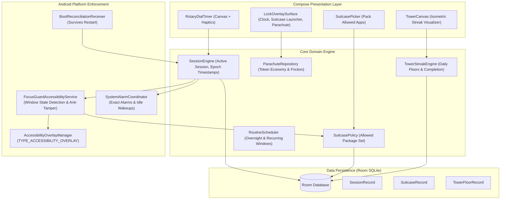

# FocusGuard — Implementation Plan: Reverse-Engineering & Reconstructing "blockit" (`com.hypenet.focused`)

**Target Package:** `com.hypenet.focused` (blockit: break phone addiction / Focused by Sgnoogle / Francesco Sgnaolin)  
**Analysis Framework:** Reverse Engineer Anything (REA)  
**Target Codebase:** [`FocusGuard` (`com.coder7475.focusguard`)](file:///home/fahad/AndroidStudioProjects/focusGuard)  
**Stack:** Kotlin 2.2 · Jetpack Compose · Material 3 · Room SQLite · AccessibilityService · minSdk 24 / targetSdk 37  
**Status:** Approved Architecture Plan  

---

## 1. REA Reverse-Engineering Dossier & Target Analysis

Using REA methodology across public distribution channels, binary telemetry disclosures, official documentation ([blockit-app.com](https://blockit-app.com)), technical reviews, and teardowns, we decompose `com.hypenet.focused` into observed mechanisms, architectural inferences, and platform unknowns.

### 1.1 Findings Ledger

| Feature / Subsystem | Evidence & Observed Behavior | Inferred Architecture & OS Primitives | Platform Constraints & Unknowns |
| :--- | :--- | :--- | :--- |
| **Rotary Dial Timer** | Tactile circular dial selector with discrete haptic clicks, inspired by Teenage Engineering / Braun analog hardware. | Custom Jetpack Compose `Canvas` with pointer input tracking polar angles `atan2(y, x)` and `Vibrator` / `HapticFeedbackConstants`. | Must handle continuous drag vs. discrete detent snapping with zero frame drops. |
| **The Suitcase** | User "packs" essential apps (Maps, Phone, Spotify, Notes) allowed during lockdown; remaining apps are locked. | Package manager query + Allowlist stored in Room / DataStore. Package names checked in Accessibility event stream. | Android 11+ package visibility: needs targeted `<queries>` or non-violating role resolutions. |
| **The Parachute** | Emergency exit mechanism. Sessions cannot be cancelled on a whim; exiting early burns a limited "parachute" token. | Persistent token count in Room SQLite. Multi-step confirmation dialog with deliberate delay. | Play Store in-app billing is required for purchasing tokens; clean-room implementation can provide local token bank or typing friction challenge. |
| **The Tower** | Gamified habit visualization: each successful day of focus stacks an architectural floor onto a growing tower. | Procedural / asset-based 2D isometric rendering in Compose. Daily completion evaluated against calendar days. | Handling timezone shifts, skipped days, and tower decay/streak rules. |
| **Lock Overlay** | Immediate lock screen takeover when attempting to open restricted apps; displays remaining time and Suitcase launcher. | `AccessibilityService` listens to `TYPE_WINDOW_STATE_CHANGED`. Overlays rendered via `TYPE_ACCESSIBILITY_OVERLAY` or task intent redirect. | Android 14/15 restrictions on background activity starts; `SYSTEM_ALERT_WINDOW` permissions. |
| **Self-Defense / Anti-Uninstall** | Users cannot casually force-stop or uninstall the app from System Settings during an active lock session. | Interception of `com.android.settings` foreground events matching the app's package name; redirects back to lock screen. | Play Store policy prohibits abusive un-uninstallability; requires dedicated in-app uninstall flow when not locked. |
| **Routines / Scheduled Windows** | Automated recurring lock windows (e.g., Bedtime 11:00 PM – 7:00 AM) activating unattended. | `AlarmManager.setExactAndAllowWhileIdle()` triggering a `BroadcastReceiver`, reconciling with Room. | OEM aggressive battery management (MIUI, OxygenOS, OneUI) killing alarms; needs autostart onboarding. |
| **Reboot Resilience** | Re-locks immediately after phone reboot if session has remaining time. | `BOOT_COMPLETED` receiver reads `endTimeEpochMs` from Room SQLite. Re-engages overlay if `currentTime < endTime`. | Android 15 FGS restrictions from boot; must wake accessibility service or start receiver. |

---

## 2. Design System & Aesthetics: Teenage Engineering Inspired

`blockit` derives its brand identity from physical industrial hardware (specifically Teenage Engineering, Braun, and Dieter Rams principles). FocusGuard will adopt this distinct visual language:

### 2.1 Color Palette & Typography
- **Backgrounds:** Matte Charcoal `#121214` (Dark mode) / Cool Off-White `#F2F3F5` (Light mode).
- **Surfaces & Cards:** Dark Gunmetal `#1C1D21` / Crisp White `#FFFFFF` with 1px border `#2A2B30`.
- **Primary Accent:** Safety Orange `#FF5500` / Signal Amber `#FFAA00` for active timers, focus states, and the parachute button.
- **Secondary Accent:** Electric Cyan `#00E5FF` for streak/tower completions.
- **Typography:** Monospaced and heavy grotesque sans-serif (e.g. Roboto Mono / Space Grotesk) with uppercase labels, tracking, and metric readouts.

### 2.2 Tactile Interaction Design
- **Rotary Detents:** Heavy haptic ticks (`HapticFeedbackType.TextHandleMove` or custom `VibrationEffect.createPrebaked`) triggering at discrete angle intervals (e.g. every 5 or 15 minutes).
- **Physical Switch Feel:** High-contrast toggle states, tactile spring animations (`spring(dampingRatio = Spring.DampingRatioMediumBouncy)`).

---

## 3. High-Level System Architecture



---

## 4. Phase-by-Phase Implementation Roadmap

### Phase 1: Design System & Rotary Wheel Component
**Goal:** Build the tactile dial timer that defines the app's signature user experience.
1. **Design Tokens:** Define `FocusGuardColors`, `FocusGuardTypography`, and `FocusGuardShapes` in `ui/theme/`.
2. **Rotary Wheel Composable (`RotaryDialTimer.kt`):**
   - Implement custom circular gesture tracker via `pointerInput` and `detectDragGestures`.
   - Calculate polar angle: $\theta = \operatorname{atan2}(y - c_y, x - c_x)$.
   - Snap values to discrete step increments (5m, 15m, 30m, 45m, 60m, 90m, 120m, up to 8h).
   - Integrate tactile haptics firing whenever passing a detent boundary.
   - Draw dial ticks, numerals, and an illuminated Safety Orange progress arc.
3. **Session Preset Bar:** Quick-select hardware-style buttons for 25m (Pomodoro), 45m, and Deep Work (90m).

---

### Phase 2: "The Suitcase" App Whitelisting Engine
**Goal:** Allow users to pre-pack essential tools before locking down the device.
1. **System Roles Resolver:**
   - Query default Telecom dialer (`TelecomManager.getDefaultDialerPackage()`).
   - Query default SMS application (`Telephony.Sms.getDefaultSmsPackage()`).
   - Hardcode emergency intent handlers (`ACTION_DIAL`, `ACTION_EMERGENCY_ASSISTANCE`).
2. **Suitcase App Selector Screen (`SuitcaseScreen.kt`):**
   - Query installed launcher applications using `PackageManager.queryIntentActivities(Intent(ACTION_MAIN).addCategory(CATEGORY_LAUNCHER))`.
   - Filter out FocusGuard and core system packages.
   - Display apps in a clean, categorized list (Communication, Productivity, Media, Utilities).
   - Persist selected package set in Room (`SuitcaseEntity`) or DataStore.
3. **Suitcase Quick Launcher:**
   - Composable displayed directly on the lock overlay allowing one-tap launching of packed apps without returning to the home screen.

---

### Phase 3: "The Parachute" & Anti-Tamper Subsystem
**Goal:** Prevent impulsive unlock while providing a disciplined escape valve.
1. **Token Economy:**
   - Store `parachuteCount` in encrypted DataStore or Room.
   - Start new users with 1 free Emergency Parachute.
   - Earning mechanics: Earn 1 Parachute for every 7 consecutive days of completed focus sessions (or custom configured interval).
2. **Emergency Exit Confirmation Modal (`ParachuteDialog.kt`):**
   - When user taps "Deploy Parachute", show a prominent warning.
   - Require a 10-second holding gesture or typing a mindful confirmation phrase (e.g. *"I am breaking my commitment"*).
   - Decrement parachute token count and record early exit in session history.
3. **Anti-Tamper & Settings Guard:**
   - In `FocusGuardAccessibilityService`, detect when `packageName == "com.android.settings"`.
   - Inspect event text/content description for "FocusGuard", "Force stop", or "Uninstall".
   - If user attempts to force-stop or uninstall FocusGuard during an active session, automatically execute `GLOBAL_ACTION_HOME` and display the lock overlay.
   - Safe uninstall button in FocusGuard settings when NO session is active.

---

### Phase 4: "The Tower" Gamified Habit Tracker
**Goal:** Visualize consistency and streaks with physical-style architectural progression.
1. **Tower Data Model:**
   - `TowerFloorEntity`: `date` (LocalDate), `minutesFocused`, `sessionCount`, `floorStyle` (Normal, Milestone, Penthouse), `completedSuccessfully` (Boolean).
2. **Streak Engine:**
   - Evaluate daily goal: e.g. at least 30 minutes of focus per day to complete that day's floor.
   - If day missed: display a broken/cracked foundation floor or reset current tower level.
3. **Tower Rendering Composable (`TowerView.kt`):**
   - Isometric or stylized 2D vertical building stack.
   - As days progress, floors stack upwards with animated placement and sound/haptic celebration.
   - Milestones at Day 7, Day 30, and Day 100 featuring unique architectural designs (spires, antennas, gardens).

---

### Phase 5: Enforcement Overlay & Session Engine
**Goal:** Deliver rock-solid lockdown that survives process death and restarts.
1. **Session Engine & Epoch Reconciliation:**
   - Calculate `endsAtEpochMs = System.currentTimeMillis() + durationMs`.
   - Save session as `ACTIVE` in Room database.
   - Schedule exact alarm via `AlarmManager.setExactAndAllowWhileIdle()` for `endsAtEpochMs`.
2. **Accessibility Enforcement Pipeline:**
   - `onAccessibilityEvent(event: AccessibilityEvent)`:
     ```kotlin
     val currentPackage = event.packageName?.toString() ?: return
     if (sessionEngine.isSessionActive()) {
         if (!suitcasePolicy.isAllowed(currentPackage)) {
             overlayManager.showLockOverlay()
         } else {
             overlayManager.hideLockOverlay()
         }
     }
     ```
3. **Full-Screen Compose Lock Overlay:**
   - Uses `WindowManager.LayoutParams.TYPE_ACCESSIBILITY_OVERLAY` (or `TYPE_APPLICATION_OVERLAY`).
   - Flags: `FLAG_NOT_TOUCH_MODAL | FLAG_LAYOUT_IN_SCREEN | FLAG_SHOW_WHEN_LOCKED`.
   - Displays live countdown timer, packed Suitcase app icons, motivational quote, and "Deploy Parachute" button.
4. **Boot Recovery:**
   - `BootReceiver` listening for `ACTION_BOOT_COMPLETED` and `ACTION_LOCKED_BOOT_COMPLETED`.
   - On boot, inspect `SessionDao.getActiveSession()`. If `System.currentTimeMillis() < session.endsAtEpochMs`, re-arm alarm and show overlay immediately.

---

### Phase 6: Automatic Routines & Home Screen Widget
**Goal:** Hands-free scheduled sessions and instant home screen control.
1. **Routine Scheduler:**
   - Configure recurring windows (e.g. Sleep Routine: 22:30 – 07:00, Work Routine: Mon–Fri 09:00 – 17:00).
   - Support overnight midnight-crossing calculation.
2. **Quick Glance Widget (`FocusGuardWidget.kt`):**
   - AppWidgetProvider / Jetpack Glance widget.
   - Display today's tower floor, current status (Idle / Focused), and a 1-tap quick start button.

---

## 5. Verification & Testing Matrix

| Scenario | Expected Behavior | Verification Method |
| :--- | :--- | :--- |
| **Open Distracting App** | Instantly obstructed by lock overlay; back/recents do not dismiss it. | Accessibility service automated UI test / Robolectric. |
| **Launch Packed App** | App in Suitcase opens normally without trigger overlay. | Window change event allowlist unit test. |
| **Emergency Call** | Phone dialer and incoming calls remain 100% accessible. | Role resolver intent integration test. |
| **Reboot Mid-Session** | Device reboots; lock overlay re-appears upon unlock if time remains. | ADB simulated boot test (`am broadcast -a android.intent.action.BOOT_COMPLETED`). |
| **Deploy Parachute** | Emergency token decremented; session cleanly ends early. | Room transaction and token balance assertions. |
| **Settings Tamper** | User navigates to Settings -> Apps -> FocusGuard -> blocked. | Simulated accessibility event on package `com.android.settings`. |

---

## 6. Implementation Deliverables Checklist

- [ ] **Step 1:** Add Room, DataStore, and KSP dependencies in `build.gradle.kts` and `libs.versions.toml`.
- [ ] **Step 2:** Implement Teenage Engineering design system tokens and colors in `ui/theme/`.
- [ ] **Step 3:** Implement `RotaryDialTimer` Compose component with polar angle gesture tracking and haptics.
- [ ] **Step 4:** Implement `SuitcaseRepository` and `SuitcasePickerScreen` for whitelisting essential apps.
- [ ] **Step 5:** Implement `ParachuteRepository` and emergency unlock friction dialogue.
- [ ] **Step 6:** Implement `TowerFloorEntity` and `TowerCanvas` for daily streak visualization.
- [ ] **Step 7:** Connect `FocusGuardAccessibilityService` with `OverlayController` and anti-tamper safeguards.
- [ ] **Step 8:** Configure `AlarmManager` and `BootReceiver` for wall-clock epoch reconciliation across device reboots.
