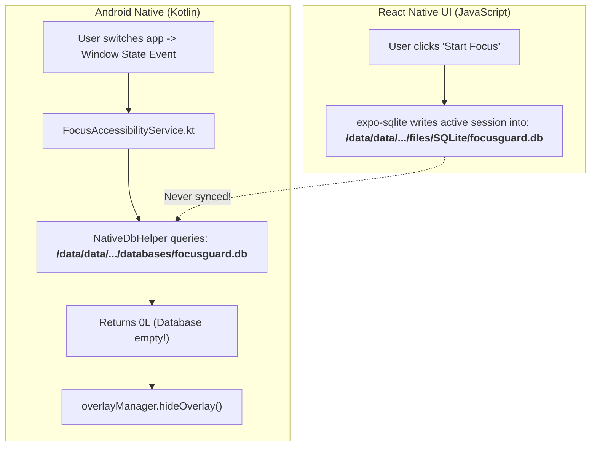

# FocusGuard App Blocking Bug Report & Fix Guide

> **Audience**: Developers & Maintainers  
> **Target App**: FocusGuard (`focusGuard`)  
> **Reference Baseline**: Kotlin Native Version (`archive/kotlin-jav`)  
> **Severity**: Critical (Core feature does not function on device)

---

## 1. What Is the Bug?

When you start a focus session in **FocusGuard**, the app interface displays a running countdown timer and a persistent foreground service notification appears in the status bar. 

However, **it does not actually block other apps**. If you leave FocusGuard and open YouTube, Chrome, Instagram, or any other app:
- No lock screen overlay appears.
- You can freely use any app on the phone without restriction.
- The app behaves as if blocking is completely disabled.

---

## 2. Why Is This Happening? (The Root Causes)

When comparing the React Native/Expo version (`focusGuard`) with the working Kotlin native version (`archive/kotlin-jav`), **four critical flaws** were identified:



### Cause 1: SQLite Database Path Mismatch (The Main Blocker)
* **What the UI does**: The React Native layer uses `expo-sqlite` to save active sessions into a database file named `focusguard.db`. On Android, `expo-sqlite` stores databases in the app's internal files directory:
  ```
  /data/user/0/com.coder7575.SleepGuard/files/SQLite/focusguard.db
  ```
* **What the native service does**: The background service ([`FocusAccessibilityService.kt`](file:///home/fahad/AndroidStudioProjects/focusGuard/focusGuard/modules/focus-enforcer/android/src/main/java/com/coder7575/sleepguard/enforcer/FocusAccessibilityService.kt#L32)) uses standard Android `SQLiteOpenHelper` via [`NativeDbHelper.kt`](file:///home/fahad/AndroidStudioProjects/focusGuard/focusGuard/modules/focus-enforcer/android/src/main/java/com/coder7575/sleepguard/enforcer/NativeDbHelper.kt#L7):
  ```kotlin
  class NativeDbHelper(context: Context) : SQLiteOpenHelper(context, "focusguard.db", null, 1)
  ```
  By default, Android's `SQLiteOpenHelper` looks in the `databases` directory:
  ```
  /data/user/0/com.coder7575.SleepGuard/databases/focusguard.db
  ```
* **Result**: The native accessibility service is reading from a completely empty database. `getActiveSessionEndsAt()` **always returns `0`**. Since `0 < currentTime`, the service assumes no session is active and immediately calls `overlayManager.hideOverlay()`.

---

### Cause 2: Native Accessibility Service Is Never Notified in Memory
In the original native version (`archive/kotlin-jav`), [`FocusGuardAccessibilityService.kt`](file:///home/fahad/AndroidStudioProjects/focusGuard/archive/kotlin-jav/app/src/main/java/com/coder7475/focusguard/service/accessibility/FocusGuardAccessibilityService.kt#L56-L65) maintained a live in-memory reference (`currentActiveSession`) and listened for session updates.

In the React Native version:
- When you tap "Start Focus", `SessionEngine.ts` calls `FocusEnforcer.startFocusLock(endsAtEpochMs)`.
- `FocusEnforcerModule.kt` alerts the **Foreground Service** and the **AlarmCoordinator**, but **never informs `FocusAccessibilityService`**.
- The Accessibility Service is left in the dark, forced to poll SQLite on every screen tap, which fails because of Cause 1.

---

### Cause 3: Missing Window Flags in `LockOverlayWindowManager.kt`
In [`LockOverlayWindowManager.kt`](file:///home/fahad/AndroidStudioProjects/focusGuard/focusGuard/modules/focus-enforcer/android/src/main/java/com/coder7575/sleepguard/enforcer/LockOverlayWindowManager.kt#L72-L82), the overlay window layout parameters are defined as:
```kotlin
val params = WindowManager.LayoutParams(
    WindowManager.LayoutParams.MATCH_PARENT,
    WindowManager.LayoutParams.MATCH_PARENT,
    WindowManager.LayoutParams.TYPE_ACCESSIBILITY_OVERLAY,
    WindowManager.LayoutParams.FLAG_LAYOUT_IN_SCREEN or
        WindowManager.LayoutParams.FLAG_SHOW_WHEN_LOCKED or
        WindowManager.LayoutParams.FLAG_KEEP_SCREEN_ON,
    PixelFormat.TRANSLUCENT
)
```
- Missing `FLAG_NOT_FOCUSABLE` and `FLAG_LAYOUT_NO_LIMITS`: Without proper flags on modern Android versions (Android 12–15), window tokens can be rejected or crash when rendered from an accessibility context.
- Double-attachment crash: If `showOverlay()` is called while the view is already attached, `windowManager.addView(...)` throws an uncaught `IllegalStateException: View already added`. The empty `catch (_: Exception) {}` block swallows this failure silently.

---

### Cause 4: Overly Sensitive App-Switching Logic
In `archive/kotlin-jav`, [`FocusGuardAccessibilityService.kt`](file:///home/fahad/AndroidStudioProjects/focusGuard/archive/kotlin-jav/app/src/main/java/com/coder7475/focusguard/service/accessibility/FocusGuardAccessibilityService.kt#L93-L106) specifically:
1. Ignored null/blank package names.
2. Ignored events coming from its own overlay window.
3. Cached `lastTargetPackage` to avoid screen flashing.

In the React Native version, every window event (including transient system dialogs and gesture navigation bar touches) causes immediate re-evaluation and rapid dismissal of the overlay.

---

## 3. Recommendations to Fix

1. **Synchronize Active Session in Memory (Direct IPC)**:
   Pass `endsAtEpochMs` directly to `FocusAccessibilityService` via a companion object or singleton when `startFocusLock` is called. Do not rely exclusively on disk I/O during time-critical window change events.
2. **Align Database Locations**:
   Point `NativeDbHelper` and `FocusDatabaseHelper` to the exact path `expo-sqlite` uses: `File(context.filesDir, "SQLite/focusguard.db")`.
3. **Refactor `LockOverlayWindowManager`**:
   Add proper window flags, prevent duplicate `addView()` calls, and add proper Android logging instead of empty catch blocks.
4. **Reinstate Target Filtering in `FocusAccessibilityService`**:
   Ignore internal overlay window events and avoid redundant hide/show cycles.

---

## 4. Step-by-Step Implementation Guide

### Step 1: Add In-Memory Session State to `FocusAccessibilityService.kt`

Open `focusGuard/modules/focus-enforcer/android/src/main/java/com/coder7575/sleepguard/enforcer/FocusAccessibilityService.kt` and update it to maintain a shared active timestamp:

```kotlin
class FocusAccessibilityService : AccessibilityService() {
    companion object {
        @Volatile
        var activeSessionEndsAt: Long = 0L
    }

    override fun onAccessibilityEvent(event: AccessibilityEvent?) {
        if (event == null || event.eventType != AccessibilityEvent.TYPE_WINDOW_STATE_CHANGED) {
            return
        }

        val targetPkg = event.packageName?.toString()
        if (targetPkg.isNullOrBlank() || targetPkg == packageName) {
            return
        }

        if (roleResolver.isAllowlisted(targetPkg)) {
            overlayManager.hideOverlay()
            return
        }

        // 1. Check in-memory state first, then fallback to database
        var targetEpoch = activeSessionEndsAt
        if (targetEpoch <= System.currentTimeMillis()) {
            targetEpoch = dbHelper.getActiveSessionEndsAt()
            activeSessionEndsAt = targetEpoch
        }

        if (targetEpoch > System.currentTimeMillis()) {
            overlayManager.setEndsAtEpochMs(targetEpoch)
            overlayManager.showOverlay()
        } else {
            overlayManager.hideOverlay()
        }
    }
}
```

---

### Step 2: Notify Accessibility Service from `FocusEnforcerModule.kt`

Open `focusGuard/modules/focus-enforcer/android/src/main/java/com/coder7575/sleepguard/enforcer/FocusEnforcerModule.kt` and update `startFocusLock` and `stopFocusLock`:

```kotlin
// In startFocusLock:
Function("startFocusLock") { endsAtEpochMs: Double ->
    val context = appContext.reactContext ?: return@Function false
    val epoch = endsAtEpochMs.toLong()
    FocusAccessibilityService.activeSessionEndsAt = epoch
    FocusForegroundService.start(context, epoch)
    AlarmCoordinator.scheduleSessionCompletion(context, epoch)
    true
}

// In stopFocusLock:
Function("stopFocusLock") {
    val context = appContext.reactContext ?: return@Function false
    FocusAccessibilityService.activeSessionEndsAt = 0L
    FocusForegroundService.stop(context)
    AlarmCoordinator.cancelSessionCompletion(context)
    true
}
```

---

### Step 3: Fix SQLite Path in `NativeDbHelper.kt`

Open `focusGuard/modules/focus-enforcer/android/src/main/java/com/coder7575/sleepguard/enforcer/NativeDbHelper.kt` and point it to the directory managed by `expo-sqlite`:

```kotlin
package com.coder7575.sleepguard.enforcer

import android.content.Context
import android.database.sqlite.SQLiteDatabase
import java.io.File

class NativeDbHelper(private val context: Context) {

    private fun getReadableDatabase(): SQLiteDatabase? {
        val dbFile = File(context.filesDir, "SQLite/focusguard.db")
        if (!dbFile.exists()) return null
        return try {
            SQLiteDatabase.openDatabase(dbFile.absolutePath, null, SQLiteDatabase.OPEN_READONLY)
        } catch (_: Exception) {
            null
        }
    }

    fun getActiveSessionEndsAt(): Long {
        val db = getReadableDatabase() ?: return 0L
        return try {
            val cursor = db.rawQuery(
                "SELECT endsAtEpochMs FROM focus_sessions WHERE status = 'ACTIVE' LIMIT 1",
                null
            )
            var targetEpoch = 0L
            if (cursor.moveToFirst()) {
                targetEpoch = cursor.getLong(0)
            }
            cursor.close()
            db.close()
            targetEpoch
        } catch (_: Exception) {
            db.close()
            0L
        }
    }
}
```

---

### Step 4: Fix Overlay Flags in `LockOverlayWindowManager.kt`

Open `focusGuard/modules/focus-enforcer/android/src/main/java/com/coder7575/sleepguard/enforcer/LockOverlayWindowManager.kt` and update `showOverlay()`:

```kotlin
val params = WindowManager.LayoutParams(
    WindowManager.LayoutParams.MATCH_PARENT,
    WindowManager.LayoutParams.MATCH_PARENT,
    WindowManager.LayoutParams.TYPE_ACCESSIBILITY_OVERLAY,
    WindowManager.LayoutParams.FLAG_LAYOUT_IN_SCREEN or
        WindowManager.LayoutParams.FLAG_LAYOUT_NO_LIMITS or
        WindowManager.LayoutParams.FLAG_SHOW_WHEN_LOCKED or
        WindowManager.LayoutParams.FLAG_NOT_TOUCH_MODAL or
        WindowManager.LayoutParams.FLAG_KEEP_SCREEN_ON,
    PixelFormat.TRANSLUCENT
).apply {
    gravity = Gravity.FILL
}
```

Make sure that `showOverlay()` safely checks `if (isVisible || overlayView != null) return` to avoid `View already added` crashes.

---

### Step 5: Verification & Testing Checklist

1. **Rebuild the development client**:
   ```bash
   cd focusGuard
   npx expo run:android
   ```
2. **Grant Accessibility Service**:
   Go to **Settings > Accessibility > Downloaded Apps > SleepGuard / FocusGuard** and toggle ON.
   *(On Android 13+, if grayed out, enable "Allow restricted settings" in App Info).*
3. **Start a 1-Minute Session**:
   Tap "Start Focus" on the home dial.
4. **Open a Non-Allowed App**:
   Open Chrome, Settings, or YouTube. The full-screen lock overlay with the red countdown timer and "EMERGENCY CALL" button should immediately appear over the app.
5. **Test Whitelisted Features**:
   Tap "EMERGENCY CALL". The native phone dialer should open cleanly without being blocked.
