# FocusGuard Mobile Architecture, Performance & Native Quality Audit

**Auditor:** Mobile App Builder (Native Android & Cross-Platform Specialist)  
**Date:** November 10, 2026  
**Target Codebase:** `focusGuard` (React Native 0.88.1 / Expo SDK 58 CNG / Custom Kotlin Enforcer)  
**Scope:** Native Android Integration, Battery & Thermal Efficiency, React Native / Expo Architecture, Lock Resilience, UI/UX Ergonomics, and Google Play Store Compliance.

---

## Executive Summary

FocusGuard is a privacy-first, un-dismissible focus and sleep discipline lock application built on React Native 0.88, Expo SDK 58 (Continuous Native Generation - CNG), and a dedicated bare-metal Android module (`focus-enforcer`).

The foundational architecture is sound:
1. **Zero-Network Privacy By Design**: Zero network permissions declared in the manifest, zero remote analytics tracking, and `canRetrieveWindowContent="false"` in accessibility configuration.
2. **Dual-Layer Persistence**: Writes to `focusguard.db` via `expo-sqlite` in WAL mode while exposing direct read access via SQLite C/Java bindings (`NativeDbHelper.kt`) so native Android components can verify lock state on boot or background alarms without booting the Hermes JavaScript runtime.
3. **Modern Engine Alignment**: Utilizes the React Native New Architecture (`newArchEnabled=true`, Hermes bytecode pre-compilation, typed routes with Expo Router v4, and React 19 Compiler support).

However, this audit uncovered **critical performance, battery drain, and system-level lock traps** in the native layer that require immediate remediation before production deployment.

---

## System Architecture Diagram

```mermaid
graph TD
    subgraph UI & Domain Layer (Hermes JS Engine)
        UI[React 19 / React Native 0.88 Screens]
        Engines[SessionEngine & ScheduleEngine]
        Storage[expo-sqlite WAL & SecureStore]
    end

    subgraph Native Android Runtime (Kotlin)
        Module[FocusEnforcerModule Expo TurboModule]
        A11y[FocusAccessibilityService]
        FGS[FocusForegroundService]
        Alarm[AlarmCoordinator / AlarmManager]
        Boot[BootReceiver]
        Overlay[LockOverlayWindowManager]
        NativeDB[NativeDbHelper SQLite WAL direct read]
    end

    UI --> Engines
    Engines --> Storage
    Engines --> Module
    Module --> A11y
    Module --> FGS
    Module --> Alarm
    Boot --> NativeDB
    A11y --> NativeDB
    A11y --> Overlay
```

---

## Detailed Audit Findings

### 1. Critical Defects & High-Severity Vulnerabilities

#### 🚨 Finding 1.1: Extreme Battery Drain via 1Hz Foreground Notification Posting
* **File:** `focusGuard/modules/focus-enforcer/android/src/main/java/com/coder7575/sleepguard/enforcer/FocusForegroundService.kt` (Lines 136–151)
* **Severity:** Critical (Blocks `< 5% / hour` battery consumption target)
* **Description:**
  Inside `FocusForegroundService.startTicker()`, the service executes a `Runnable` loop posting an updated notification through `notificationManager.notify(NOTIFICATION_ID_TRACKER, ...)` every **1,000 milliseconds**:
  ```kotlin
  tickerRunnable = object : Runnable {
      override fun run() {
          val remainingMs = endsAtEpochMs - System.currentTimeMillis()
          if (remainingMs <= 0L) {
              onSessionCompleted()
          } else {
              val formatted = formatRemainingTime()
              notificationManager.notify(NOTIFICATION_ID_TRACKER, buildTrackerNotification(formatted))
              handler.postDelayed(this, 1000L)
          }
      }
  }
  ```
* **Impact:**
  - Prevents the Android SoC from entering low-power CPU idle states (C-states).
  - Triggers repeated SystemUI IPC calls, re-rendering the status bar and notification shade every second.
  - On Android 12+, frequent notification posting triggers OS rate limiting, notification throttling, and high system thermal penalties.
* **Platform-Native Solution:**
  Android provides native chronometer countdown rendering directly inside `NotificationCompat.Builder` without requiring background loops or repeated notifications:
  ```kotlin
  val notification = NotificationCompat.Builder(this, CHANNEL_ID_TRACKER)
      .setSmallIcon(android.R.drawable.ic_lock_idle_lock)
      .setContentTitle("SleepGuard Active")
      .setContentText("Focus lock active")
      .setUsesChronometer(true)
      .setChronometerCountDown(true)
      .setWhen(endsAtEpochMs)
      .setOngoing(true)
      .setOnlyAlertOnce(true)
      .setContentIntent(pendingIntent)
      .setPriority(NotificationCompat.PRIORITY_LOW)
      .build()
  ```
  The countdown updates smoothly at 60 FPS natively in SystemUI while the background service sleeps until `AlarmManager` fires at `endsAtEpochMs`.

---

#### 🚨 Finding 1.2: Permanent Overlay Trap on Session Expiration
* **Files:**
  - `focusGuard/modules/focus-enforcer/android/src/main/java/com/coder7575/sleepguard/enforcer/FocusAccessibilityService.kt` (Line 31)
  - `focusGuard/modules/focus-enforcer/android/src/main/java/com/coder7575/sleepguard/enforcer/LockOverlayWindowManager.kt` (Lines 95–103)
  - `focusGuard/modules/focus-enforcer/android/src/main/java/com/coder7575/sleepguard/enforcer/AlarmReceiver.kt` (Lines 8–12)
* **Severity:** Critical (Device lockup on session completion)
* **Description:**
  When a focus session expires naturally:
  1. `AlarmReceiver` receives `ACTION_SESSION_EXPIRED` and stops `FocusForegroundService`. It **does not reset** `FocusAccessibilityService.activeSessionEndsAt` or signal `LockOverlayWindowManager.hideOverlay()`.
  2. In `LockOverlayWindowManager.kt`, the countdown ticks down to `00:00:00` but never dismisses `overlayView`.
  3. In `FocusAccessibilityService.kt`:
     ```kotlin
     if (targetPkg == lastTargetPackage && overlayManager.isVisible) {
         return // Skips evaluation completely!
     }
     ```
     Because the user remains on the blocked application, `targetPkg == lastTargetPackage` is true and `overlayManager.isVisible` is true. Any incoming accessibility events are immediately dropped before the service checks whether the lock has expired.
* **Impact:** The user is permanently locked behind the full-screen window overlay even though the session time has expired.
* **Platform-Native Solution:**
  - In `LockOverlayWindowManager.kt`, auto-dismiss the overlay window when remaining time reaches `<= 0L`:
    ```kotlin
    if (remaining <= 0L) {
        hideOverlay()
        return
    }
    ```
  - In `AlarmReceiver.kt`, broadcast a termination signal to `FocusAccessibilityService` or reset `FocusAccessibilityService.activeSessionEndsAt = 0L` and invoke `hideOverlay()`.

---

#### ⚠️ Finding 1.3: Continuous Disk I/O on Every Window Event When Idle
* **File:** `focusGuard/modules/focus-enforcer/android/src/main/java/com/coder7575/sleepguard/enforcer/FocusAccessibilityService.kt` (Lines 43–48)
* **Severity:** High (System-wide UI stutter & background battery waste)
* **Description:**
  ```kotlin
  var activeTarget = activeSessionEndsAt
  if (activeTarget <= System.currentTimeMillis()) {
      activeTarget = dbHelper.getActiveSessionEndsAt()
      activeSessionEndsAt = activeTarget
  }
  ```
  When FocusGuard has **no active session**, `activeSessionEndsAt` is `0L`.
  Whenever the user uses their device normally (switching tabs in Chrome, opening Settings, launching Camera, receiving a message), an accessibility window state event triggers. Because `0L <= currentTimeMillis()` is always true, `dbHelper.getActiveSessionEndsAt()` is called on **every single window transition**, opening `focusguard.db`, executing a SQLite query, and closing the database file.
* **Impact:** Continuous disk I/O and CPU overhead during normal device use outside of any focus session.
* **Platform-Native Solution:**
  Maintain an explicit state variable (e.g. `hasPersistedActiveSession: Boolean` or cached query timestamp) updated only when:
  1. `FocusEnforcerModule.startFocusLock` is called.
  2. `FocusEnforcerModule.stopFocusLock` is called.
  3. `BootReceiver` initializes on startup.

---

#### ⚠️ Finding 1.4: Scheduled Routines Lack Background Execution Mechanisms
* **Files:**
  - `focusGuard/src/domain/ScheduleEngine.ts`
  - `focusGuard/src/app/(tabs)/schedules.tsx`
* **Severity:** Medium / High (Missing core feature functionality)
* **Description:**
  `ScheduleEngine.ts` implements thorough logic for calculating routine active windows and overnight schedules (`computeNextStart`, `computeActiveWindowEnd`, `isInsideScheduleWindow`).
  However, while users can create and toggle routines in `schedules.tsx`, **neither Android AlarmManager nor WorkManager is ever scheduled**.
* **Impact:** Scheduled focus sessions (such as "Night Sleep Lock") will never trigger automatically unless the user manually opens the application while inside the schedule window.
* **Platform-Native Solution:**
  Implement a `ScheduleCoordinator.kt` (or WorkManager background worker) that queries active schedules from SQLite and schedules exact alarms (`AlarmManager.setExactAndAllowWhileIdle`) for the next schedule window onset.

---

### 2. Code Quality, Build Configuration & Optimization

#### 2.1 Missing ProGuard / R8 Protection for Native Enforcer Classes
* **File:** `focusGuard/android/app/proguard-rules.pro`
* **Status:** `android.enableMinifyInReleaseBuilds=true` is enabled in `gradle.properties`.
* **Risk:** The custom native module `com.coder7575.sleepguard.enforcer.*` is referenced via Android manifest strings, reflection, and Expo module autolinking. Without explicit keep rules, R8 optimizations in release APKs can strip methods, obfuscate class names, or break Expo Module reflection.
* **Remedy:** Add the following rules to `focusGuard/android/app/proguard-rules.pro`:
  ```proguard
  # FocusGuard Native Enforcer Module
  -keep class com.coder7575.sleepguard.enforcer.** { *; }
  -keepclassmembers class com.coder7575.sleepguard.enforcer.** { *; }
  ```

#### 2.2 Unused Duplicate File
* **File:** `focusGuard/modules/focus-enforcer/android/src/main/java/com/coder7575/sleepguard/enforcer/FocusDatabaseHelper.kt`
* **Finding:** Identical 42-line duplicate of `NativeDbHelper.kt`. It is unreferenced in both Kotlin code and the Expo module definition.
* **Remedy:** Delete `FocusDatabaseHelper.kt` to prevent maintenance confusion.

#### 2.3 Allowlist Role Misclassification
* **File:** `focusGuard/modules/focus-enforcer/android/src/main/java/com/coder7575/sleepguard/enforcer/SystemRoleResolver.kt` (Line 83)
* **Finding:** `"com.miui.home"` (Xiaomi MIUI/HyperOS launcher) is listed under `OEM_DIALER_PACKAGES` instead of `OEM_LAUNCHER_PACKAGES`.
* **Remedy:** Move `"com.miui.home"` to `OEM_LAUNCHER_PACKAGES`.

---

### 3. UI/UX & Mobile Ergonomics Evaluation

| Component / Screen | Assessment | Mobile UX Recommendation |
| :--- | :--- | :--- |
| **Rotary Dial** (`RotaryDial.tsx`) | Excellent gesture responsiveness via `react-native-gesture-handler` and `react-native-reanimated`. Discrete snapping to intervals with haptic feedback (`expo-haptics`). | Add accessibility props (`accessibilityRole="adjustable"`, `accessibilityValue`) to comply with accessibility standards. |
| **Lock Overlay** (`LockOverlayWindowManager.kt`) | Functional full-screen layout utilizing raw Android `LinearLayout` with high z-index `TYPE_ACCESSIBILITY_OVERLAY`. | Apply rounded corner card styling, an icon asset, and responsive display metrics (`TypedValue.applyDimension`) for various device densities. |
| **Onboarding Diagnostics** (`onboarding.tsx`) | Excellent guided workflow explaining Android 13+ "Restricted Settings" with direct intents to Application Details and System Settings. | Add auto-advancement when all required permissions are confirmed granted. |
| **Visual Theming** | Industrial dark palette (`#121316` base, `#FF5722` safety orange accent, `#E6F4FE` text). High contrast meets WCAG AAA guidelines for low-light bedtime use. | Preserved across all screens and components. |

---

### 4. Google Play Store Compliance Guidelines

If submitting FocusGuard to the Google Play Store, prepare for strict policy enforcement regarding high-privilege Android permissions:

1. **Accessibility API (`BIND_ACCESSIBILITY_SERVICE`)**:
   - Google Play restricts Accessibility Services to disability support or specific well-defined safety/discipline tools.
   - An upfront, prominent in-app disclosure must be displayed before directing users to Android Settings.
   - The disclosure must clearly state: (1) FocusGuard uses AccessibilityService to detect foreground app packages and display a lock screen during user-initiated focus sessions; (2) it does not collect or inspect text or screen content (`canRetrieveWindowContent = false`).
2. **Exact Alarm Permission (`SCHEDULE_EXACT_ALARM` / `USE_EXACT_ALARM`)**:
   - FocusGuard qualifies as a timer/disciplining alarm tool. Specify this in the Google Play Console declaration.
3. **Foreground Service Special Use (`specialUse`)**:
   - Manifest declares `android:foregroundServiceType="specialUse"` with `PROPERTY_SPECIAL_USE_FGS_SUBTYPE`.
   - Prepare a brief video recording demonstrating the persistent status-bar lock countdown for the review team.

---

## 5. Prioritized Remediation Roadmap & Verification Status

```mermaid
flowchart TD
    Phase1[Phase 1: Critical Fixes & Stability - SOLVED & TESTED] --> Task1[Replace 1Hz Notification Ticker with Chronometer ✓]
    Phase1 --> Task2[Auto-dismiss Overlay on Timer Expiration ✓]
    Phase1 --> Task3[Eliminate Idle SQLite Queries in AccessibilityService ✓]

    Phase2[Phase 2: Routine Automation & Release Hardening - SOLVED & TESTED] --> Task4[Implement ScheduleCoordinator with AlarmManager ✓]
    Phase2 --> Task5[Add ProGuard Keep Rules for Enforcer Module ✓]

    Phase3[Phase 3: Code Cleanup - SOLVED & TESTED] --> Task6[Delete Duplicate FocusDatabaseHelper.kt ✓]
    Phase3 --> Task7[Fix Xiaomi Launcher Allowlist Entry ✓]

    Phase4[Phase 4: Verification Gates - ALL GREEN] --> Gate1[TypeScript Compiler: Clean ✓]
    Phase4 --> Gate2[ESLint: 0 warnings, 0 errors ✓]
    Phase4 --> Gate3[Jest: 5 test suites, 27 tests passed ✓]
    Phase4 --> Gate4[Gradle Native Kotlin Unit Tests: 2 suites, 9 tests passed ✓]
    Phase4 --> Gate5[Security Pass: Secrets, Permissions, IPC & SQL Injection: Clean ✓]
```



### Remediation Status & Verification Sign-Off

1. **`FocusForegroundService.kt`** [RESOLVED]:
   - Eliminated the 1Hz notification manager wake loop.
   - Migrated to native `NotificationCompat.Builder` chronometer countdown (`setUsesChronometer(true)`, `setChronometerCountDown(true)`, `setWhen(endsAtEpochMs)`).
   - Replaced repeated `handler.postDelayed` with a single completion callback for battery-neutral execution.
2. **`LockOverlayWindowManager.kt` & `AlarmReceiver.kt`** [RESOLVED]:
   - Added automatic `hideOverlay()` invocation when remaining time reaches `<= 0L`.
   - Upgraded overlay layout with responsive card styling (`TypedValue.applyDimension`), 20dp corner radius, industrial dark palette, and high-visibility countdown.
   - Updated `AlarmReceiver` and `FocusAccessibilityService.clearActiveSession()` to immediately dismiss overlays upon alarm expiration.
3. **`FocusAccessibilityService.kt`** [RESOLVED]:
   - Eliminated SQLite disk I/O on window changes outside sessions. Cached in-memory timestamp and added `DB_RECHECK_COOLDOWN_MS` throttle (30s) during idle device usage.
   - Fixed the `targetPkg == lastTargetPackage && overlayManager.isVisible` lock trap by ensuring expired sessions are not dropped.
4. **`ScheduleCoordinator.kt` & Routine Automation** [RESOLVED]:
   - Implemented `ScheduleCoordinator` using Android `AlarmManager.setExactAndAllowWhileIdle`.
   - Added native routine window evaluation for both intraday and overnight schedules.
   - Added `getEnabledSchedules()`, `recordSessionActive()`, and `markActiveSessionsCompleted()` to `NativeDbHelper`.
   - Connected `schedules.tsx` via `FocusEnforcer.rescheduleRoutines()` to keep native background alarms in sync.
   - Updated `BootReceiver` to reschedule routine alarms upon device boot.
5. **Mobile Ergonomics & Accessibility** [RESOLVED]:
   - `RotaryDial.tsx`: Added accessibility attributes (`accessible={true}`, `accessibilityRole="adjustable"`, `accessibilityValue`, and increment/decrement actions).
   - `onboarding.tsx`: Added auto-advancement when all 4 core permissions are confirmed granted.
6. **Code Cleanup & ProGuard Protection** [RESOLVED]:
   - Added `-keep class com.coder7575.sleepguard.enforcer.** { *; }` and members keep rules to `proguard-rules.pro` and `withFocusEnforcer.js`.
   - Deleted unused duplicate `FocusDatabaseHelper.kt`.
   - Moved `"com.miui.home"` from `OEM_DIALER_PACKAGES` to `OEM_LAUNCHER_PACKAGES` in `SystemRoleResolver.kt`.
7. **Quality & Verification Gates** [ALL GREEN]:
   - **TypeScript Gate**: `pnpm tsc --noEmit` passed with 0 errors.
   - **Linter Gate**: `expo lint` passed with 0 errors.
   - **JS / React Native Test Gate**: 5 test suites (27 tests) passed.
   - **Native Android Test Gate**: 2 test suites (9 tests in `ScheduleCoordinatorTest` and `SystemRoleResolverTest`) passed with 100% success rate.
   - **Security Pass Gate**: Zero hardcoded secrets, zero-network permissions preserved, `canRetrieveWindowContent="false"` intact, all PendingIntents flagged `FLAG_IMMUTABLE`, and SQLite parameterized queries verified.
