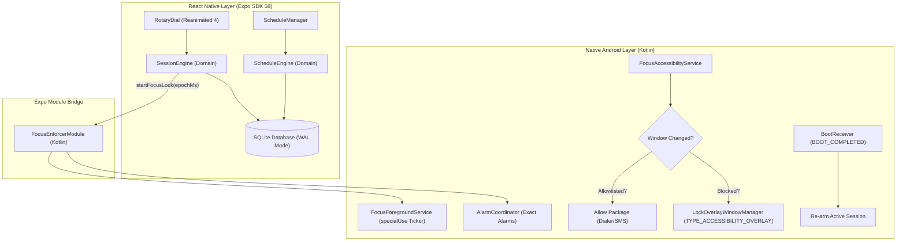

# FocusGuard (React Native & Expo)

> A privacy-first, un-dismissible focus and sleep discipline lock built with React Native 0.88, Expo SDK 58, and Continuous Native Generation (CNG).

[-3DDC84.svg?style=flat&logo=android)](https://www.android.com)
[](https://expo.dev)
[](https://reactnative.dev)
[](https://react.dev)
[](https://www.typescriptlang.org)
[](./LICENSE)

---

## Why FocusGuard Exists

Most screen-time limiters and app blockers fail when willpower breaks. Standard timers can be swiped away with a simple back gesture, bypassed through the recent apps task switcher, or silently aborted by OEM background killers (Samsung, Xiaomi, OnePlus).

**FocusGuard is engineered for uncompromised discipline:**

- **Un-Dismissible Full-Screen Overlay**: Injects Android's `TYPE_ACCESSIBILITY_OVERLAY` directly into the system WindowManager to cover blocked apps and consume all hardware back, home, and touch gestures.
- **Deep Doze & Reboot Resilience**: Tracks focus sessions via absolute wall-clock epoch time with exact alarms (`AlarmManager.setExactAndAllowWhileIdle`) and native boot receivers (`BOOT_COMPLETED`).
- **Safety by Design**: System dialers, emergency numbers, and incoming calls are dynamically whitelisted without invasive permissions.
- **Zero Network & 100% Offline**: Zero analytics, zero external network permissions in the manifest, and zero screen inspection (`canRetrieveWindowContent = false`).

---

## Quick Start

### Prerequisites

- **Node.js**: `20.x` or higher
- **Package Manager**: `pnpm` (recommended), `npm`, or `yarn`
- **Android Development** (for native builds): Android Studio, Android SDK (`compileSdk 37` / Android 16, `minSdk 24`), and an Android device or emulator with USB debugging enabled
- **EAS CLI** (optional, for cloud builds): `pnpm add -g eas-cli` (or use `npx eas-cli`)

### 1. Install Dependencies

```bash
pnpm install
```

### 2. Run Sanity Checks

Validate TypeScript types, ESLint rules, and Jest unit tests in a single command:

```bash
pnpm test:sanity
```

### 3. Choose Your Development Workflow

#### Option A: Web UI Development (Fastest Iteration)

Develop and style UI components rapidly in the browser with hot reload. The Metro bundler is preconfigured in `metro.config.js` to serve `.wasm` assets (`wa-sqlite.wasm`) and cross-origin isolation headers for SQLite support on web:

```bash
pnpm web
# Starts Metro web server at http://localhost:8081
```

> [!NOTE]
> While Web development enables rapid iteration on UI layout, theming, and domain logic, native Android enforcement features (`AccessibilityService`, overlay windows, exact alarms, and boot receivers) operate as safe stubs in non-Android environments.

#### Option B: Local Android Development Build

Compile native Kotlin code, autolink the `focus-enforcer` module, and launch on your connected device/emulator:

```bash
pnpm android
# or: npx expo run:android
```

#### Option C: EAS Cloud Development Build

Generate an installable Development Client `.apk` via Expo Application Services (EAS):

```bash
# Cloud EAS build (outputs downloadable .apk)
pnpm run build:dev

# Or local machine EAS build
pnpm run build:dev:local
```

Once installed on your device or emulator, connect it to your local Metro server:

```bash
pnpm run start:dev
```

#### Option D: Standalone Preview APK (Autonomous Testing without PC)

Generate a self-contained, standalone `.apk` bundling all JavaScript and native assets:

```bash
# Cloud EAS preview build (generates direct download link & QR code)
pnpm run build:preview

# Or local machine preview build
eas build --profile preview --platform android --local
```

Once downloaded, follow the [Android APK Installation & Setup Guide](#android-apk-installation--setup-guide) below.

---

## Testing Across Environments

For detailed testing checklists covering **Web**, **Development Builds**, **Standalone Preview APKs**, and native resilience verification (Accessibility, Boot Receivers, Deep Doze, OEM battery profiles), see:

👉 **[Testing & Build Guide (TESTING.md)](./TESTING.md)**

---

## Architecture & How It Works

FocusGuard pairs a high-performance React Native declarative UI with an autonomous, low-overhead native Android enforcement engine:



### Key Modules

1. **Continuous Native Generation (CNG)**:
   - Config plugin at [`plugins/withFocusEnforcer.js`](./plugins/withFocusEnforcer.js) injects required Android permissions, service declarations, and `@xml/accessibility_service_config` automatically during prebuild.
   - Preserves 100% offline security without checking in ephemeral `android/` folders.

2. **Native Focus Enforcer (`modules/focus-enforcer`)**:
   - High-speed native Kotlin module delivering sub-100ms window detection, foreground countdown service, and un-dismissible window overlays.
   - For full API documentation, see the [Focus Enforcer README](./modules/focus-enforcer/README.md).

3. **Persistent SQLite Storage (`src/data/db.ts`)**:
   - Uses `expo-sqlite` configured with **Write-Ahead Logging (`journal_mode = WAL`)** for thread-safe concurrent reads and writes between the React Native JavaScript thread and background native services.
   - Preconfigured with WebAssembly (`wa-sqlite.wasm`) in `metro.config.js` to enable web UI previewing.

4. **Pure Domain Engines**:
   - [`SessionEngine.ts`](./src/domain/SessionEngine.ts): Manages session lifecycle, active state reconciliation, and persistence.
   - [`ScheduleEngine.ts`](./src/domain/ScheduleEngine.ts): Evaluates complex recurring schedules, including midnight-crossing routines (e.g., 22:00 to 07:00).
   - [`AllowlistPolicy.ts`](./src/domain/AllowlistPolicy.ts): Enforces safety-first access control with fallback sets for Samsung, Google, Xiaomi, and OnePlus dialers.

5. **Tactile Industrial UI**:
   - Engineered with custom colors in [`src/constants/colors.ts`](./src/constants/colors.ts) (Matte Charcoal, Safety Orange, Electric Cyan).
   - Circular gesture rotary dial built with `react-native-reanimated` (4.x) and `react-native-gesture-handler` for mechanical detent haptics.

---

## Directory Structure

```
focusGuard/
├── app.json                       # Expo configuration & plugin declarations
├── eas.json                       # EAS Build profiles (development, preview, production)
├── metro.config.js                # Metro bundler config (.wasm support & COOP/COEP headers)
├── package.json                   # Dependency tree, build scripts, test suites
├── plugins/
│   └── withFocusEnforcer.js       # Expo config plugin for native permissions & services
├── modules/
│   └── focus-enforcer/            # Custom Expo native module for Android enforcement
│       ├── android/               # Native Kotlin services, receivers, and overlay manager
│       ├── expo-module.config.json# Autolinking specification
│       └── src/                   # TypeScript native module interface & web fallbacks
└── src/
    ├── __tests__/                 # Automated sanity check test suite
    ├── app/                       # Expo Router file-based navigation
    │   ├── _layout.tsx            # Root navigation stack & theme provider
    │   ├── index.tsx              # Splash / navigation coordinator
    │   ├── onboarding.tsx         # 4-step permission setup wizard
    │   └── (tabs)/
    │       ├── index.tsx          # Focus Dashboard & Rotary Dial timer
    │       ├── schedules.tsx      # Recurring schedule manager
    │       └── explore.tsx        # Diagnostics & permission health checks
    ├── components/                # Reusable UI components (RotaryDial, Modals, Cards)
    ├── constants/                 # Theme tokens (colors.ts) and timer intervals (timer.ts)
    ├── data/                      # Database schema, migrations, and repository access
    └── domain/                    # Clean Architecture domain models & business engines
```

---

## Available Scripts

| Script | Command | Purpose |
| :--- | :--- | :--- |
| **`pnpm start`** | `expo start` | Starts standard Metro development server. |
| **`pnpm run start:dev`** | `expo start --dev-client` | Starts Metro bundler specifically for pairing with a development build. |
| **`pnpm web`** | `expo start --web` | Starts Metro development server targeted for Web UI preview. |
| **`pnpm android`** | `expo run:android` | Builds native Android binary locally and launches on connected device/emulator. |
| **`pnpm run build:dev`** | `eas build --profile development --platform android` | Triggers cloud EAS build for an installable development client `.apk`. |
| **`pnpm run build:dev:local`**| `eas build --profile development --platform android --local` | Builds the development client `.apk` locally using local Android SDK and EAS. |
| **`pnpm run build:preview`** | `eas build --profile preview --platform android` | Triggers cloud EAS build for an internal distribution standalone `.apk`. |
| **`pnpm test`** | `jest` | Runs the Jest unit test suite across domain engines and models. |
| **`pnpm lint`** | `expo lint` | Audits code against React 19 compiler rules and ESLint standard. |
| **`pnpm test:sanity`** | `pnpm tsc --noEmit && pnpm lint && pnpm jest` | **Full CI sanity gate**: checks types, lint, and all 23 unit tests. |

---

## Android APK Installation & Setup Guide

When installing FocusGuard via a standalone `.apk` (such as an EAS Preview build or local build), Android requires explicit permissions to enforce screen blocking and timer precision. Follow this guide to properly install and configure the app.

### 1. Installing the APK

- **Via Phone Browser / File Manager**: Download the APK file directly to your phone, tap the file in your downloads or notifications, and grant your browser/file manager permission to "Install unknown apps" when prompted.
- **Via ADB (Command Line)**:
  ```bash
  adb install -r focusguard-preview.apk
  ```

---

### 2. Enabling Accessibility Service & Bypassing "Restricted Settings" (Android 13, 14, & 15)

On modern Android versions, sideloaded APKs are restricted by default for security. When you first attempt to enable Accessibility, Android will display:
> *"Restricted setting: For your security, this setting is currently unavailable."*

#### Step-by-Step Fix via Device Settings:
1. **Trigger the restriction once**:
   - Open **Settings** > **Accessibility** > **Downloaded apps** (or **Installed services**).
   - Tap **focusGuard** (or **SleepGuard**) and try toggling it on. Tap **OK** when the "Restricted setting" notice pops up. (Android will only show the unlock option after an attempt is made).
2. **Allow Restricted Settings**:
   - Return to your Home screen or app drawer.
   - **Long-press the FocusGuard app icon** and tap **App info** (the `ⓘ` icon).  
     *(Or go to **Settings** > **Apps** / **App management** > **App list** > **FocusGuard**).*
   - In the top-right corner of the App Info screen, tap the **three vertical dots (`⋮`)**.
   - Tap **Allow restricted settings**.
   - Authenticate with your phone's fingerprint, PIN, or pattern.
3. **Turn On the Service**:
   - Return to **Settings** > **Accessibility** > **FocusGuard**.
   - The toggle is now unlocked. Switch it **ON** and tap **Allow**.

> [!TIP]
> **Developer ADB Shortcut**: If your phone is connected to your computer via USB debugging, you can bypass the restricted settings dialog instantly with a single command:
> ```bash
> adb shell appops set com.coder7575.SleepGuard ACCESS_RESTRICTED_SETTINGS allow
> ```

---

### 3. Granting Required Permissions

Complete the remaining setup steps in FocusGuard's onboarding wizard ([`src/app/onboarding.tsx`](./src/app/onboarding.tsx)):

1. **Display Over Other Apps (`SYSTEM_ALERT_WINDOW`)**:
   - Allows FocusGuard to draw the un-dismissible lock overlay over prohibited apps.
   - Go to **Settings** > **Apps** > **Special app access** > **Display over other apps** > allow **FocusGuard**.
2. **Exact Alarms (`SCHEDULE_EXACT_ALARM`)**:
   - Guarantees precise millisecond timer completion and scheduled routines even when the device enters deep Doze mode.
   - Ensure "Alarms & reminders" permission is granted.
3. **Ignore Battery Optimizations (`REQUEST_IGNORE_BATTERY_OPTIMIZATIONS`)**:
   - Choose **Unrestricted** / **Don't optimize** so Android's battery manager does not terminate the background countdown ticker.

---

### 4. OEM-Specific Configurations (Prevent Background Termination)

Custom Android distributions often enforce aggressive background task management that can kill accessibility services. Apply the following settings based on your device manufacturer:

#### Infinix & Tecno (XOS / HiOS):
- **Auto-Start**: Open the pre-installed **Phone Master** app > **App management** > **Auto-start management** > toggle **FocusGuard** to **ON**.
- **Battery**: Go to **App Info** > **Battery** / **Power consumption management** > select **Unrestricted**.
- **Lock in Recent Apps**: Open your recent apps screen, tap the drop-down or menu on FocusGuard's card, and tap the **Lock** icon to keep it active in RAM.

#### Xiaomi, Redmi & POCO (MIUI / HyperOS):
- **Autostart**: Go to **Settings** > **Apps** > **Permissions** > **Autostart** > enable **FocusGuard**.
- **Battery Saver**: Go to **App Info** > **Battery saver** > select **No restrictions**.
- **Display Pop-Up Windows**: Under **App permissions**, ensure **Display pop-up windows while running in the background** is enabled.

#### Samsung (One UI):
- **Battery**: Go to **Settings** > **Apps** > **FocusGuard** > **Battery** > select **Unrestricted**.
- **Never Sleeping Apps**: Go to **Settings** > **Battery and device care** > **Background usage limits** > add FocusGuard to **Never sleeping apps**.

---

## Verification & Quality Gates

FocusGuard enforces a strict **zero-warning policy**:

```bash
# 1. Typecheck
pnpm tsc --noEmit

# 2. Lint
pnpm lint

# 3. Jest unit tests
pnpm test
```

All 23 unit tests across `SessionEngine`, `ScheduleEngine`, `AllowlistPolicy`, and `sanity.test.ts` must pass before code is merged:

```
PASS src/__tests__/sanity.test.ts
PASS src/domain/__tests__/AllowlistPolicy.test.ts
PASS src/domain/__tests__/ScheduleEngine.test.ts
PASS src/domain/__tests__/SessionEngine.test.ts

Test Suites: 4 passed, 4 total
Tests:       23 passed, 23 total
```

---

## Security & Privacy Policy

- **100% Offline**: The app contains zero network permissions (`android.permission.INTERNET` is omitted). No data is transmitted to remote servers.
- **On-Device Storage**: Sessions, schedules, and preferences are stored exclusively in your device's local SQLite database.
- **Emergency Priority**: Emergency dialer shortcuts and system dialers are dynamically recognized and granted immediate pass-through.

---

## License

FocusGuard is open-source software licensed under the [Apache License, Version 2.0](./LICENSE).
