# FocusGuard Engineering Audit: Overlay Flickering & Instability Root Cause Analysis

> **Target App**: FocusGuard Native Enforcer (`focusGuard/modules/focus-enforcer`)  
> **Device Profile**: Infinix Hot 50i (XOS 14, Android 14, Go/Standard Edition)  
> **Issue**: Standalone Preview APK exhibits rapid flickering; the lock overlay cannot stay put and cycles continuously.  
> **Severity**: **Critical (P0)** — Core enforcement functionality fails, resulting in unusable lock screens and high CPU/Looper churn.

---

## 1. Executive Summary

During testing of the standalone preview APK on an Infinix Hot 50i (Android 14), starting a focus session causes the full-screen lock overlay to violently flicker, rapidly appearing and disappearing rather than remaining anchored over blocked applications.

The engineering audit traced this behavior directly to an **infinite ping-pong event cycle** between Android's WindowManager and `FocusAccessibilityService`. When the overlay is injected into the window hierarchy, WindowManager assigns the window the app's package name (`com.coder7575.SleepGuard`) and fires an accessibility window transition event. Because `SystemRoleResolver` marks `com.coder7575.SleepGuard` as allowlisted, the service interprets its own overlay as an authorized app and immediately invokes `hideOverlay()`. Once dismissed, the underlying blocked application regains window focus, triggering `showOverlay()` again. This cycle repeats at 30–60Hz.

Additionally, three secondary factors compound the instability on Infinix XOS:
1. **Window Focus Flags**: Missing `FLAG_NOT_FOCUSABLE` in `WindowManager.LayoutParams` causes the overlay to steal input focus, broadcasting new window state transitions on every frame.
2. **Missing Transsion Launcher in Allowlist**: Infinix Hot 50i's native launcher (`com.transsion.XOSLauncher`) is absent from `SystemRoleResolver.OEM_LAUNCHER_PACKAGES`.
3. **Android 11+ Package Visibility Filter**: Missing `<queries>` elements in `AndroidManifest.xml` prevent `PackageManager.resolveActivity` from dynamically resolving the default home launcher.

---

## 2. Event Cycle Anatomy: The Ping-Pong Death Spiral

```mermaid
sequenceDiagram
    autonumber
    actor User
    participant BlockedApp as Blocked App (e.g. YouTube)
    participant A11yService as FocusAccessibilityService
    participant RoleResolver as SystemRoleResolver
    participant WindowMgr as Android WindowManager
    participant OverlayView as LockOverlay (SleepGuard Window)

    User->>BlockedApp: Opens blocked application
    BlockedApp->>WindowMgr: Window gains focus
    WindowMgr->>A11yService: onAccessibilityEvent(TYPE_WINDOW_STATE_CHANGED, "com.google.android.youtube")
    A11yService->>RoleResolver: isAllowlisted("com.google.android.youtube")
    RoleResolver-->>A11yService: false (BLOCKED)
    A11yService->>WindowMgr: overlayManager.showOverlay()
    WindowMgr->>OverlayView: addView(rootLayout, params)
    Note over OverlayView: Overlay appears on screen
    
    rect rgb(60, 20, 20)
    Note over WindowMgr,A11yService: FATAL FEEDBACK LOOP BEGINS
    WindowMgr->>A11yService: onAccessibilityEvent(TYPE_WINDOW_STATE_CHANGED, "com.coder7575.SleepGuard")
    Note over A11yService: targetPkg ("SleepGuard") != lastTargetPackage ("YouTube")
    A11yService->>RoleResolver: isAllowlisted("com.coder7575.SleepGuard")
    RoleResolver-->>A11yService: true (Own Package is Allowed)
    A11yService->>WindowMgr: overlayManager.hideOverlay()
    WindowMgr->>OverlayView: removeView(rootLayout)
    Note over OverlayView: Overlay instantly disappears!
    end

    rect rgb(20, 40, 60)
    Note over BlockedApp,WindowMgr: UNDERLYING APP RESUMES FOCUS
    BlockedApp->>WindowMgr: Regains top window focus
    WindowMgr->>A11yService: onAccessibilityEvent(TYPE_WINDOW_STATE_CHANGED, "com.google.android.youtube")
    Note over A11yService: targetPkg ("YouTube") != lastTargetPackage ("SleepGuard")
    A11yService->>RoleResolver: isAllowlisted("com.google.android.youtube")
    RoleResolver-->>A11yService: false (BLOCKED)
    A11yService->>WindowMgr: overlayManager.showOverlay()
    Note over OverlayView: Overlay re-added -> Infinite Strobe Loop (30-60 Hz)
    end
```



---

## 3. Deep-Dive Root Cause Analysis

### 3.1 Root Cause 1 (Primary): Omission of Self-Dismissal Guard in `FocusAccessibilityService.kt`

In the working native Kotlin codebase (`kotlin-jav`), [`FocusGuardAccessibilityService.kt`](file:///home/fahad/AndroidStudioProjects/focusGuard/kotlin-jav/app/src/main/java/com/coder7475/focusguard/service/accessibility/FocusGuardAccessibilityService.kt#L92-L99) contained explicit guard logic:

```kotlin
// Working reference (kotlin-jav):
// 3. Prevent self-dismissal when overlay window itself fires window events
if (targetPackage == packageName) {
    val isMainActivity = className == MainActivity::class.java.name
    if (!isMainActivity) {
        // Event comes from our overlay ComposeView / window, NOT MainActivity
        return
    }
}
```

During the migration to the Expo React Native module (`focusGuard/modules/focus-enforcer`), this check was completely omitted:

```kotlin
// Current flawed code (FocusAccessibilityService.kt lines 40-51):
val now = System.currentTimeMillis()
if (targetPkg == lastTargetPackage && overlayManager.isVisible && activeSessionEndsAt > now) {
    return
}
lastTargetPackage = targetPkg

// Check if package is allowed (own app, dialer, sms, emergency, launcher)
if (roleResolver.isAllowlisted(targetPkg)) {
    overlayManager.hideOverlay() // <--- DESTROYS ITS OWN OVERLAY WINDOW
    return
}
```

**Mechanics of the failure:**
1. When `overlayManager.showOverlay()` displays the layout, WindowManager broadcasts `TYPE_WINDOW_STATE_CHANGED` for `com.coder7575.SleepGuard`.
2. `targetPkg` (`"com.coder7575.SleepGuard"`) differs from `lastTargetPackage` (e.g. `"com.google.android.youtube"`).
3. `isAllowlisted("com.coder7575.SleepGuard")` returns `true` because line 49 of `SystemRoleResolver.kt` states:
   ```kotlin
   if (pkg == context.packageName) return true
   ```
4. `overlayManager.hideOverlay()` is executed immediately, destroying the overlay that was just presented.

---

### 3.2 Root Cause 2: Inappropriate Window Flags in `LockOverlayWindowManager.kt`

In `LockOverlayWindowManager.kt` (lines 148–161):
```kotlin
val params = WindowManager.LayoutParams(
    WindowManager.LayoutParams.MATCH_PARENT,
    WindowManager.LayoutParams.MATCH_PARENT,
    WindowManager.LayoutParams.TYPE_ACCESSIBILITY_OVERLAY,
    WindowManager.LayoutParams.FLAG_LAYOUT_IN_SCREEN or
        WindowManager.LayoutParams.FLAG_LAYOUT_NO_LIMITS or
        WindowManager.LayoutParams.FLAG_SHOW_WHEN_LOCKED or
        WindowManager.LayoutParams.FLAG_NOT_TOUCH_MODAL or
        WindowManager.LayoutParams.FLAG_KEEP_SCREEN_ON,
    PixelFormat.TRANSLUCENT
)
```

1. **Missing `FLAG_NOT_FOCUSABLE`**: Without `FLAG_NOT_FOCUSABLE`, the overlay window aggressively grabs key and window focus from the operating system upon attachment. Grabbing window focus forces WindowManager to publish a top-level `TYPE_WINDOW_STATE_CHANGED` event, feeding the loop in Root Cause 1.
2. **Hazardous `FLAG_NOT_TOUCH_MODAL`**: On customized Android ROMs like Transsion XOS, `FLAG_NOT_TOUCH_MODAL` permits touches outside focusable bounds to leak to background windows, inducing concurrent window state changes between the foreground overlay and the underlying activity.

---

### 3.3 Root Cause 3: Infinix XOS Launcher Misclassification & Android 11+ Package Visibility

The **Infinix Hot 50i** runs XOS 14. Its native launcher package names are:
- `com.transsion.XOSLauncher`
- `com.transsion.hilauncher`

Inspecting `SystemRoleResolver.kt` (lines 98–105):
```kotlin
val OEM_LAUNCHER_PACKAGES = setOf(
    "com.google.android.apps.nexuslauncher",
    "com.sec.android.app.launcher",
    "com.miui.home",
    "com.oneplus.launcher",
    "com.oppo.launcher"
)
```
Neither `com.transsion.XOSLauncher` nor `com.transsion.hilauncher` is present.

Furthermore, dynamic launcher discovery via `getDefaultLauncherPackage()` fails on Android 11+ (API 30+):
```kotlin
val intent = Intent(Intent.ACTION_MAIN).apply {
    addCategory(Intent.CATEGORY_HOME)
}
val resolveInfo = context.packageManager.resolveActivity(
    intent,
    PackageManager.MATCH_DEFAULT_ONLY
)
```
Because `plugins/withFocusEnforcer.js` does not inject a `<queries>` block with `<intent><action android:name="android.intent.action.MAIN"/><category android:name="android.intent.category.HOME"/></intent></queries>` into `AndroidManifest.xml`, Android's package visibility sandbox redacts third-party launcher packages and returns `null` or the generic fallback `"android"`.

**Result on Infinix Hot 50i**:
When the user minimizes an app or is on the Home Screen, XOS Launcher is judged as **BLOCKED**. The overlay attempts to block the Home Screen, hits Root Cause 1, and causes the home screen itself to strobe.

---

### 3.4 Root Cause 4: Unhandled System UI & Transient Surfaces (`com.android.systemui`)

When interacting with the phone:
- Pulling down the notification shade,
- Adjusting the volume slider,
- Swiping the navigation gesture bar pill,
WindowManager produces events with `event.packageName == "com.android.systemui"` or `"android"`.

Because neither `"com.android.systemui"` nor `"android"` is allowlisted in `SystemRoleResolver`, the system classifies normal OS UI interactions as blocked app launches, triggering overlay recreation while the user is actively touching system controls.

---

## 4. Remediation Plan

To permanently resolve the flickering bug and ensure the lock overlay stays firmly anchored, the following architectural fixes are required:

### Fix 1: Add Self-Window Suppression & Activity Filtering in `FocusAccessibilityService.kt`
1. Ignore events where `targetPkg == context.packageName` unless `event.className` is explicitly the React Native `MainActivity` (`com.coder7575.SleepGuard.MainActivity`).
2. If `overlayManager.isVisible` is already `true` and the active session has not expired, do not execute self-dismissal.

### Fix 2: Refine WindowManager Flags in `LockOverlayWindowManager.kt`
1. Add `FLAG_NOT_FOCUSABLE` to `WindowManager.LayoutParams` so the overlay view consumes all screen touches without stealing top-level window focus or triggering window-state-changed accessibility broadcasts.
2. Remove `FLAG_NOT_TOUCH_MODAL` so that no touch gestures can bypass the barrier.

### Fix 3: Update `SystemRoleResolver.kt` for Transsion & OEM Compatibility
1. Add `com.transsion.XOSLauncher`, `com.transsion.hilauncher`, and `com.transsion.smartcaller` to `OEM_LAUNCHER_PACKAGES` and `OEM_DIALER_PACKAGES`.
2. Allowlist `"com.android.systemui"` and `"android"` as non-blockable system packages.

### Fix 4: Inject `<queries>` in `plugins/withFocusEnforcer.js`
Declare intent queries in the Android manifest for `ACTION_MAIN / CATEGORY_HOME`, `ACTION_DIAL`, and `ACTION_SENDTO` to ensure `packageManager.resolveActivity` succeeds under Android 11+ package visibility rules.

---

## 5. Verification Checklist

- [ ] Open a non-allowlisted app (e.g. Chrome, YouTube, Settings) with an active focus session: **Overlay must appear instantly and stay static without flickering**.
- [ ] Tap, swipe, and attempt back gestures: **Overlay must absorb all touches; background app must not be interactable**.
- [ ] Emergency Call Button: **Must launch system dialer and allow emergency numbers**.
- [ ] Infinix Home Screen: **Ensure XOSLauncher is handled gracefully without triggering a lock loop**.
- [ ] Status bar / Gesture Pill: **Touching volume or gesture pill must not dismiss or flash the overlay**.
