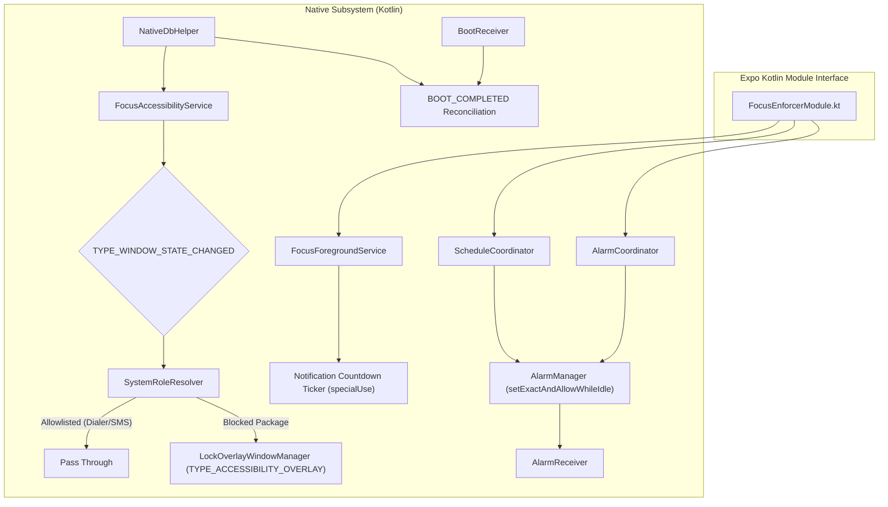

# Focus Enforcer Native Module (`focus-enforcer`)

> A high-performance native Android Expo module that delivers sub-100ms accessibility window interception, un-dismissible full-screen lock overlays, foreground countdown tickers, and deep Doze alarm recovery.

[](https://www.android.com)
[](https://docs.expo.dev/modules/overview/)
[](../../LICENSE)

---

## Why This Module Exists

Pure React Native applications run inside a JavaScript runtime thread. If an app blocker relies solely on JavaScript timers or standard React Native view components:
1. Users can dismiss the lock screen with Android's system back button or gesture navigation.
2. The Android OS can kill the JavaScript runtime during deep Doze or background memory pressure.
3. Swapping apps via the recent tasks switcher creates touch leakage, exposing blocked applications.

`focus-enforcer` provides a standalone native Kotlin subsystem that operates directly at the Android OS `WindowManager` and `AccessibilityService` layers. Even if the React Native activity is backgrounded or destroyed, native enforcement continues uninterrupted.

---

## Native Architecture & Components



### Component Breakdown

| Component | Responsibility | Technical Details |
| :--- | :--- | :--- |
| **`FocusEnforcerModule.kt`** | JavaScript Bridge | Implements the modern Expo Kotlin Modules API (`expo.modules.kotlin.modules.Module`). Dispatches settings intents and bridges lock commands. |
| **`FocusAccessibilityService.kt`** | Window Interception | Detects `TYPE_WINDOW_STATE_CHANGED` events within 100ms. Configured with `canRetrieveWindowContent = false` for zero screen inspection. |
| **`LockOverlayWindowManager.kt`** | Un-Dismissible Barrier | Injects a full-screen `TYPE_ACCESSIBILITY_OVERLAY` view surface directly into the Android `WindowManager`. Swallows all back, home, and touch gestures. |
| **`FocusForegroundService.kt`** | State & Ticker Preservation | Runs an active `specialUse` foreground service with native chronometer countdown (`setUsesChronometer(true)`). |
| **`AlarmCoordinator.kt`** | Exact Timing | Registers exact wall-clock alarms with `setExactAndAllowWhileIdle` to guarantee session completion survives deep Doze. |
| **`ScheduleCoordinator.kt`** | Routine Automation | Evaluates active/upcoming schedule windows and registers exact alarms for background routine onset and recurrence. |
| **`BootReceiver.kt`** | Crash & Reboot Recovery | Catches `BOOT_COMPLETED` and `LOCKED_BOOT_COMPLETED` broadcasts to re-arm active sessions and reschedule routines on device boot. |
| **`SystemRoleResolver.kt`** | Safe Communication | Dynamically queries `TelecomManager` and `Telephony.Sms` to whitelist default phone and emergency numbers without requiring invasive `QUERY_ALL_PACKAGES` permissions. |
| **`NativeDbHelper.kt`** | Native Persistence | Directly queries the shared SQLite WAL database file (`focusguard.db`) on the native side during boot and background alarm events without waking the React Native engine. |

---

## TypeScript API Reference

Import the typed module in your application:

```typescript
import FocusEnforcer, { PermissionType } from '../modules/focus-enforcer/src';
```

### Type Definitions

```typescript
export type PermissionType = 
  | 'ACCESSIBILITY' 
  | 'EXACT_ALARM' 
  | 'BATTERY' 
  | 'OVERLAY' 
  | 'APP_DETAILS';

export interface FocusEnforcerNative {
  startFocusLock(endsAtEpochMs: number): boolean;
  stopFocusLock(): boolean;
  getPermissionStatus(permissionName: PermissionType): boolean;
  openSettingsForPermission(permissionName: PermissionType): boolean;
  openEmergencyDialer(): boolean;
}
```

### Methods

#### `startFocusLock(endsAtEpochMs: number): boolean`
Activates the native focus lock until the specified epoch timestamp (milliseconds).
- Starts `FocusForegroundService` with a persistent countdown notification.
- Schedules an exact wake-up alarm via `AlarmCoordinator`.
- Signals `FocusAccessibilityService` to enforce the lock overlay on non-allowlisted apps.

```typescript
const durationMs = 25 * 60 * 1000; // 25 minutes
const endsAtEpochMs = Date.now() + durationMs;
const success = FocusEnforcer.startFocusLock(endsAtEpochMs);
```

#### `stopFocusLock(): boolean`
Stops the active focus lock immediately.
- Cancels pending exact alarms.
- Stops `FocusForegroundService`.
- Dismisses any active `LockOverlayWindowManager` surfaces.

```typescript
FocusEnforcer.stopFocusLock();
```

#### `getPermissionStatus(permissionName: PermissionType): boolean`
Queries the real-time grant status of a required Android system privilege.

Supported values for `permissionName`:
- `'ACCESSIBILITY'`: Checks if `FocusAccessibilityService` is enabled in `Settings.Secure`.
- `'EXACT_ALARM'`: Checks `AlarmManager.canScheduleExactAlarms()` (Android 12+ / API 31+).
- `'BATTERY'`: Checks `PowerManager.isIgnoringBatteryOptimizations()`.
- `'OVERLAY'`: Checks `Settings.canDrawOverlays()`.
- `'APP_DETAILS'`: Always returns `false` to indicate intent redirection is available.

```typescript
const isAccessibilityGranted = FocusEnforcer.getPermissionStatus('ACCESSIBILITY');
```

#### `openSettingsForPermission(permissionName: PermissionType): boolean`
Dispatches an explicit system intent that navigates the user directly to the relevant settings configuration page.

- `'ACCESSIBILITY'`: Dispatches `Settings.ACTION_ACCESSIBILITY_SETTINGS`.
- `'EXACT_ALARM'`: Dispatches `Settings.ACTION_REQUEST_SCHEDULE_EXACT_ALARM` (Android 12+).
- `'BATTERY'`: Dispatches `Settings.ACTION_REQUEST_IGNORE_BATTERY_OPTIMIZATIONS`.
- `'OVERLAY'`: Dispatches `Settings.ACTION_MANAGE_OVERLAY_PERMISSION`.
- `'APP_DETAILS'`: Dispatches `Settings.ACTION_APPLICATION_DETAILS_SETTINGS` (essential for Android 13+ restricted settings).

```typescript
FocusEnforcer.openSettingsForPermission('APP_DETAILS');
```

#### `openEmergencyDialer(): boolean`
Launches the device's default phone dialer via an `Intent.ACTION_DIAL` intent with `FLAG_ACTIVITY_NEW_TASK`.

```typescript
FocusEnforcer.openEmergencyDialer();
```

---

## Platform Support & Fallbacks

| Platform | Behavior |
| :--- | :--- |
| **Android (Device/Emulator)** | Full native implementation via Kotlin services, window manager overlays, exact alarms, and SQLite WAL integration. |
| **iOS / Web / Simulators** | Graceful fallback stub: functions safely return `true` without crashing, enabling cross-platform UI development and testing. |

---

## Config Plugin Integration

This module is automatically configured during `npx expo prebuild` via the config plugin located at [`plugins/withFocusEnforcer.js`](../../plugins/withFocusEnforcer.js).

The plugin automates:
1. Adding required permissions (`FOREGROUND_SERVICE_SPECIAL_USE`, `SCHEDULE_EXACT_ALARM`, `RECEIVE_BOOT_COMPLETED`, `SYSTEM_ALERT_WINDOW`, `REQUEST_IGNORE_BATTERY_OPTIMIZATIONS`).
2. Declaring `FocusAccessibilityService` and `accessibility_service_config.xml`.
3. Declaring `FocusForegroundService` with `PROPERTY_SPECIAL_USE_FGS_SUBTYPE`.
4. Registering `BootReceiver` and `AlarmReceiver`.

No manual modifications to generated `android/` directory files are needed.
