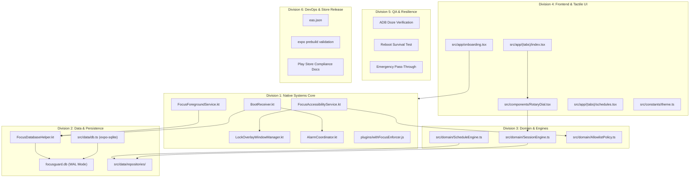

# Design

## Context

FocusGuard was originally implemented as an uncompromising Android application written in Kotlin with Jetpack Compose (`kotlin-jav`). It relies on privileged platform APIs: an `AccessibilityService` that intercepts window state transitions (`TYPE_WINDOW_STATE_CHANGED`), a `WindowManager` overlay (`TYPE_ACCESSIBILITY_OVERLAY`), an ongoing `specialUse` foreground service, and exact wall-clock alarms (`AlarmManager.setExactAndAllowWhileIdle()`).

The target project is `focusGuard/`, a modern React Native application powered by Expo SDK 58 and Expo Router v5. Standard React Native code cannot execute background accessibility callbacks, mount system-level overlays across other applications, or survive device reboots without native Android integration. To satisfy these platform requirements while retaining the agility and developer experience of Expo, the application implements a **Hybrid Core Architecture** governed by **6 specialized Engineering Divisions** as detailed in `docs/ENGINEERING_TEAM_PLAN.md` and `docs/MIGRATION_PLAN.md`.

## Goals / Non-Goals

**Goals:**
- Implement the complete FocusGuard feature set from `kotlin-jav` in `focusGuard/` using React Native 0.88, Expo SDK 58, and TypeScript.
- Partition architecture into 6 distinct Engineering Divisions: Native Systems Core, Data & Persistence, Domain Engines, Frontend & Tactile UI, QA & System Resilience, and DevOps & Release.
- Encapsulate all Android native enforcement inside a Local Expo Module (`focusGuard/modules/focus-enforcer/`) and an Expo Config Plugin (`focusGuard/plugins/withFocusEnforcer.js`), maintaining 100% Expo Continuous Native Generation (CNG) hygiene.
- Enable autonomous background boot reconciliation and Doze survival using native Kotlin SQLite helpers alongside `expo-sqlite` in Write-Ahead Logging (WAL) mode on `focusguard.db`.
- Deliver a high-framerate, 60 FPS haptic Rotary Dial timer in React Native using `react-native-reanimated` 4 and `react-native-gesture-handler`.
- Provide a 7-step interactive permission diagnostics wizard and OEM battery guide.
- Guarantee emergency dialer and SMS pass-through (911, 112, 999, default telecom role).

**Non-Goals:**
- Network sync, analytics, remote logging, or cloud authentication (strict 100% offline privacy architecture).
- Modifying the generated `android/` directory directly or checking it into version control.
- Native iOS accessibility interception (iOS does not allow system-wide window overlays; Apple Screen Time integration is designated for future phases).

## Decisions

### 1. Hybrid Native Subsystem via Local Expo Module & Config Plugin
- **Decision**: Package the Android enforcement logic as a local Expo module (`modules/focus-enforcer/`) and inject permissions, services, and receivers via an Expo Config Plugin (`plugins/withFocusEnforcer.js`).
- **Rationale**: Keeps native code cleanly isolated and enables reproducible builds via `npx expo prebuild` and EAS Build without manual Android project hacks.
- **Alternatives Considered**: Bare React Native ejected project (rejected: complicates upgrades and loses Expo ecosystem advantages); Custom native libraries published to npm (rejected: unnecessary release overhead for project-internal core services).

### 2. Autonomous 100% Native View for Lock Screen Overlay
- **Decision**: Build the un-dismissible full-screen overlay in `LockOverlayWindowManager.kt` using native Android views (`FrameLayout`, `TextView`, `Button`) rather than embedding a React Native `ReactRootView` inside `WindowManager.addView()`.
- **Rationale**: An overlay attached to an `AccessibilityService` must render with $<80\text{ms}$ latency and must never crash if the JavaScript engine is sleeping, reloading, or suspended.
- **Alternatives Considered**: Hosting a React Native root view in the overlay (rejected: crashes or delays during JS bundle reloads, heavy memory footprint during system window switching).

### 3. Dual-Access Shared SQLite Database (`focusguard.db`) in WAL Mode
- **Decision**: Persist focus sessions and schedules in a single SQLite database file (`focusguard.db`) opened by `expo-sqlite` in TypeScript and Android's native `SQLiteOpenHelper` in Kotlin. WAL mode (`PRAGMA journal_mode=WAL;`) is enforced on every connection.
- **Rationale**: Background components (`BootReceiver`, `FocusForegroundService`) must read and update sessions during boot or deep Doze when the React Native runtime has not initialized.
- **Alternatives Considered**: React Native Async Storage or MMKV only (rejected: inaccessible from native background services without launching the JavaScript engine); Room database with JNI bridge (rejected: excessive complexity for simple session/schedule records).

### 4. `AlarmManager.setExactAndAllowWhileIdle()` for Timing Accuracy
- **Decision**: Coordinate session expiration and schedule triggers using native Android exact alarms (`AlarmManager.setExactAndAllowWhileIdle()`).
- **Rationale**: Android Doze mode aggressively throttles `WorkManager`, `JobScheduler`, and JavaScript timers (`setInterval`). Exact alarms with wake lock permission guarantee execution at exact wall-clock epochs.
- **Alternatives Considered**: `WorkManager` (rejected: subject to 15-minute minimum batching in Doze mode); JS `setTimeout` (rejected: suspended as soon as device enters sleep).

### 5. Mathematical Polar Angle Rotary Dial with Reanimated 4
- **Decision**: Implement the Rotary Dial in TypeScript using `react-native-reanimated` 4 and `react-native-gesture-handler`, calculating angles via $\theta = \operatorname{atan2}(y - c_y, x - c_x)$ and snapping to discrete duration detents (15m, 25m, 45m, 60m, 90m, 120m, 180m, 240m) with `expo-haptics`.
- **Rationale**: Maintains silky 60 FPS UI thread animations without crossing the asynchronous React Native bridge on every touch event.
- **Alternatives Considered**: Standard slider or numeric text input (rejected: loses the core industrial tactile experience of FocusGuard).

### 6. Overnight Midnight-Crossing Schedule Engine in Pure TypeScript
- **Decision**: Implement `ScheduleEngine.ts` with pure mathematical evaluation of active intervals and bitmask day-of-week recurrence. For schedules where $T_{end} < T_{start}$ (e.g., 22:00 to 07:00), the window is split into pre-midnight $[T_{start}, 1440)$ and post-midnight $[0, T_{end})$ intervals.
- **Rationale**: Pure functional TypeScript logic allows 100% automated Jest unit test coverage and seamless cross-platform execution.

## Engineering Division Architecture

## Risks / Trade-offs

- **[Risk] OEM Battery Killers**: Aggressive OEM battery managers (Xiaomi HyperOS, Samsung One UI, OnePlus OxygenOS) terminate background accessibility services and foreground services.  
  → *Mitigation*: Dedicated 7-step diagnostics wizard with OEM-specific direct intent guides directing users to exempt the app from battery optimizations and autostart restrictions.
- **[Risk] Google Play Accessibility Policy Review**: Google Play strictly reviews apps utilizing `AccessibilityService`.  
  → *Mitigation*: Comprehensive in-app prominent disclosure dialog explaining that no user content is inspected (`canRetrieveWindowContent = false`), accompanied by Division 6 compliance video assets and Play Store documentation.
- **[Risk] Emergency Call Locking Liability**: Trapping a user on the lock screen during a life-threatening emergency.  
  → *Mitigation*: Hardcoded emergency intent handler, dynamic detection of system telecom package, and immediate dismissal of overlay on emergency dialer entry.
- **[Risk] Cross-Process SQLite Database Locking**: Concurrent writes from native Kotlin service and React Native JS engine causing `SQLITE_BUSY`.  
  → *Mitigation*: Enforce `PRAGMA journal_mode = WAL;` and `PRAGMA busy_timeout = 5000;` on all database handles.
